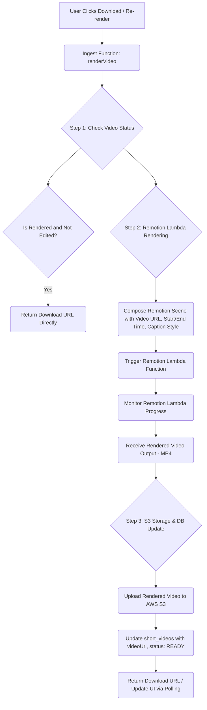

# Vidsh Shot API Documentation

## 1. Introduction

Vidsh Shot is a full-stack SaaS application designed to revolutionize video content creation by transforming long-form videos into viral short-form content. Leveraging advanced AI models, the platform automatically identifies high-engagement moments, cuts clips, generates captions, and facilitates direct scheduling to multiple social media platforms through a single, unified API. This document outlines the public and internal API endpoints, architectural components, and technical considerations for the Vidsh Shot platform.

## 2. Architecture Overview

Vidsh Shot employs a modern, serverless-first architecture designed for scalability, performance, and maintainability. The system orchestrates various cloud services and specialized APIs to deliver its core functionality, with `Ingest.js` acting as the central workflow engine for long-running and asynchronous tasks.

```mermaid
graph TD
    A[Client UI - Next.js/Shadcn] -->|User Actions| B(Next.js Server Actions / API Routes)
    B --> C(Clerk Authentication)
    C --> B
    B --> D(ARJet Security & Rate Limiting)
    D --> B
    B --> E(Ingest.js Workflow Trigger)
    E --> F(Ingest.js Workflow - Background Jobs)
    F --> G(AWS S3 - Video Storage)
    F --> H(Neon PostgreSQL - Drizzle ORM)
    F --> I(Digram - Video Transcription API)
    F --> J(Google Gemini - AI Model for Scene Analysis)
    F --> K(Remotion Lambda - Video Rendering Service)
    F --> L(Jour API - Social Media Publishing)
    H --> B
    G --> K
    K --> G
    L --> M(Social Media Platforms)
    M --> L
    E -->|Polling for Progress| B
    B --> A

    subgraph User Interaction Flow
        A -- Upload Video --> B
        B -- Store in S3, Trigger Ingest --> E
        E -- Video Processing Workflow --> F
        F -- Transcribe (Digram) --> I
        F -- AI Analysis (Gemini) --> J
        F -- Store Short Clip Metadata --> H
        F -- Polling for Status --> E
        A -- Display Short Clips --> B
        A -- Edit Caption Style --> B
        B -- Update DB --> H
        A -- Download Short Clip --> B
        B -- Trigger Remotion Lambda (Ingest) --> E
        E -- Video Rendering Workflow --> F
        F -- Render Video (Remotion Lambda) --> K
        K -- Store Rendered Video in S3 --> G
        G -- Return Download URL --> F
        F -- Update DB --> H
        A -- Schedule Post --> B
        B -- Trigger Social Media Workflow (Ingest) --> E
        E -- Social Media Scheduling Workflow --> F
        F -- Publish via Jour API --> L
        L --> M
    end

    subgraph Security & DevOps
        D -- Bot Protection/Abuse Prevention --> ARJet Dashboard
        F -- Ingest Dev/Cloud Monitoring --> Ingest Dashboard
        K -- Remotion Lambda Monitoring --> AWS CloudWatch / Lambda
        H -- Database Monitoring --> Neon Dashboard
    end
```

## 3. Technology Stack

The Vidsh Shot application is built using the following core technologies and external services:

*   **Frontend Framework:** Next.js (React)
*   **UI Library:** Shadcn UI, Tailwind CSS
*   **Backend Runtime:** Node.js (via Next.js Server Actions and Ingest.js)
*   **Workflow Engine:** Ingest.js (for long-running background jobs and step functions)
*   **Database:** Neon PostgreSQL (Serverless PostgreSQL)
*   **ORM:** Drizzle ORM
*   **Authentication:** Clerk (Comprehensive user authentication and management)
*   **Cloud Storage:** AWS S3 (Scalable object storage for videos)
*   **AI Security & Abuse Prevention:** ARJet (Bot protection, rate limiting, prompt injection detection)
*   **Video Transcription:** Digram API ($200 credit for transcription)
*   **AI Model (Scene Analysis):** Google Gemini (for identifying high-engagement video moments)
*   **Video Playback & Rendering:** Remotion (Programmatic video creation, playback, and server-side rendering via AWS Lambda)
*   **Social Media Integration:** Jour API (Unified API for posting, scheduling, and engaging across 15+ platforms)
*   **Development Environment:** Google Anti-Gravity / VS Code with AI agents (Claude, Gemini, Copilot, Cleanbot)

## 4. Authentication & Authorization

Vidsh Shot utilizes Clerk for user authentication and ARJet for comprehensive security, including authorization checks and abuse prevention.

### 4.1. Clerk Integration

Clerk provides a complete authentication solution, handling user sign-in, sign-up, session management, and multi-factor authentication. It also supports various social sign-on options.

*   **Mechanism:** Clerk's pre-built UI components and SDKs are integrated directly into the Next.js application. Custom sign-in and sign-up pages are used.
*   **User Management:** New user information (ID, name, email, image URL) is persisted to the Neon PostgreSQL database upon successful sign-up or sign-in if the user is new.
*   **Dashboard Access:** Access to the application dashboard is restricted to authenticated users.

**Authentication Flow:**
1.  User attempts to access `/dashboard`.
2.  Clerk middleware intercepts the request.
3.  If unauthenticated, redirects to `/sign-in`.
4.  Upon successful sign-in via Clerk's UI, the user is redirected to `/dashboard`.
5.  On `/dashboard` load, a server action/API route checks if the user exists in the Neon DB. If not, a new entry is created.

### 4.2. ARJet Security

ARJet is integrated at the middleware level to provide robust security features, including:
*   **Endpoint Abuse Prevention:** Protects against malicious requests to API endpoints.
*   **Prompt Injection Detection:** Safeguards AI models (Gemini) from malicious prompt injections.
*   **Rate Limiting:** Enforces usage limits for various actions (e.g., video uploads).
*   **Bot Protection:** Identifies and blocks automated bot traffic.

ARJet operates directly within the application's code, securing HTTP routes, agent tools, and AI workflows. Environment variables (`ARJET_API_KEY`, `ARJET_SITE_ID`) are required for ARJet integration.

## 5. API Endpoints

This section details the RESTful API endpoints available in the Vidsh Shot application. All endpoints are secured and require appropriate authentication.

**Base URL:** `https://api.vidshot.com` (Assumption: Placeholder, will be the deployed application domain)

### 5.1. User & Authentication

Authentication is primarily handled by Clerk, but user data persistence involves a backend interaction.

#### 5.1.1. User Database Synchronization

**`POST /api/users/sync`**

Synchronizes user information with the Vidsh Shot database upon sign-in. This endpoint is called whenever a user accesses the application, ensuring their details are up-to-date in the local database.

*   **Description:** Checks if a user exists in the database. If not, creates a new user entry. If existing, ensures basic profile information is synchronized. This approach avoids webhooks for initial user creation.
*   **Authentication:** Requires Clerk-authenticated session.
*   **Rate Limiting:** Subject to general API rate limits via ARJet.

**Request Body (JSON):**
```json
{
  "clerkUserId": "user_123abcDEF", // Clerk's unique user ID (Required)
  "firstName": "John",              // User's first name (Optional)
  "lastName": "Doe",                // User's last name (Optional)
  "email": "john.doe@example.com",  // User's primary email (Required)
  "imageUrl": "https://clerk.com/image.jpg" // User's profile image URL (Optional)
}
```

**Response (200 OK):**
```json
{
  "message": "User synchronized successfully.",
  "user": {
    "id": "uuid-of-db-user",
    "clerkUserId": "user_123abcDEF",
    "name": "John Doe",
    "email": "john.doe@example.com",
    "imageUrl": "https://clerk.com/image.jpg",
    "subscriptionStatus": "FREE", // Assumption: Default status
    "createdAt": "2023-10-27T10:00:00Z",
    "updatedAt": "2023-10-27T10:00:00Z"
  }
}
```

**Error Responses:**
*   `401 Unauthorized`: If no valid Clerk session.
*   `400 Bad Request`: If required fields are missing in the request body.
*   `500 Internal Server Error`: For database or server issues.

### 5.2. Video Upload & Project Management

Handles the initiation of video uploads, project creation, and status retrieval.

#### 5.2.1. Initiate Video Upload & Project Creation

**`POST /api/videos/upload`**

Initiates the video upload process to AWS S3 and creates a new project entry in the database. This triggers the `Ingest.js` video processing workflow.

*   **Description:** Accepts a video file, uploads it to a pre-signed S3 URL, and creates a project to track its processing. The actual processing (transcription, AI analysis) is handled asynchronously by `Ingest.js`.
*   **Authentication:** Requires Clerk-authenticated session.
*   **Rate Limiting:** Limited to **2 video uploads per user per day** via ARJet. Resets daily.
*   **Payload Size Limit:** Configured to `2GB` for video uploads in `next.config.ts` to accommodate large files.

**Request Body (multipart/form-data):**
```http
Content-Type: multipart/form-data; boundary=----WebKitFormBoundary7MA4YWxkTrZu0gW
  
------WebKitFormBoundary7MA4YWxkTrZu0gW
Content-Disposition: form-data; name="video"; filename="long_video.mp4"
Content-Type: video/mp4

<binary video data>
------WebKitFormBoundary7MA4YWxkTrZu0gW--
```

**Request Headers:**
*   `x-user-id`: Clerk User ID (inferred from session or passed for tracking by ARJet)

**Response (202 Accepted):**
```json
{
  "message": "Video upload initiated and project created.",
  "projectId": "proj_abc123def456",
  "uploadUrl": "https://s3.amazonaws.com/vidshot-bucket/temp/video_id.mp4?AWSAccessKeyId=...&Expires=...&Signature=...", // Signed URL for client-side S3 upload
  "projectStatus": {
    "id": "proj_abc123def456",
    "userId": "uuid-of-db-user",
    "originalVideoUrl": "https://s3.amazonaws.com/vidshot-bucket/videos/proj_abc123def456/original.mp4",
    "status": "UPLOADED",
    "progress": 0,
    "createdAt": "2023-10-27T10:05:00Z",
    "updatedAt": "2023-10-27T10:05:00Z"
  }
}
```

**Error Responses:**
*   `401 Unauthorized`: If no valid Clerk session.
*   `429 Too Many Requests`: If the user exceeds the daily video upload limit (ARJet).
*   `400 Bad Request`: If no video file is provided or file type is invalid.
*   `413 Payload Too Large`: If the video file exceeds the configured `2GB` limit.
*   `500 Internal Server Error`: For S3 upload issues or project creation failures.

#### 5.2.2. Get Project Status

**`GET /api/projects/{projectId}`**

Retrieves the current status and details of a video project, including its processing progress and generated short clips. Uses polling for real-time updates.

*   **Description:** Provides detailed information about a video project. The `status` field indicates the current stage of the `Ingest.js` workflow.
*   **Authentication:** Requires Clerk-authenticated session.
*   **Authorization:** User must own the project.

**Path Parameters:**
*   `projectId` (string, Required): The unique identifier of the project.

**Response (200 OK):**
```json
{
  "id": "proj_abc123def456",
  "userId": "uuid-of-db-user",
  "originalVideoUrl": "https://s3.amazonaws.com/vidshot-bucket/videos/proj_abc123def456/original.mp4",
  "status": "AI_ANALYSIS_COMPLETED", // Possible statuses: UPLOADED, TRANSCRIBING, AI_ANALYSIS_IN_PROGRESS, AI_ANALYSIS_COMPLETED, RENDERING_PENDING, READY
  "progress": 100, // 0-100 percentage
  "transcription": "...", // Full transcribed text (Optional, if available)
  "caption": "...", // Full caption (SRT format) (Optional, if available)
  "shortClips": [
    {
      "id": "short_clip_1",
      "title": "Motivational Snippet",
      "description": "Powerful words of wisdom...",
      "startTime": 10000, // in milliseconds
      "endTime": 40000,   // in milliseconds
      "seoScore": 85,
      "reason": "High emotional impact and clear call to action.",
      "caption": "[00:00:10.000] Hey there. This is the first time...",
      "status": "PENDING_RENDER", // PENDING_RENDER, RENDERING, READY
      "videoUrl": null, // URL of the rendered short video (null if not rendered)
      "styleConfig": { /* current caption style config */ } // Assumption: Style config ID or JSON
    }
    // ... more short clips
  ],
  "createdAt": "2023-10-27T10:05:00Z",
  "updatedAt": "2023-10-27T10:15:00Z"
}
```

**Error Responses:**
*   `401 Unauthorized`: If no valid Clerk session.
*   `403 Forbidden`: If the user does not own the project.
*   `404 Not Found`: If the project does not exist.
*   `500 Internal Server Error`: For database or server issues.

### 5.3. AI Analysis & Short Clip Generation

Triggers the AI analysis pipeline to generate short video clips from an uploaded long video.

#### 5.3.1. Start AI Analysis

**`POST /api/projects/{projectId}/analyze`**

Triggers the `Ingest.js` workflow for video transcription and AI-powered scene analysis, leading to the generation of multiple short video clips.

*   **Description:** This endpoint transitions a project from `UPLOADED` to `AI_ANALYSIS_IN_PROGRESS`. The `Ingest.js` workflow orchestrates calling Digram for transcription and Gemini for scene detection.
*   **Authentication:** Requires Clerk-authenticated session.
*   **Authorization:** User must own the project.
*   **Prompt Injection Detection:** ARJet actively monitors AI model interactions for prompt injection attempts.

**Path Parameters:**
*   `projectId` (string, Required): The unique identifier of the project.

**Response (202 Accepted):**
```json
{
  "message": "AI analysis started for project.",
  "projectId": "proj_abc123def456",
  "status": "AI_ANALYSIS_IN_PROGRESS"
}
```

**Error Responses:**
*   `401 Unauthorized`: If no valid Clerk session.
*   `403 Forbidden`: If the user does not own the project.
*   `404 Not Found`: If the project does not exist.
*   `409 Conflict`: If AI analysis is already in progress or completed for this project.
*   `500 Internal Server Error`: For `Ingest.js` workflow initiation failures.

### 5.4. Short Clip Editing & Rendering

Manages the customization and rendering of generated short clips.

#### 5.4.1. Update Short Clip Caption Style

**`PUT /api/projects/{projectId}/shorts/{shortId}/edit-style`**

Updates the caption styling for a specific short video clip.

*   **Description:** Allows users to select predefined or custom caption styles (font, color, highlighting logic) for a short video. This update is reflected immediately in the `Remotion Player` preview. If the video was previously rendered, its `status` is reset to `PENDING_RENDER`, requiring re-rendering for download.
*   **Authentication:** Requires Clerk-authenticated session.
*   **Authorization:** User must own the project.

**Path Parameters:**
*   `projectId` (string, Required): The unique identifier of the project.
*   `shortId` (string, Required): The unique identifier of the short video clip.

**Request Body (JSON):**
```json
{
  "style": {
    "name": "Vibrant Yellow Highlight",
    "fontFamily": "Inter",
    "textColor": "#FFFFFF",
    "highlightColor": "#FFFF00", // Yellow for highlighted words
    "highlightBackgroundColor": "#000000", // Black for non-highlighted background (Assumption based on demo)
    "fontSizePx": 48, // (Assumption)
    "maxWordsPerLine": 3, // Max 3-4 words display
    "position": "bottom" // (Assumption: Can be top, middle, bottom)
  }
}
```
**Assumption:** The `style` object contains enough metadata to dynamically render captions using Remotion and also track changes that require re-rendering. This might map to a `caption_styles` table or directly to the `short_videos` table.

**Response (200 OK):**
```json
{
  "message": "Caption style updated successfully.",
  "shortClip": {
    "id": "short_clip_1",
    "title": "Motivational Snippet",
    // ... other short clip properties
    "status": "PENDING_RENDER", // Status is reset as style changed
    "styleConfig": { /* updated style object */ },
    "updatedAt": "2023-10-27T10:30:00Z"
  }
}
```

**Error Responses:**
*   `401 Unauthorized`: If no valid Clerk session.
*   `403 Forbidden`: If the user does not own the project.
*   `404 Not Found`: If the project or short clip does not exist.
*   `400 Bad Request`: If invalid style data is provided.
*   `500 Internal Server Error`: For database or server issues.

#### 5.4.2. Render Short Clip for Download

**`POST /api/projects/{projectId}/shorts/{shortId}/render`**

Triggers the server-side rendering of a short video clip using `Remotion Lambda` to produce a downloadable MP4 file.

*   **Description:** This endpoint initiates an `Ingest.js` workflow that calls `Remotion Lambda` to render the short clip with its applied caption styles. Progress is tracked via polling. The rendered video is stored in AWS S3, and its URL is saved to the database. This endpoint is called if a download URL is not present or if the video was edited after its last render.
*   **Authentication:** Requires Clerk-authenticated session.
*   **Authorization:** User must own the project.

**Path Parameters:**
*   `projectId` (string, Required): The unique identifier of the project.
*   `shortId` (string, Required): The unique identifier of the short video clip.

**Response (202 Accepted):**
```json
{
  "message": "Video rendering initiated.",
  "shortClip": {
    "id": "short_clip_1",
    // ... other short clip properties
    "status": "RENDERING", // PENDING_RENDER, RENDERING, READY
    "videoUrl": null,
    "updatedAt": "2023-10-27T10:35:00Z"
  }
}
```

**Error Responses:**
*   `401 Unauthorized`: If no valid Clerk session.
*   `403 Forbidden`: If the user does not own the project.
*   `404 Not Found`: If the project or short clip does not exist.
*   `409 Conflict`: If rendering is already in progress for this clip.
*   `500 Internal Server Error`: For `Ingest.js` workflow initiation or `Remotion Lambda` failures.

#### 5.4.3. Get Short Clip Download URL

**`GET /api/projects/{projectId}/shorts/{shortId}/download`**

Retrieves a pre-signed URL for downloading a rendered short video clip.

*   **Description:** If the short video has been successfully rendered, this endpoint returns a temporary, authenticated URL from AWS S3 for direct download. If not rendered, it might trigger the rendering process (see `render` endpoint) or return a `PENDING` status.
*   **Authentication:** Requires Clerk-authenticated session.
*   **Authorization:** User must own the project.

**Path Parameters:**
*   `projectId` (string, Required): The unique identifier of the project.
*   `shortId` (string, Required): The unique identifier of the short video clip.

**Response (200 OK):**
```json
{
  "message": "Download URL retrieved successfully.",
  "downloadUrl": "https://s3.amazonaws.com/vidshot-bucket/rendered/short_clip_id.mp4?AWSAccessKeyId=...&Expires=...&Signature=...", // Temporary, signed S3 URL
  "shortClipStatus": "READY"
}
```
**Response (202 Accepted - if rendering triggered):**
```json
{
  "message": "Video rendering initiated, please try again shortly.",
  "shortClipStatus": "RENDERING"
}
```

**Error Responses:**
*   `401 Unauthorized`: If no valid Clerk session.
*   `403 Forbidden`: If the user does not own the project.
*   `404 Not Found`: If the project or short clip does not exist.
*   `409 Conflict`: If the video is `PENDING_RENDER` and requires a manual re-render due to changes.
*   `500 Internal Server Error`: For S3 URL generation or database issues.

### 5.5. Social Media Integration & Scheduling

Provides functionality to connect social media accounts and schedule posts using the Jour API.

#### 5.5.1. Connect Social Media Account

**`POST /api/social/connect`**

Initiates the OAuth flow to connect a user's social media account via Jour API.

*   **Description:** This endpoint typically redirects the user to Jour's OAuth consent screen, which then redirects back to the Vidsh Shot application with an authorization code. The backend then exchanges this code for access tokens via Jour and stores the connected account details in the database. Jour provides a single API endpoint to connect to over 15 social networks without individual SDK integrations or complex app review processes.
*   **Authentication:** Requires Clerk-authenticated session.

**Request Body (JSON):**
```json
{
  "platform": "INSTAGRAM" // e.g., "INSTAGRAM", "TIKTOK", "FACEBOOK", "YOUTUBE", "X" (Twitter) (Assumption: specific enum or string values)
}
```

**Response (200 OK):**
```json
{
  "message": "Social media connection initiated.",
  "redirectUrl": "https://jour.com/oauth?client_id=...&redirect_uri=..." // URL to Jour's OAuth page
}
```
**Assumption:** The initial `POST` requests a redirect URL from Jour or a local service that interacts with Jour's OAuth.

**Error Responses:**
*   `401 Unauthorized`: If no valid Clerk session.
*   `400 Bad Request`: If an invalid platform is specified.
*   `500 Internal Server Error`: For Jour API interaction issues.

#### 5.5.2. Get Connected Social Media Accounts

**`GET /api/social/accounts`**

Retrieves a list of social media accounts connected by the user.

*   **Description:** Returns details of all social media profiles linked to the current user's Vidsh Shot account via Jour.
*   **Authentication:** Requires Clerk-authenticated session.

**Response (200 OK):**
```json
{
  "accounts": [
    {
      "id": "soc_acc_1",
      "platform": "INSTAGRAM",
      "username": "@john_doe_clips",
      "profileImageUrl": "https://cdn.instagram.com/profile.jpg",
      "status": "CONNECTED", // CONNECTED, DISCONNECTED, ERROR
      "externalAccountId": "instagram_user_id_123" // Jour's internal ID or platform's ID (Assumption)
    },
    {
      "id": "soc_acc_2",
      "platform": "YOUTUBE",
      "username": "JohnDoeVids",
      "profileImageUrl": "https://cdn.youtube.com/profile.jpg",
      "status": "CONNECTED",
      "externalAccountId": "youtube_channel_id_456"
    }
  ]
}
```
**Assumption:** `externalAccountId` refers to the ID Jour uses for the account, or the native platform ID.

**Error Responses:**
*   `401 Unauthorized`: If no valid Clerk session.
*   `500 Internal Server Error`: For database or Jour API interaction issues.

#### 5.5.3. Schedule Social Media Post

**`POST /api/social/schedule`**

Schedules a short video clip to be posted to selected social media platforms at a specified time using Jour.

*   **Description:** This endpoint creates a scheduled post entry in the database and triggers an `Ingest.js` workflow. The `Ingest.js` workflow is configured to run every 15 minutes, checking for upcoming scheduled posts and publishing them via the Jour API.
*   **Authentication:** Requires Clerk-authenticated session.
*   **Authorization:** User must own the short video and connected social accounts.

**Request Body (JSON):**
```json
{
  "shortVideoId": "short_clip_1",          // ID of the short video to post (Required)
  "selectedAccountIds": ["soc_acc_1", "soc_acc_2"], // IDs of connected social media accounts (Required)
  "title": "Unstoppable Motivation!",       // Post title (Generated by AI, editable) (Required)
  "description": "Never give up on your dreams. #motivation #shorts", // Post description (Generated by AI, editable) (Required)
  "scheduledAt": "2023-10-28T14:30:00Z"     // UTC timestamp for scheduled post (Required)
}
```
**Validation Rules:**
*   `shortVideoId`: Must correspond to an existing, rendered short video owned by the user.
*   `selectedAccountIds`: Must be a non-empty array of valid connected social account IDs owned by the user.
*   `title`, `description`: String, max length according to social media platform limits (e.g., 2200 for Instagram captions, 280 for X posts).
*   `scheduledAt`: Must be a future date/time.

**Response (202 Accepted):**
```json
{
  "message": "Post scheduled successfully.",
  "scheduledPostId": "sched_post_abc",
  "status": "PENDING" // PENDING, PUBLISHED, FAILED
}
```

**Error Responses:**
*   `401 Unauthorized`: If no valid Clerk session.
*   `403 Forbidden`: If the user does not own the short video or selected accounts.
*   `404 Not Found`: If `shortVideoId` or any `selectedAccountIds` are invalid.
*   `400 Bad Request`: If invalid request payload or validation rules are violated.
*   `500 Internal Server Error`: For `Ingest.js` workflow initiation or Jour API interaction issues.

#### 5.5.4. Get Scheduled Posts

**`GET /api/social/scheduled-posts`**

Retrieves a list of all scheduled social media posts for the current user.

*   **Description:** Provides an overview of all planned and already published posts, including their status and target platforms.
*   **Authentication:** Requires Clerk-authenticated session.
*   **Query Parameters:**
    *   `status` (string, Optional): Filter by post status (e.g., `PENDING`, `PUBLISHED`, `FAILED`).
    *   `startDate` (date-time, Optional): Filter posts scheduled after this date.
    *   `endDate` (date-time, Optional): Filter posts scheduled before this date.

**Response (200 OK):**
```json
{
  "posts": [
    {
      "id": "sched_post_abc",
      "shortVideoId": "short_clip_1",
      "title": "Unstoppable Motivation!",
      "description": "Never give up on your dreams. #motivation #shorts",
      "scheduledAt": "2023-10-28T14:30:00Z",
      "postedAt": null, // Date/time when actually published (null if PENDING)
      "status": "PENDING",
      "platforms": ["INSTAGRAM", "YOUTUBE"], // Platforms where post is scheduled/published
      "previewUrl": "https://s3.amazonaws.com/vidshot-bucket/rendered/short_clip_id.mp4" // URL to the video content
    }
  ]
}
```
**Assumption:** `previewUrl` is the S3 URL of the short video.

**Error Responses:**
*   `401 Unauthorized`: If no valid Clerk session.
*   `500 Internal Server Error`: For database or Jour API interaction issues.

## 6. Core Workflows (Ingest.js & Remotion Lambda)

Ingest.js serves as the backbone for orchestrating complex, long-running, and asynchronous processes in Vidsh Shot. It ensures reliability, retries, and step-by-step execution, offloading heavy computations from the main API server.

### 6.1. Video Processing Workflow (`uploadVideo`)

**Trigger:** `POST /api/videos/upload`

This workflow handles the transformation of a raw long video into actionable short clips.

```mermaid
graph TD
    A[User Uploads Video to S3] --> B(Ingest Function: uploadVideo)
    B --> C{Step 1: Digram Transcription}
    C --> D(Call Digram API with S3 URL)
    D --> E(Receive Transcription & Captions - SRT)
    E --> F{Step 2: AI Scene Analysis (Gemini)}
    F --> G(Send Transcription to Gemini Model)
    G --> H(Receive Best Moment Data: Start/End Times, SEO Score, Reason, Captions)
    H --> I{Step 3: Database Update}
    I --> J(Update Project with Transcription/Captions)
    J --> K(Create Multiple Short Video Entries in DB)
    K --> L(Return Success / Update UI via Polling)
```

**Steps:**
1.  **S3 Upload Confirmation:** Ensures the video is successfully stored in AWS S3.
2.  **Digram Transcription:** Calls the Digram API to transcribe the full video, generating text and SRT captions.
    *   `DIAGRAM_API_KEY` required.
3.  **Gemini AI Scene Analysis:** Sends the generated transcription to the Google Gemini AI model.
    *   **Prompt:** "Analyze this transcription and identify 4-5 high-engagement moments for short video clips (30-90 seconds). For each moment, provide the `startTime`, `endTime`, a `title`, `description`, `reason` for its selection, and an `SEO score` out of 100. Also, extract the relevant `captions` for that specific segment. Configure short video count via `config.ts`."
    *   `NEXT_PUBLIC_GEMINI_API_KEY` required.
4.  **Database Persistence:** Updates the `projects` table with full transcription/captions and creates new entries in the `short_videos` table for each identified clip.
    *   Each `short_video` entry includes `title`, `description`, `startTime`, `endTime`, `seoScore`, `reason`, `caption`, and initial `status: PENDING_RENDER`.

### 6.2. Video Rendering Workflow (`renderVideo`)

**Trigger:** `POST /api/projects/{projectId}/shorts/{shortId}/render`

This workflow handles the server-side rendering of individual short video clips with custom captions.



**Steps:**
1.  **Status Check:** Verifies if the video is already rendered and if its caption style has changed since the last render. If `status` is `READY` and no edits, bypass rendering.
2.  **Remotion Lambda Execution:** Invokes a `Remotion Lambda` function to render the video.
    *   **Input:** Original long video URL (from S3), `shortVideo.startTime`, `shortVideo.endTime`, and the `shortVideo.styleConfig` for captions.
    *   `REMOTION_AWS_FUNCTION_NAME`, `REMOTION_AWS_BUCKET_NAME`, `REMOTION_AWS_REGION`, `REMOTION_SITE_URL` required.
3.  **Progress Tracking:** Polls the `Remotion Lambda` service for real-time rendering progress.
4.  **S3 Storage:** Stores the finalized MP4 video in a designated S3 bucket.
5.  **Database Update:** Updates the `short_videos` table with the S3 URL of the rendered video and sets `status: READY`.

### 6.3. Social Media Scheduling Workflow (`schedulePost`)

**Trigger:** `POST /api/social/schedule`

This recurring workflow publishes scheduled posts to social media platforms.

```mermaid
graph TD
    A[Ingest Function: schedulePost (Runs Every 15 Mins)] --> B{Step 1: Fetch Pending Posts}
    B --> C(Query DB for short_videos with status: PENDING and scheduledAt <= now)
    C --> D{Step 2: Process Each Post}
    D --> E(Retrieve Video URL & Post Metadata)
    E --> F(Retrieve Connected Social Account Details - Access Tokens)
    F --> G{Step 3: Publish via Jour API}
    G --> H(Call Jour API to Post Video, Title, Description to selected platforms)
    H --> I(Receive Jour API Response)
    I --> J{Step 4: Update DB Status}
    J --> K(Update scheduled_posts status: PUBLISHED / FAILED)
    K --> L(Handle Errors/Retries)
```

**Steps:**
1.  **Scheduled Polling:** The `schedulePost` Ingest function is configured to run automatically every 15 minutes.
2.  **Fetch Posts:** Queries the database for `scheduled_posts` where `status` is `PENDING` and `scheduledAt` is less than or equal to the current time.
3.  **Jour API Publishing:** For each eligible post:
    *   Retrieves the rendered video's S3 URL.
    *   Gathers post `title` and `description` (potentially AI-refined).
    *   Retrieves access tokens for the target social media accounts from the `social_accounts` table.
    *   Invokes the Jour API to publish the post.
    *   `JOUR_API_KEY` required.
4.  **Status Update:** Updates the `scheduled_posts` table `status` to `PUBLISHED` or `FAILED` based on the Jour API response. Ingest.js handles retries for transient failures (up to 3 retries).

## 7. Database Schema (Drizzle ORM)

Vidsh Shot uses Neon PostgreSQL with Drizzle ORM. Below are the inferred database schemas.

```typescript
// @filename: schema.ts
import { pgTable, uuid, timestamp, text, boolean, integer, jsonb, pgEnum } from 'drizzle-orm/pg-core';
import { relations } from 'drizzle-orm';

// --- Enums ---
export const userSubscriptionStatusEnum = pgEnum('user_subscription_status', ['FREE', 'PREMIUM']);
export const projectStatusEnum = pgEnum('project_status', [
    'UPLOADED',
    'TRANSCRIBING',
    'AI_ANALYSIS_IN_PROGRESS',
    'AI_ANALYSIS_COMPLETED',
    'RENDERING_PENDING',
    'RENDERING',
    'READY',
    'FAILED'
]);
export const shortVideoStatusEnum = pgEnum('short_video_status', [
    'PENDING_RENDER',
    'RENDERING',
    'READY',
    'FAILED'
]);
export const socialPlatformEnum = pgEnum('social_platform', [
    'INSTAGRAM',
    'TIKTOK',
    'FACEBOOK',
    'YOUTUBE',
    'X' // Twitter
    // ... more platforms supported by Jour
]);
export const scheduledPostStatusEnum = pgEnum('scheduled_post_status', [
    'PENDING',
    'PUBLISHED',
    'FAILED'
]);

// --- Tables ---

export const users = pgTable('users', {
  id: uuid('id').defaultRandom().primaryKey(),
  clerkUserId: text('clerk_user_id').notNull().unique(), // Clerk's unique user ID
  name: text('name'),
  email: text('email').notNull().unique(),
  imageUrl: text('image_url'),
  subscriptionStatus: userSubscriptionStatusEnum('subscription_status').default('FREE').notNull(),
  createdAt: timestamp('created_at').defaultNow().notNull(),
  updatedAt: timestamp('updated_at').defaultNow().notNull(),
});

export const usersRelations = relations(users, ({ many }) => ({
  projects: many(projects),
  socialAccounts: many(socialAccounts),
  scheduledPosts: many(scheduledPosts),
}));

export const projects = pgTable('projects', {
  id: uuid('id').defaultRandom().primaryKey(),
  userId: uuid('user_id').notNull().references(() => users.id),
  originalVideoUrl: text('original_video_url').notNull(), // S3 URL of the original long video
  status: projectStatusEnum('status').default('UPLOADED').notNull(),
  progress: integer('progress').default(0).notNull(), // 0-100%
  transcription: text('transcription'), // Full text transcription from Digram
  caption: text('caption'), // Full SRT caption from Digram
  createdAt: timestamp('created_at').defaultNow().notNull(),
  updatedAt: timestamp('updated_at').defaultNow().notNull(),
});

export const projectsRelations = relations(projects, ({ one, many }) => ({
  user: one(users, {
    fields: [projects.userId],
    references: [users.id],
  }),
  shortVideos: many(shortVideos),
}));

export const shortVideos = pgTable('short_videos', {
  id: uuid('id').defaultRandom().primaryKey(),
  projectId: uuid('project_id').notNull().references(() => projects.id),
  title: text('title').notNull(),
  description: text('description'),
  startTime: integer('start_time').notNull(), // in milliseconds
  endTime: integer('end_time').notNull(),     // in milliseconds
  seoScore: integer('seo_score'), // AI-generated SEO score out of 100
  reason: text('reason'), // AI-generated reason for clip selection
  caption: text('caption'), // Captions specific to this short clip segment
  status: shortVideoStatusEnum('status').default('PENDING_RENDER').notNull(),
  videoUrl: text('video_url'), // S3 URL of the rendered short video
  styleConfig: jsonb('style_config').default({ // JSON object for caption styling
    fontFamily: 'Arial',
    textColor: '#FFFFFF',
    highlightColor: '#FFFF00',
    highlightBackgroundColor: '#000000',
    fontSizePx: 48,
    maxWordsPerLine: 3,
    position: 'bottom'
  }).notNull(),
  createdAt: timestamp('created_at').defaultNow().notNull(),
  updatedAt: timestamp('updated_at').defaultNow().notNull(),
});

export const shortVideosRelations = relations(shortVideos, ({ one, many }) => ({
  project: one(projects, {
    fields: [shortVideos.projectId],
    references: [projects.id],
  }),
  scheduledPosts: many(scheduledPosts),
}));

// Assumption: Table for storing social media account details
export const socialAccounts = pgTable('social_accounts', {
    id: uuid('id').defaultRandom().primaryKey(),
    userId: uuid('user_id').notNull().references(() => users.id),
    platform: socialPlatformEnum('platform').notNull(),
    externalAccountId: text('external_account_id').notNull(), // Jour's internal ID or platform's ID
    username: text('username').notNull(),
    profileImageUrl: text('profile_image_url'),
    accessToken: text('access_token').notNull(), // Encrypted (Assumption: security best practice)
    refreshToken: text('refresh_token'), // Encrypted (Assumption: security best practice)
    status: text('status').default('CONNECTED').notNull(), // e.g., CONNECTED, DISCONNECTED, ERROR
    createdAt: timestamp('created_at').defaultNow().notNull(),
    updatedAt: timestamp('updated_at').defaultNow().notNull(),
});

export const socialAccountsRelations = relations(socialAccounts, ({ one, many }) => ({
    user: one(users, {
        fields: [socialAccounts.userId],
        references: [users.id],
    }),
    scheduledPosts: many(scheduledPostsToSocialAccounts),
}));

// Assumption: Table for scheduling posts
export const scheduledPosts = pgTable('scheduled_posts', {
    id: uuid('id').defaultRandom().primaryKey(),
    userId: uuid('user_id').notNull().references(() => users.id),
    shortVideoId: uuid('short_video_id').notNull().references(() => shortVideos.id),
    title: text('title').notNull(),
    description: text('description'),
    scheduledAt: timestamp('scheduled_at').notNull(),
    postedAt: timestamp('posted_at'), // When actually published
    status: scheduledPostStatusEnum('status').default('PENDING').notNull(),
    jourPostId: text('jour_post_id'), // Jour's ID for the published post (Assumption)
    createdAt: timestamp('created_at').defaultNow().notNull(),
    updatedAt: timestamp('updated_at').defaultNow().notNull(),
});

export const scheduledPostsRelations = relations(scheduledPosts, ({ one, many }) => ({
    user: one(users, {
        fields: [scheduledPosts.userId],
        references: [users.id],
    }),
    shortVideo: one(shortVideos, {
        fields: [scheduledPosts.shortVideoId],
        references: [shortVideos.id],
    }),
    socialAccounts: many(scheduledPostsToSocialAccounts),
}));

// Assumption: Junction table for many-to-many relationship between scheduledPosts and socialAccounts
export const scheduledPostsToSocialAccounts = pgTable('scheduled_posts_to_social_accounts', {
    scheduledPostId: uuid('scheduled_post_id').notNull().references(() => scheduledPosts.id),
    socialAccountId: uuid('social_account_id').notNull().references(() => socialAccounts.id),
});

export const scheduledPostsToSocialAccountsRelations = relations(scheduledPostsToSocialAccounts, ({ one }) => ({
    scheduledPost: one(scheduledPosts, {
        fields: [scheduledPostsToSocialAccounts.scheduledPostId],
        references: [scheduledPosts.id],
    }),
    socialAccount: one(socialAccounts, {
        fields: [scheduledPostsToSocialAccounts.socialAccountId],
        references: [socialAccounts.id],
    }),
}));
```

## 8. Security Considerations

Security is paramount for Vidsh Shot, especially when dealing with user data, AI models, and social media integrations.

*   **Authentication & Session Management:** Clerk handles these aspects, providing industry-standard security practices.
*   **Data Encryption:** Access tokens for social media (Jour) and API keys (Digram, Gemini) should be stored encrypted at rest in the database and environment variables, respectively. (Assumption for DB encryption).
*   **API Key Management:** All external API keys are stored as environment variables and are not exposed client-side unless explicitly prefixed with `NEXT_PUBLIC_` (e.g., `NEXT_PUBLIC_GEMINI_API_KEY` for client-side AI interaction). AWS S3 credentials, Digram API keys, etc., are kept server-side.
*   **AWS S3 Bucket Policies:** Proper bucket policies (e.g., CORS, read/write access controls) are configured to ensure only authorized entities can access or upload to S3. Signed URLs are used for temporary public access to videos.
*   **Input Validation:** All incoming API requests undergo stringent input validation to prevent common vulnerabilities like SQL injection, XSS, and buffer overflows.
*   **ARJet Integration:**
    *   **Rate Limiting:** Protects against excessive resource consumption and denial-of-service attacks. Currently, limited to 2 video uploads per user per day.
    *   **Prompt Injection:** Guards against malicious inputs to AI models that could manipulate their behavior or extract sensitive information.
    *   **Endpoint Abuse:** Monitors and blocks suspicious activity on critical API endpoints.
    *   **Bot Detection:** Identifies and mitigates automated bot traffic that could skew analytics, overload resources, or exploit features.
*   **Least Privilege:** AWS IAM roles and policies are configured with the principle of least privilege, granting only necessary permissions to services like `Remotion Lambda` and `Ingest.js`.
*   **Secure Coding Practices:** Adherence to secure coding guidelines, regular security audits, and dependency scanning are vital.

## 9. Scalability & Performance

The Vidsh Shot architecture is designed to handle increasing load and process large media files efficiently.

*   **Serverless Components:** AWS S3, Neon PostgreSQL, AWS Lambda (for Remotion), and Ingest.js are inherently scalable, automatically adjusting resources based on demand.
*   **Asynchronous Workflows (Ingest.js):** Long-running tasks like video transcription, AI analysis, and rendering are offloaded to `Ingest.js` workflows. This prevents API timeouts, keeps the main application responsive, and provides retry mechanisms for robustness.
*   **AWS S3 for Media Storage:** S3 is a highly scalable and cost-effective solution for storing large video files, capable of handling petabytes of data and high concurrent access.
*   **Remotion Lambda for Rendering:** Leveraging `Remotion Lambda` allows for parallel and distributed video rendering, significantly speeding up the process compared to local rendering. Configuring higher concurrency limits (e.g., 1000) for Lambda is crucial.
*   **Database Scaling (Neon PostgreSQL):** Neon offers serverless scaling for PostgreSQL, automatically adjusting compute resources to match demand, and providing connection pooling.
*   **Content Delivery Network (CDN):** (Assumption) For global users, serving rendered videos and static assets via a CDN (e.g., AWS CloudFront) would further improve download speeds and reduce latency.
*   **Caching:** (Assumption) Implementing caching strategies for frequently accessed data (e.g., project metadata, user profiles) can reduce database load and improve response times.

## 10. Error Handling

Consistent error handling is crucial for a robust API.

*   **HTTP Status Codes:** Standard HTTP status codes are used to indicate the outcome of an API request.
    *   `2xx` (Success): `200 OK`, `201 Created`, `202 Accepted` (for asynchronous operations).
    *   `4xx` (Client Error): `400 Bad Request`, `401 Unauthorized`, `403 Forbidden`, `404 Not Found`, `409 Conflict`, `429 Too Many Requests`.
    *   `5xx` (Server Error): `500 Internal Server Error`, `503 Service Unavailable`.
*   **Standardized Error Response Body:** All error responses follow a consistent JSON structure.

**Example Error Response:**
```json
{
  "code": "BAD_REQUEST",
  "message": "Invalid input provided for the video upload.",
  "details": [
    {
      "field": "video",
      "error": "No video file found in the request."
    }
  ]
}
```
*   **Error Codes:** Specific error codes (e.g., `VALIDATION_ERROR`, `AUTH_FAILED`, `NOT_FOUND`, `RATE_LIMIT_EXCEEDED`) provide clients with programmatic context for handling errors.
*   **Logging & Monitoring:** Comprehensive logging of errors (using tools like AWS CloudWatch, Sentry, or custom logging within Ingest.js) and active monitoring with alerts are implemented to quickly identify and address issues.
*   **Ingest.js Retries:** Ingest.js automatically retries failed workflow steps (up to 3 times by default) to handle transient errors in external APIs or services.

## 11. Rate Limiting

Rate limiting is enforced at multiple layers to protect against abuse and ensure fair resource usage.

*   **ARJet Global Rate Limiting:** Applied to all API endpoints to prevent general abuse and DDoS attacks.
*   **ARJet Per-User Rate Limiting:**
    *   **Video Uploads:** A specific limit of **2 video uploads per user per day** is enforced. This limit is tracked by the Clerk user ID and resets daily.
*   **External API Limits:** Awareness and graceful handling of rate limits imposed by external services like Digram, Gemini, and Jour are built into the `Ingest.js` workflows. `Ingest.js` can automatically implement back-off and retry strategies.
*   **Response for Rate Limit Exceeded:** Clients will receive a `429 Too Many Requests` HTTP status code with a descriptive error message when a rate limit is hit. (Assumption: `Retry-After` header could also be included).

## 12. Webhooks

While `Ingest.js` for workflows and Clerk for authentication inherently utilize webhook-like mechanisms for their internal operations, Vidsh Shot explicitly **avoids using webhooks for initial user database synchronization**. Instead, user data is checked and synchronized every time a user logs in or accesses the application. This simplifies initial setup and reduces potential points of failure for basic user management.

## 13. Appendix

### 13.1. External Services API Keys

| Service           | Environment Variable (Server-side)                 | Environment Variable (Client-side)           | Description                                                        |
| :---------------- | :------------------------------------------------- | :------------------------------------------- | :----------------------------------------------------------------- |
| AWS S3            | `AWS_ACCESS_KEY_ID`, `AWS_SECRET_ACCESS_KEY`       | N/A                                          | Access to AWS resources (S3, Lambda)                               |
|                   | `AWS_REGION`, `AWS_S3_BUCKET_NAME`                 | N/A                                          |                                                                    |
| Clerk             | `CLERK_SECRET_KEY`                                 | `NEXT_PUBLIC_CLERK_PUBLISHABLE_KEY`          | Authentication and user management                                 |
| Neon DB           | `DATABASE_URL`                                     | N/A                                          | Connection string for Neon PostgreSQL database                     |
| Digram            | `DIAGRAM_API_KEY`                                  | N/A                                          | Video transcription service                                        |
| Google Gemini     | N/A                                                | `NEXT_PUBLIC_GEMINI_API_KEY`                 | AI model for scene analysis                                        |
| ARJet             | `ARJET_API_KEY`                                    | `NEXT_PUBLIC_ARJET_SITE_ID` (Assumption)     | AI abuse, bot protection, rate limiting, prompt injection          |
| Jour              | `JOUR_API_KEY`                                     | N/A                                          | Unified social media API                                           |
| Remotion Lambda   | `REMOTION_AWS_FUNCTION_NAME`                       | N/A                                          | AWS Lambda function name for video rendering                       |
|                   | `REMOTION_AWS_BUCKET_NAME`                         | N/A                                          | S3 bucket for Remotion assets/output                               |
|                   | `REMOTION_AWS_REGION`                              | N/A                                          | AWS region for Remotion Lambda deployment                          |
|                   | `REMOTION_SITE_URL`                                | N/A                                          | URL of the deployed Remotion site for rendering compositions       |
| Ingest.js (Local) | `INGEST_DEV=1`                                     | N/A                                          | Enables local Ingest development server                            |
|                   | `INGEST_SIGNING_KEY` (Generated by Ingest)         | N/A                                          | Key for Ingest.js communication security                           |

### 13.2. Next.js Configuration (`next.config.ts`)

```typescript
// @filename: next.config.ts
import { withIngest } from '@ingest.js/next';

const nextConfig = {
  // ... other Next.js configurations
  experimental: {
    serverActions: {
      bodySizeLimit: '2gb', // Increased for large video uploads
    },
  },
};

// Assuming withIngest integrates Ingest.js middleware
export default withIngest(nextConfig);
```