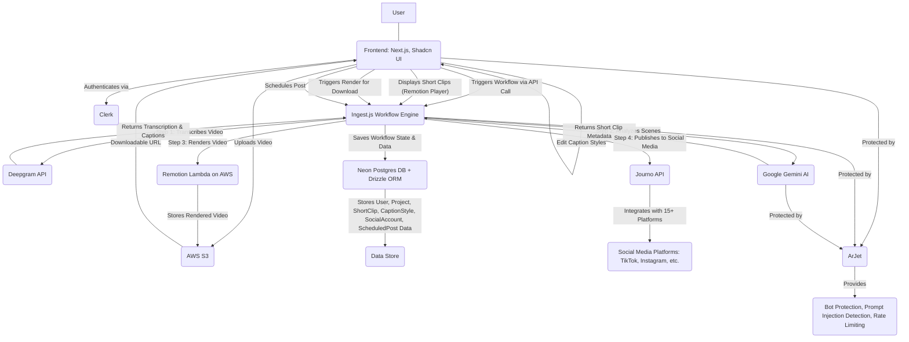

# Product Requirements Document: VidShots - AI Long Video to Short Video Generator

## 1. Executive Summary

VidShots is a full-stack SaaS application designed to empower content creators, marketers, and businesses to efficiently transform long-form video content into engaging, viral short-form clips. Leveraging advanced AI, VidShots automates the entire content generation workflow, from identifying high-engagement moments and intelligent video cutting to auto-captioning, style editing, and multi-platform social media scheduling, all from a single, intuitive dashboard. This platform aims to significantly reduce the time and effort traditionally required for short-form content creation, enabling users to maintain a consistent social media presence and maximize their content's reach and impact.

## 2. Problem Statement

Content creators and businesses face significant challenges in consistently producing high-quality short-form video content for platforms like Reels and TikTok from their existing long-form videos. The current process is often manual, time-consuming, and requires specialized skills, leading to:

*   **Inefficient Content Repurposing**: Manually reviewing long videos to identify engaging segments is labor-intensive and prone to human bias, missing optimal moments.
*   **Complex Editing Workflows**: Cutting, cropping, and adding captions requires multiple tools and technical expertise, slowing down content production.
*   **Lack of Viral Potential**: Without data-driven insights, creators struggle to identify clips with high engagement potential.
*   **Fragmented Social Media Management**: Scheduling content across various social media platforms typically involves using multiple native tools or SDKs, leading to a complex and often bottlenecked publishing process.
*   **Security Concerns**: AI-powered applications are vulnerable to bot abuse, prompt injections, and endpoint exploitation, compromising data integrity and increasing operational costs.

## 3. Goals & Objectives

### 3.1. Business Goals

*   **Market Leadership**: Establish VidShots as a leading solution for AI-powered short-form video generation and social media automation.
*   **User Acquisition**: Achieve a substantial user base of content creators, small businesses, and marketing agencies within the first 12 months.
*   **Revenue Generation**: Implement a scalable subscription-based monetization model.
*   **Operational Efficiency**: Optimize infrastructure costs while maintaining high service availability and performance.

### 3.2. Product Objectives

*   **Automate Content Creation**: Enable users to generate viral-ready short videos from long-form content with minimal manual intervention.
*   **Streamline Social Publishing**: Provide a unified platform for scheduling and publishing short videos across major social media networks.
*   **Enhance User Experience**: Deliver an intuitive, performant, and reliable application.
*   **Ensure Platform Security**: Protect the application and its users from various digital threats, including bot attacks and prompt injection.
*   **Scalability**: Design the system to handle a growing number of users and video processing demands without significant architectural changes.

## 4. User Personas

### 4.1. Persona 1: "The Aspiring Creator" - Sarah, 24, Vlogger & Influencer

*   **Background**: Runs a YouTube channel focused on travel and lifestyle. Currently spends hours manually editing long videos into short clips for Instagram Reels and TikTok.
*   **Pain Points**:
    *   Struggles to identify the "best" moments in her long videos quickly.
    *   Finds manual editing tedious and time-consuming, often sacrificing quality due to time constraints.
    *   Wants consistent posting but lacks the bandwidth.
    *   Worries about social media platform algorithms and maximizing reach.
*   **Needs**:
    *   Automated detection of engaging video segments.
    *   Quick and easy captioning and styling options.
    *   A single platform to schedule posts across Instagram and TikTok.
    *   Insights into why a clip is engaging (SEO score, virality potential).
*   **Goals**: Grow her audience on short-form platforms, save time on editing, maintain a consistent content schedule.

### 4.2. Persona 2: "The Marketing Manager" - David, 38, Digital Marketing Agency

*   **Background**: Manages social media for multiple small business clients. Often repurposes client webinars, product demos, and interviews into digestible snippets.
*   **Pain Points**:
    *   High volume of long-form content that needs repurposing.
    *   Difficulty in maintaining brand consistency across different client accounts when creating shorts.
    *   Managing multiple social media accounts for various clients is a logistical nightmare.
    *   Needs to demonstrate ROI and justify content efforts to clients.
*   **Needs**:
    *   Batch processing capabilities for multiple videos.
    *   Customizable caption styles to match client branding.
    *   Robust multi-account social media scheduling.
    *   Analytics or reporting (future enhancement) to track performance.
*   **Goals**: Efficiently scale content production for clients, streamline social media scheduling, ensure brand consistency, reduce operational costs.

## 5. Functional Requirements

VidShots will provide the following core functionalities:

### 5.1. User & Authentication Management (Clerk)

*   **FR-UM-1**: Users shall be able to register and log in securely using email/password and social sign-on (Google, GitHub).
*   **FR-UM-2**: The application shall automatically detect new users upon first sign-in.
*   **FR-UM-3**: New user information (ID, name, email, image URL, subscription status) shall be saved to the database upon first sign-in.
*   **FR-UM-4**: Existing user information shall be retrieved from the database on subsequent logins.
*   **FR-UM-5**: Users shall have access to a personalized dashboard upon successful authentication.

### 5.2. Dashboard & UI (Next.js, Shadcn UI)

*   **FR-UI-1**: The application shall feature a responsive, dark-themed landing page (VidShots).
*   **FR-UI-2**: The dashboard shall include a collapsible sidebar with navigation options: "Home", "My Videos", "Schedule Post", "Pricing", and "User Profile".
*   **FR-UI-3**: The dashboard homepage shall display a hero section with a clear call to action for video upload.
*   **FR-UI-4**: The UI shall provide a visual preview of selected videos before upload.

### 5.3. Video Upload & Storage (AWS S3)

*   **FR-VU-1**: Users shall be able to upload long-form video files from their local device.
*   **FR-VU-2**: The system shall support video uploads up to 2GB in size.
*   **FR-VU-3**: A real-time progress bar shall be displayed during video upload.
*   **FR-VU-4**: Uploaded videos shall be securely stored in an AWS S3 bucket.
*   **FR-VU-5**: Each uploaded video shall create a new "Project" entry in the database, storing `original_video_url` and initial status.
*   **FR-VU-6**: (ArJet) Users shall be rate-limited to upload a maximum of two (2) videos per day, resetting every 24 hours.

### 5.4. AI Analysis Workflow (Ingest.js & Deepgram, Gemini AI)

This workflow is orchestrated by Ingest.js to handle long-running background tasks.

*   **FR-AI-1**: Upon user's "Start AI Analysis" action, an Ingest.js workflow shall be triggered.
*   **FR-AI-2**: **Transcription Step**:
    *   The workflow shall send the uploaded video URL to the Deepgram API for transcription.
    *   Deepgram shall generate full video transcription (text) and SRT captions.
    *   The full transcription and captions shall be saved to the `Project` entry in the database.
*   **FR-AI-3**: **Scene Detection & Highlight Generation Step**:
    *   The workflow shall send the generated transcription to the Google Gemini AI model (2.0 Flash preview).
    *   The AI model shall identify and return metadata for 4-5 "high-engagement" short video clips (configurable via `config/constants.ts`).
    *   For each short clip, the AI shall provide:
        *   `start_time` (in seconds)
        *   `end_time` (in seconds)
        *   `title`
        *   `description`
        *   `reason_for_selection` (why it's engaging)
        *   `seo_score` (out of 100)
        *   `caption_for_clip` (relevant segment of the full caption)
    *   This metadata shall be stored in a new `ShortVideoClip` table, linked to the `Project`.
*   **FR-AI-4**: The UI shall display a clear loading indicator/progress status during the AI analysis workflow, navigating to a dedicated project page.

### 5.5. Short Video Clip Display & Playback (Remotion Player)

*   **FR-DP-1**: The project detail page shall display all generated short video clips in a grid format with their metadata (title, description, SEO score, reason).
*   **FR-DP-2**: Each short clip shall be playable using a Remotion Player component.
*   **FR-DP-3**: The Remotion Player shall use the `original_video_url` and the `start_time`/`end_time` from the short clip metadata to play only the relevant segment.
*   **FR-DP-4**: Remotion Player shall overlay captions on the video, synchronized with the audio, using the `caption_for_clip` metadata.
*   **FR-DP-5**: (Default Styling) Captions shall be displayed with a yellow text color for active words and black for others, with a maximum of 3-4 words highlighted at a time, positioned centrally.
*   **FR-DP-6**: Videos shall not autoplay on load; thumbnails shall be displayed.

### 5.6. Video Editing (Caption Styles)

*   **FR-VE-1**: Each short clip card shall include an "Edit Style" option.
*   **FR-VE-2**: Clicking "Edit Style" shall open a modal dialogue.
*   **FR-VE-3**: The modal shall display the selected short video in a Remotion Player on the right side.
*   **FR-VE-4**: The left side of the modal shall offer various caption design styles and font options in a 3x3 grid format.
*   **FR-VE-5**: Users shall be able to select a caption style, and the Remotion Player preview shall update in real-time.
*   **FR-VE-6**: Applying a style shall save the chosen `caption_style_id` to the `ShortVideoClip` entry in the database and mark the clip as `is_edited=true`.
*   **FR-VE-7**: (Assumption) A `CaptionStyle` database entity will store predefined or user-created styles including `font_family`, `font_size`, `text_color`, `highlight_color`, `background_color`, `position_x`, `position_y`.

### 5.7. Video Rendering & Export (Remotion Lambda)

*   **FR-RE-1**: Each short clip card shall include a "Download" button.
*   **FR-RE-2**: If a `ShortVideoClip` has an existing `video_url` and `is_edited` is `false`, clicking "Download" shall initiate a direct download.
*   **FR-RE-3**: If `video_url` is not present or `is_edited` is `true`, clicking "Download" shall trigger an Ingest.js workflow to render the video using Remotion Lambda.
*   **FR-RE-4**: During rendering, a dialogue shall display a real-time progress bar (polling based) until completion.
*   **FR-RE-5**: Remotion Lambda shall render the video on AWS, incorporating the selected caption style and synchronized captions.
*   **FR-RE-6**: Upon successful rendering, the generated downloadable video URL (AWS S3) shall be saved to the `ShortVideoClip` database entry.
*   **FR-RE-7**: If a user edits a video after it has been rendered, the `is_edited` flag shall trigger a re-render on the next download request.

### 5.8. Social Media Scheduling (Journo API)

*   **FR-SMS-1**: Users shall be able to connect their social media accounts (e.g., Instagram, TikTok, Facebook, Twitter, LinkedIn, YouTube) via a unified API (Journo).
*   **FR-SMS-2**: The "Schedule Post" section shall display a calendar view of scheduled and published posts.
*   **FR-SMS-3**: Users shall be able to select a short video clip from their "My Videos" library for scheduling.
*   **FR-SMS-4**: A 10-second preview of the selected video shall be available during scheduling.
*   **FR-SMS-5**: Users shall select one or more connected social media accounts to publish to.
*   **FR-SMS-6**: The system shall offer AI-assisted title and description generation for the social media post.
*   **FR-SMS-7**: Users shall be able to manually refine the AI-generated title and description.
*   **FR-SMS-8**: Users shall specify a future date and time for publishing.
*   **FR-SMS-9**: An Ingest.js workflow shall poll every 15 minutes to identify upcoming scheduled posts.
*   **FR-SMS-10**: The Ingest.js workflow shall use the Journo API to publish the scheduled video and its associated text to the selected social media platforms.
*   **FR-SMS-11**: The UI shall update the post's status (e.g., "Scheduled", "Published", "Failed") on the calendar.

### 5.9. Security & Abuse Protection (ArJet)

*   **FR-SEC-1**: The application shall implement global web protection including bot detection and a shield for HTTP routes via middleware (ArJet).
*   **FR-SEC-2**: AI-related endpoints (e.g., "Start AI Analysis" trigger) shall be protected against prompt injection attacks (ArJet).
*   **FR-SEC-3**: All backend API endpoints and server actions shall be protected against endpoint abuse (ArJet).
*   **FR-SEC-4**: The video upload functionality shall enforce a rate limit of two (2) videos per user per 24 hours, automatically resetting daily (ArJet, Clerk User ID tracking).
*   **FR-SEC-5**: (Assumption) All sensitive API keys and credentials shall be stored as environment variables and not exposed client-side.

## 6. Non-Functional Requirements

### 6.1. Performance

*   **NFR-PER-1**: Video uploads to AWS S3 shall complete within 99% of requests within 10 seconds for files up to 100MB on standard broadband.
*   **NFR-PER-2**: AI analysis (transcription and highlight generation) shall complete within 99% of requests within 10-30 seconds for videos up to 5 minutes long.
*   **NFR-PER-3**: Short video rendering (via Remotion Lambda) shall complete within 99% of requests within 60 seconds for 30-90 second clips.
*   **NFR-PER-4**: Real-time caption styling preview shall update within 100ms of user interaction.
*   **NFR-PER-5**: Database queries for user data, project details, and short video clips shall execute within 200ms for 99% of requests.

### 6.2. Scalability

*   **NFR-SCA-1**: The video storage solution (AWS S3) shall automatically scale to accommodate petabytes of video data.
*   **NFR-SCA-2**: The database (NeonDB) shall scale to support 10,000 concurrent connections and millions of records.
*   **NFR-SCA-3**: The Ingest.js workflow engine shall be capable of processing thousands of concurrent video analysis and rendering jobs.
*   **NFR-SCA-4**: Remotion Lambda concurrency shall be configured to handle up to 1,000 concurrent video rendering tasks.
*   **NFR-SCA-5**: All external AI/API services (Deepgram, Gemini, Journo, Clerk, ArJet) are expected to handle high loads as per their respective SLAs.

### 6.3. Security

*   **NFR-SEC-1**: All data in transit shall be encrypted using TLS 1.2 or higher.
*   **NFR-SEC-2**: All data at rest in AWS S3 and NeonDB shall be encrypted (e.g., S3 managed encryption, NeonDB default encryption).
*   **NFR-SEC-3**: User authentication shall conform to industry best practices (Clerk multi-factor authentication, session management).
*   **NFR-SEC-4**: API keys and secrets shall be securely managed and rotated periodically.
*   **NFR-SEC-5**: The application shall be protected against common web vulnerabilities including XSS, CSRF, and SQL injection.
*   **NFR-SEC-6**: (ArJet) The system shall detect and mitigate prompt injection, bot attacks, and endpoint abuse with an accuracy of >95%.

### 6.4. Reliability & Availability

*   **NFR-REL-1**: The application shall maintain an uptime of 99.9% (excluding planned maintenance).
*   **NFR-REL-2**: Ingest.js workflows shall implement retry mechanisms (minimum 3 retries) for transient failures in external API calls or processing steps.
*   **NFR-REL-3**: All critical data shall be backed up regularly.
*   **NFR-REL-4**: Error logging and monitoring shall be implemented across all application layers.

### 6.5. Usability (UX)

*   **NFR-UX-1**: The user interface shall be intuitive and easy to navigate, requiring minimal training for new users.
*   **NFR-UX-2**: All interactive elements shall provide clear visual feedback on user actions.
*   **NFR-UX-3**: Loading indicators and progress bars shall be displayed for all asynchronous operations (e.g., uploads, AI analysis, rendering).
*   **NFR-UX-4**: Error messages shall be user-friendly and provide actionable guidance.

### 6.6. Maintainability

*   **NFR-MNT-1**: The codebase shall adhere to Next.js and TypeScript best practices, using a modular and component-based architecture.
*   **NFR-MNT-2**: All custom components and complex logic shall be well-documented.
*   **NFR-MNT-3**: Dependencies shall be regularly updated to address security vulnerabilities and leverage performance improvements.
*   **NFR-MNT-4**: Automated testing (unit, integration) shall be implemented for critical paths.

### 6.7. Cost Efficiency

*   **NFR-COST-1**: The system shall leverage serverless technologies (AWS Lambda, NeonDB) to optimize operational costs.
*   **NFR-COST-2**: Cloud storage (AWS S3) shall be configured for cost-effective tiers.
*   **NFR-COST-3**: AI model usage shall be optimized to minimize token consumption and leverage free/trial tiers where feasible.
*   **NFR-COST-4**: Journo and ArJet API usage shall be monitored to prevent unexpected overages.

## 7. User Stories

Here are key user stories covering the primary features:

*   **As a user**, I want to **securely log in** using my Google account, **so that** I can access my VidShots dashboard.
*   **As a new user**, I want my **profile information to be automatically saved** to the database upon my first login, **so that** my account is set up for future use.
*   **As a content creator**, I want to **upload a long video file** from my computer, **so that** I can start generating short clips from it.
*   **As a content creator**, I want to **see a real-time progress bar** during video upload, **so that** I know the status of my upload.
*   **As a content creator**, I want the system to **automatically transcribe my video** and **generate captions**, **so that** AI can analyze the content effectively.
*   **As a content creator**, I want the **AI to detect high-engagement moments** in my video and **suggest 4-5 short clips**, **so that** I can easily repurpose my content.
*   **As a content creator**, I want to **see the suggested short clips** with their **start/end times, titles, and SEO scores**, **so that** I can understand their potential.
*   **As a content creator**, I want to **play a preview of each short clip** with **synchronized captions**, **so that** I can evaluate its content before downloading or scheduling.
*   **As a content creator**, I want to **customize the caption style (font, color, highlight)** for each short clip, **so that** I can match my branding or preferred aesthetic.
*   **As a content creator**, I want to **see real-time updates** to the caption style in the video preview while editing, **so that** I can immediately visualize my changes.
*   **As a content creator**, I want to **download a high-quality rendered version** of my short clip, **so that** I can use it on social media or other platforms.
*   **As a content creator**, I want the system to **re-render my video if I make changes to its caption style**, **so that** the downloaded video always reflects my latest edits.
*   **As a social media manager**, I want to **connect multiple social media accounts** (e.g., Instagram, TikTok, YouTube), **so that** I can manage all my client's content in one place.
*   **As a social media manager**, I want to **schedule a short video to multiple platforms** at a specific date and time, **so that** I can automate my posting strategy.
*   **As a social media manager**, I want **AI to suggest titles and descriptions** for my social media posts, **so that** I can quickly create engaging content.
*   **As a business owner**, I want the application to **prevent bots and abusive users** from exploiting my content or system resources, **so that** my operations remain secure and cost-effective.
*   **As a business owner**, I want **rate limiting on video uploads** to prevent excessive use of resources by free-tier users, **so that** I can manage costs and maintain service quality.

## 8. Acceptance Criteria

### 8.1. User Story: "As a content creator, I want to upload a long video file from my computer, so that I can start generating short clips from it."

*   **AC-VU-1**: The user can click an "Upload Video" button or drag-and-drop a video file onto a designated area on the dashboard homepage.
*   **AC-VU-2**: Upon file selection, a visual preview of the video appears on the UI.
*   **AC-VU-3**: Clicking "Upload & Process" initiates the file upload to AWS S3.
*   **AC-VU-4**: A distinct progress bar is displayed, showing the percentage completion of the upload.
*   **AC-VU-5**: Upon successful upload, a new "Project" entry is created in the database with the S3 URL.
*   **AC-VU-6**: If the user attempts to upload more than two videos in 24 hours, an error message indicating the rate limit is displayed, and the upload is blocked.
*   **AC-VU-7**: Uploads of files up to 2GB are handled without server errors.

### 8.2. User Story: "As a content creator, I want the AI to detect high-engagement moments in my video and suggest 4-5 short clips, so that I can easily repurpose my content."

*   **AC-AI-1**: After successful video upload, clicking "Start AI Analysis" triggers the Ingest.js workflow.
*   **AC-AI-2**: The UI navigates to a project detail page showing "Transcribing Video...", "Analyzing Scenes...", and "Generating Clips..." status indicators.
*   **AC-AI-3**: The Ingest.js workflow successfully calls the Deepgram API, stores the full `transcription` and `caption` in the `Project` database entry.
*   **AC-AI-4**: The Ingest.js workflow successfully calls the Gemini AI, which returns metadata for 4-5 distinct short clips.
*   **AC-AI-5**: For each generated short clip, a `ShortVideoClip` entry is created in the database, populating `title`, `description`, `start_time`, `end_time`, `reason_for_selection`, `seo_score`, and `caption_for_clip`.
*   **AC-AI-6**: The project detail page updates to display the generated short video clips in a grid, each with its title, SEO score, and reason.

### 8.3. User Story: "As a content creator, I want to customize the caption style (font, color, highlight) for each short clip, so that I can match my branding or preferred aesthetic."

*   **AC-VE-1**: Clicking "Edit Style" on a short video clip card opens a modal dialogue.
*   **AC-VE-2**: The modal displays the selected short video playing in a Remotion Player on the right.
*   **AC-VE-3**: The left panel of the modal presents at least 3 distinct caption style options (e.g., different fonts, color schemes, positions) in a 3x3 grid.
*   **AC-VE-4**: Selecting a style on the left causes the captions in the Remotion Player to immediately update, reflecting the chosen style.
*   **AC-VE-5**: Clicking "Apply Style" within the modal closes the modal and updates the `caption_style_id` for that `ShortVideoClip` in the database.
*   **AC-VE-6**: The `is_edited` flag for the `ShortVideoClip` is set to `true` in the database after applying a new style.

### 8.4. User Story: "As a social media manager, I want to schedule a short video to multiple platforms at a specific date and time, so that I can automate my posting strategy."

*   **AC-SMS-1**: From the "My Videos" page, clicking "Schedule" on a short clip opens a scheduling interface.
*   **AC-SMS-2**: The interface displays a 10-second preview of the selected short video.
*   **AC-SMS-3**: A list of connected social media accounts is displayed, allowing multi-selection.
*   **AC-SMS-4**: The system automatically generates a default title and description for the post, with an option for AI refinement.
*   **AC-SMS-5**: Users can manually edit the title, description, and select a desired future date and time for posting.
*   **AC-SMS-6**: Clicking "Schedule Post" creates a `ScheduledPost` entry in the database.
*   **AC-SMS-7**: The `ScheduledPost` entry includes the `short_video_clip_id`, selected `platform_ids`, `title`, `description`, and `scheduled_at` timestamp.
*   **AC-SMS-8**: The calendar view under "Schedule Post" updates to show the newly scheduled post on the selected date.
*   **AC-SMS-9**: The Ingest.js scheduler, polling every 15 minutes, identifies the scheduled post and successfully publishes it to the selected platforms via Journo API.
*   **AC-SMS-10**: The post's status in the UI (e.g., "Published") is updated once successfully posted.

## 9. KPIs & Success Metrics

*   **User Engagement & Retention:**
    *   **DAU/MAU Ratio**: Percentage of daily active users to monthly active users.
    *   **Session Duration**: Average time spent by users within the application per session.
    *   **Feature Adoption Rate**: Percentage of users utilizing key features like AI analysis, custom styling, and social scheduling.
    *   **Churn Rate**: Rate at which users discontinue their subscription or stop using the free tier.
*   **Content Generation & Efficiency:**
    *   **Videos Processed per User**: Average number of long videos uploaded and analyzed per active user per month.
    *   **Short Clips Generated**: Total number of AI-generated short clips.
    *   **Videos Rendered/Downloaded**: Number of short clips rendered and downloaded by users.
    *   **Time Saved (User Survey)**: Qualitative metric from user feedback on perceived time savings.
*   **Social Media Impact:**
    *   **Posts Scheduled/Published**: Total number of short videos scheduled and successfully published to social media.
    *   **Platform Connection Rate**: Percentage of users connecting at least one social media account.
    *   **Social Reach (Future)**: Integration with Journo analytics to track views, likes, shares, etc., for published posts.
*   **System Performance & Reliability:**
    *   **AI Analysis Latency**: Average time taken for AI analysis workflow.
    *   **Rendering Latency**: Average time taken for video rendering.
    *   **Uptime**: System availability percentage.
    *   **Error Rate**: Percentage of failed video uploads, AI analyses, or rendering jobs.
*   **Monetization (Future):**
    *   **Conversion Rate (Free to Paid)**: Percentage of free users converting to a paid subscription plan.
    *   **Average Revenue Per User (ARPU)**: For paid users.

## 10. Risks & Mitigations

| Risk                                    | Mitigation Strategy                                                                                                                                                                                                                                                                                                                                                                                                                                                                                                                          |
| :-------------------------------------- | :------------------------------------------------------------------------------------------------------------------------------------------------------------------------------------------------------------------------------------------------------------------------------------------------------------------------------------------------------------------------------------------------------------------------------------------------------------------------------------------------------------------------------------------- |
| **High API Costs** (Deepgram, Gemini, Journo, Remotion Lambda) | Implement strict usage monitoring and alerting. Optimize AI prompts for token efficiency. Leverage free tiers/credits strategically. Implement user-based rate limiting for costly operations (ArJet for video uploads/AI analysis). Explore alternative, more cost-effective APIs/models as backup. Implement pricing tiers to cover costs based on usage.                                                                                                                                                                    |
| **AI Accuracy & Quality** (Highlight generation, captioning)   | Continuously evaluate AI model performance and update to newer, more capable versions (e.g., Gemini 2.0 Flash). Allow user feedback mechanisms to improve AI suggestions. Provide robust editing tools to allow users to refine AI output. Offer configurable AI parameters (e.g., number of clips, minimum/maximum duration).                                                                                                                                                                                           |
| **Video Processing Failures** (Upload, Transcribing, Rendering) | Ingest.js retry mechanism for transient failures. Comprehensive error logging and monitoring (e.g., Sentry, CloudWatch). Robust input validation for video files. Fallback mechanisms (e.g., manual re-trigger for failed jobs). Clear error messages to users with troubleshooting steps.                                                                                                                                                                                                                              |
| **Social Media API Changes** (Journo, Platform policies)       | Rely on Journo's abstraction layer to handle underlying API changes. Closely monitor Journo's updates and announcements. Build a flexible scheduling system that can adapt to minor changes.                                                                                                                                                                                                                                                                                                                              |
| **Data Security & Privacy Breaches** (User data, video content) | Adhere to best practices for data encryption (at rest and in transit). Implement ArJet for bot/abuse protection, prompt injection detection. Regularly conduct security audits and penetration testing. Ensure all third-party services (Clerk, Journo, Deepgram) comply with high security and privacy standards. Educate users on data privacy.                                                                                                                                                                        |
| **Scalability Bottlenecks** (DB, Ingest, Remotion Lambda)      | Utilize serverless solutions (NeonDB, Ingest.js, AWS Lambda) designed for auto-scaling. Implement load testing to identify bottlenecks early. Monitor key metrics (CPU, memory, concurrent tasks) and set up auto-scaling rules. Optimize database queries and schema.                                                                                                                                                                                                                                                  |
| **Large File Upload Reliability**                             | Utilize AWS S3's multi-part upload capabilities (if not already handled by libraries). Ensure robust client-side error handling for network issues during uploads. Implement server-side validation for file integrity.                                                                                                                                                                                                                                                                                          |
| **Copyright Infringement Risk**                                | Clearly state in Terms of Service that users are responsible for the content they upload and its compliance with copyright laws. Implement reporting mechanisms for copyright violations. (Assumption: No automated copyright detection will be implemented in V1).                                                                                                                                                                                                                                             |
| **AI Agent Dependency**                                       | The reliance on AI agents (Google Anti-gravity, Gemini, Claude) for development introduces a dependency on their availability and capabilities. Maintain core understanding of underlying technologies to allow for manual development if AI agent assistance is unavailable or insufficient. Regularly review and validate AI-generated code.                                                                                                                                                                      |

## 11. Scope (In/Out)

### 11.1. In Scope for MVP

*   User Authentication (Clerk) and Profile Management
*   Dashboard with Sidebar Navigation
*   Long Video Upload to AWS S3 (up to 2GB)
*   AI-Powered Transcription (Deepgram)
*   AI-Powered Scene Detection and Short Clip Generation (Gemini AI, 4-5 clips per video)
*   Short Video Clip Display with Remotion Player and Basic Captions
*   Real-time Caption Style Editing with Preview
*   Server-side Video Rendering for Download (Remotion Lambda)
*   Multi-Platform Social Media Scheduling (Journo API)
*   AI-Assisted Social Post Title/Description Generation
*   Security & Abuse Protection (ArJet): Global web protection, prompt injection, endpoint abuse, 2 videos/day rate limiting.
*   Database Management (NeonDB, Drizzle ORM)
*   Background Task Orchestration (Ingest.js)

### 11.2. Out of Scope for MVP

*   Advanced Video Editing (e.g., trimming, transitions, adding music/effects, custom graphics beyond captions)
*   Team Collaboration Features (e.g., shared projects, user roles)
*   Detailed Analytics Dashboard for Social Media Performance
*   Monetization and Subscription Management (Clerk Billing is ready, but specific plans are out of scope for *this document*)
*   Mobile Application
*   Native Desktop Application
*   Multi-language support for AI transcription/analysis (English only for now, Deepgram supports more but not specified in transcript)
*   Custom video aspect ratio/cropping beyond what Remotion default offers (smart cropping mentioned, but not detailed enough to be a core MVP feature for customization).
*   Integrated Chat/Support System

## 12. Future Enhancements

*   **Advanced Video Editing**:
    *   Allow manual trimming/adjustment of AI-suggested short clip start/end times.
    *   Option to add background music from a royalty-free library.
    *   Ability to upload custom intros/outros for branding.
    *   Dynamic background templates for captions.
*   **Enhanced AI Capabilities**:
    *   More diverse AI models for content analysis (e.g., sentiment analysis, trend prediction).
    *   AI suggestions for optimal posting times based on audience activity.
    *   Automatic generation of multiple aspect ratios (e.g., 9:16 for vertical, 1:1 for square) per short clip.
*   **Monetization & Analytics**:
    *   Integration with Clerk Billing for subscription tiers (free, pro, business).
    *   Detailed social media analytics dashboard tracking views, engagement, and reach.
    *   Referral program for user acquisition.
*   **Collaboration & Workflow**:
    *   Team accounts with user roles and permissions.
    *   Project sharing and commenting features.
    *   Integration with project management tools (e.g., Trello, Asana).
*   **Content Library Management**:
    *   Tagging, categorization, and search for generated short clips.
    *   Version control for edited short clips.
*   **Localization**: Support for multiple languages in UI and AI transcription/captioning.

---

### Appendix A: High-Level Architecture Diagram (Mermaid)



### Appendix B: Database Schema (Drizzle ORM Conceptual)

```typescript
// schema.ts

import { pgTable, text, timestamp, boolean, integer, jsonb } from 'drizzle-orm/pg-core';
import { relations } from 'drizzle-orm';

// User Table
export const users = pgTable('users', {
  id: text('id').primaryKey(), // Clerk user ID
  name: text('name').notNull(),
  email: text('email').unique().notNull(),
  imageUrl: text('image_url'),
  subscription: text('subscription').default('free').notNull(), // e.g., 'free', 'pro'
  createdAt: timestamp('created_at').defaultNow().notNull(),
  updatedAt: timestamp('updated_at').defaultNow().notNull(),
});

// User Relations
export const usersRelations = relations(users, ({ many }) => ({
  projects: many(projects),
  socialMediaAccounts: many(socialMediaAccounts),
  scheduledPosts: many(scheduledPosts),
}));

// Project Table (for long videos)
export const projects = pgTable('projects', {
  id: text('id').primaryKey(),
  userId: text('user_id').notNull().references(() => users.id, { onDelete: 'cascade' }),
  originalVideoUrl: text('original_video_url').notNull(), // S3 URL of the original long video
  transcription: text('transcription'), // Full text transcription
  caption: jsonb('caption'), // Deepgram generated captions (SRT format or similar)
  status: text('status').default('uploaded').notNull(), // 'uploaded', 'transcribing', 'analyzing', 'ready', 'failed'
  createdAt: timestamp('created_at').defaultNow().notNull(),
  updatedAt: timestamp('updated_at').defaultNow().notNull(),
});

// Project Relations
export const projectsRelations = relations(projects, ({ one, many }) => ({
  user: one(users, { fields: [projects.userId], references: [users.id] }),
  shortVideoClips: many(shortVideoClips),
}));

// Short Video Clip Table (AI-generated shorts)
export const shortVideoClips = pgTable('short_video_clips', {
  id: text('id').primaryKey(),
  projectId: text('project_id').notNull().references(() => projects.id, { onDelete: 'cascade' }),
  title: text('title').notNull(),
  description: text('description'),
  startTime: integer('start_time').notNull(), // in seconds
  endTime: integer('end_time').notNull(),     // in seconds
  reasonForSelection: text('reason_for_selection'),
  seoScore: integer('seo_score'), // 0-100
  captionForClip: jsonb('caption_for_clip'), // Relevant part of the full caption
  status: text('status').default('pending').notNull(), // 'pending', 'rendering', 'rendered', 'failed'
  videoUrl: text('video_url'), // S3 URL of the rendered short clip
  captionStyleId: text('caption_style_id').references(() => captionStyles.id, { onDelete: 'set null' }),
  isEdited: boolean('is_edited').default(false).notNull(), // True if caption style was changed after last render
  createdAt: timestamp('created_at').defaultNow().notNull(),
  updatedAt: timestamp('updated_at').defaultNow().notNull(),
});

// Short Video Clip Relations
export const shortVideoClipsRelations = relations(shortVideoClips, ({ one, many }) => ({
  project: one(projects, { fields: [shortVideoClips.projectId], references: [projects.id] }),
  captionStyle: one(captionStyles, { fields: [shortVideoClips.captionStyleId], references: [captionStyles.id] }),
  scheduledPosts: many(scheduledPosts),
}));

// Caption Style Table
export const captionStyles = pgTable('caption_styles', {
  id: text('id').primaryKey(),
  name: text('name').unique().notNull(),
  fontFamily: text('font_family').notNull(),
  fontSize: integer('font_size').notNull(),
  textColor: text('text_color').notNull(),
  highlightColor: text('highlight_color').notNull(),
  backgroundColor: text('background_color'), // Optional
  positionX: text('position_x'), // e.g., 'center', 'left'
  positionY: text('position_y'), // e.g., 'bottom', 'top'
  isDefault: boolean('is_default').default(false).notNull(),
  // More style properties can be added as needed
});

// Caption Style Relations
export const captionStylesRelations = relations(captionStyles, ({ many }) => ({
  shortVideoClips: many(shortVideoClips),
}));


// Social Media Account Table (for Journo API connections)
export const socialMediaAccounts = pgTable('social_media_accounts', {
  id: text('id').primaryKey(),
  userId: text('user_id').notNull().references(() => users.id, { onDelete: 'cascade' }),
  platform: text('platform').notNull(), // e.g., 'tiktok', 'instagram', 'youtube'
  accessToken: text('access_token'), // Encrypted
  refreshToken: text('refresh_token'), // Encrypted
  expiresAt: timestamp('expires_at'),
  platformAccountId: text('platform_account_id'), // User's ID on the specific platform
  accountName: text('account_name'), // e.g., "Sarah's TikTok"
  createdAt: timestamp('created_at').defaultNow().notNull(),
  updatedAt: timestamp('updated_at').defaultNow().notNull(),
});

// Social Media Account Relations
export const socialMediaAccountsRelations = relations(socialMediaAccounts, ({ one, many }) => ({
  user: one(users, { fields: [socialMediaAccounts.userId], references: [users.id] }),
  scheduledPosts: many(scheduledPosts),
}));

// Scheduled Post Table
export const scheduledPosts = pgTable('scheduled_posts', {
  id: text('id').primaryKey(),
  shortVideoClipId: text('short_video_clip_id').notNull().references(() => shortVideoClips.id, { onDelete: 'cascade' }),
  userId: text('user_id').notNull().references(() => users.id, { onDelete: 'cascade' }),
  platformAccountId: text('platform_account_id').notNull().references(() => socialMediaAccounts.id, { onDelete: 'cascade' }),
  title: text('title'),
  description: text('description'),
  scheduledAt: timestamp('scheduled_at').notNull(),
  postedAt: timestamp('posted_at'), // When it was actually published
  status: text('status').default('scheduled').notNull(), // 'scheduled', 'publishing', 'published', 'failed'
  journoPostId: text('journo_post_id'), // ID returned by Journo after scheduling
  createdAt: timestamp('created_at').defaultNow().notNull(),
  updatedAt: timestamp('updated_at').defaultNow().notNull(),
});

// Scheduled Post Relations
export const scheduledPostsRelations = relations(scheduledPosts, ({ one }) => ({
  shortVideoClip: one(shortVideoClips, { fields: [scheduledPosts.shortVideoClipId], references: [shortVideoClips.id] }),
  user: one(users, { fields: [scheduledPosts.userId], references: [users.id] }),
  platformAccount: one(socialMediaAccounts, { fields: [scheduledPosts.platformAccountId], references: [socialMediaAccounts.id] }),
}));

// Ingest Job Status Table (Assumption for tracking specific Ingest job runs)
export const ingestJobs = pgTable('ingest_jobs', {
    id: text('id').primaryKey(),
    projectId: text('project_id').references(() => projects.id, { onDelete: 'cascade' }),
    shortVideoClipId: text('short_video_clip_id').references(() => shortVideoClips.id, { onDelete: 'cascade' }),
    type: text('type').notNull(), // 'video_analysis', 'video_render', 'social_publish'
    status: text('status').default('pending').notNull(), // 'pending', 'running', 'completed', 'failed'
    progress: integer('progress').default(0), // 0-100
    errorMessage: text('error_message'),
    createdAt: timestamp('created_at').defaultNow().notNull(),
    updatedAt: timestamp('updated_at').defaultNow().notNull(),
});

export const ingestJobsRelations = relations(ingestJobs, ({ one }) => ({
    project: one(projects, { fields: [ingestJobs.projectId], references: [projects.id] }),
    shortVideoClip: one(shortVideoClips, { fields: [ingestJobs.shortVideoClipId], references: [shortVideoClips.id] }),
}));
```