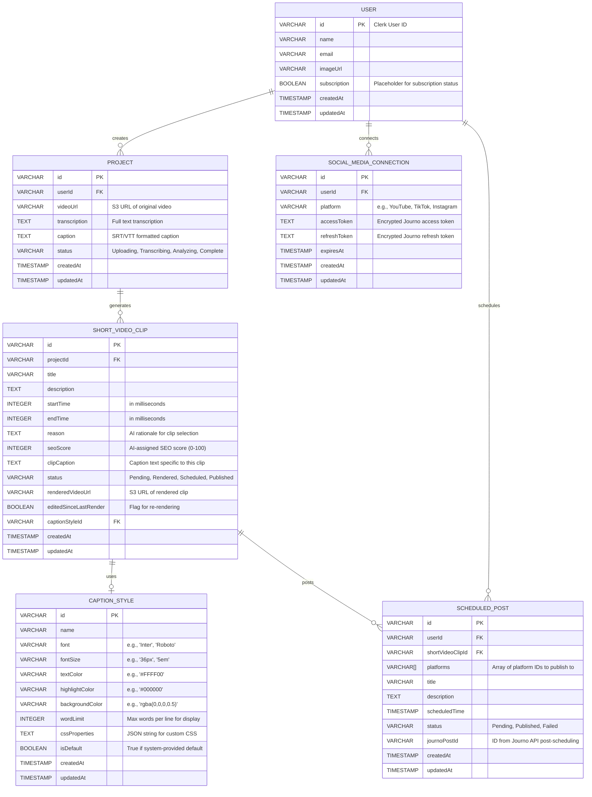

# Software Requirements Specification: VidShot - AI Long to Short Video Generator

## 1. Introduction

### 1.1. System Purpose

The VidShot application is a full-stack Software-as-a-Service (SaaS) platform designed to transform long-form video content into viral short-form clips. Leveraging advanced AI models, it automatically identifies high-engagement moments, cuts video segments, generates contextually relevant captions, and facilitates one-click scheduling to multiple social media platforms. The system aims to empower content creators and businesses to efficiently automate their short-form content generation and distribution, significantly reducing manual effort and accelerating content virality.

### 1.2. Scope

This document details the functional and non-functional requirements for the VidShot application, encompassing user authentication, secure video upload, AI-driven content analysis, programmatic video rendering, social media scheduling, and robust security measures. It outlines the architecture, data models, external integrations, and core workflows necessary for the system's implementation.

### 1.3. Target Audience

This document is intended for:
-   **Software Developers:** For understanding implementation details and code structure.
-   **QA Engineers:** For designing comprehensive test cases and validating functionality.
-   **DevOps Engineers:** For deploying, configuring, and managing infrastructure.
-   **Product Managers:** For validating alignment with business objectives and feature scope.
-   **Stakeholders:** For understanding system capabilities, progress, and strategic direction.

## 2. System Overview

VidShot is a comprehensive AI-powered content automation system built with Next.js, Tailwind CSS, and Shadcn UI. Users authenticate via Clerk, then upload long videos to AWS S3. An Ingest.dev workflow orchestrates AI analysis using Deepgram for transcription and Gemini AI for identifying high-engagement clips. These clips are previewed using Remotion Player with customizable captions. For download, clips are rendered on AWS Lambda via Remotion Lambda. Social media scheduling is handled by Journo API, with background publishing managed by Ingest. Arj.dev provides critical security, bot protection, prompt injection detection, and rate limiting.

## 3. User Roles

### 3.1. Authenticated User

Users who have successfully registered and logged into the VidShot application.
-   **Permissions:**
    -   Upload and manage long video projects.
    -   Initiate AI analysis for transcription and short clip generation.
    -   View, preview, and edit generated short clips and their captions.
    -   Render and download final short clips.
    -   Connect and manage social media accounts via Journo.
    -   Schedule short clips for posting on multiple social media platforms.
    -   View and manage scheduled posts.
    -   Access personal settings and potentially subscription details (future scope).

## 4. Functional Requirements

### 4.1. Authentication and User Management

| ID | Requirement | Description | Validation Rules | Error Scenarios |
|----|-------------|-------------|------------------|-----------------|
| FR.AUTH.100 | User Registration | The system SHALL allow new users to register using email/password, Google, or GitHub social sign-on, leveraging Clerk. | Clerk's default email format, password complexity, and social provider validations. | Invalid email, weak password, email already in use, social sign-on failure, Clerk API errors. |
| FR.AUTH.110 | User Login | The system SHALL allow registered users to log in with their credentials or social accounts via Clerk. | Clerk's default authentication checks. | Invalid credentials, account locked/disabled, social provider outages. |
| FR.AUTH.120 | Session Management | The system SHALL maintain secure user sessions managed by Clerk, ensuring persistence and proper invalidation. | Clerk's session token validation and expiration. | Expired session, invalid session token, unauthorized access attempts. |
| FR.AUTH.130 | User Data Persistence | Upon initial sign-up, the system SHALL store the user's Clerk ID, Name, Email, and Image URL into the `users` table in Neon PostgreSQL using Drizzle ORM. | `users.id` must be unique. `users.email` must be unique. | Database write failure, duplicate user record. |
| FR.AUTH.140 | Dashboard Access Control | The system SHALL restrict access to all dashboard routes and functionalities to authenticated users only. Unauthenticated users SHALL be redirected to the sign-in page. | Clerk's middleware for authenticated routes. | Attempted access to protected routes by unauthenticated users. |

### 4.2. Video Upload and Project Management

| ID | Requirement | Description | Validation Rules | Error Scenarios |
|----|-------------|-------------|------------------|-----------------|
| FR.UPLOAD.100 | Video Upload UI | The system SHALL provide a dedicated section on the dashboard for users to select a long video file from their local device. | Input type `file` with `accept` attribute for video formats. | Invalid file type selected. |
| FR.UPLOAD.110 | Video Preview | The system SHALL display a visual preview of the selected video (thumbnail or short playback) before initiating the upload. | Preview element renders selected video data. | Browser cannot render video preview (e.g., codec issue). |
| FR.UPLOAD.120 | Upload Initiation | Upon user's explicit action ("Upload and Process"), the system SHALL initiate the secure upload of the video. | User confirmation. | No video selected. |
| FR.UPLOAD.130 | Upload Progress Feedback | The system SHALL display a real-time, granular progress bar (0-100%) during the video upload process. | Progress updates sent from client-side upload or backend. | Network interruptions, upload stalling, incorrect progress reporting. |
| FR.UPLOAD.140 | AWS S3 Storage | The system SHALL upload the selected video file directly to a designated AWS S3 bucket. | S3 API returns successful upload status. | AWS S3 connection failure, bucket not found, permission denied. |
| FR.UPLOAD.150 | Project Creation | Upon successful S3 upload, the system SHALL create a new entry in the `projects` table with the S3 video URL, `userId`, and an initial `status` of 'uploaded'. | Valid S3 URL, existing `userId`. | Database write failure, invalid foreign key. |
| FR.UPLOAD.160 | Upload Size Limit | The system SHALL enforce a maximum video file size limit of 2GB per upload. | `next.config.ts` `bodyParser` configuration for server actions. | File exceeds 2GB, API gateway limits. |
| FR.UPLOAD.170 | Video Upload Rate Limiting | The system SHALL limit each authenticated user to uploading a maximum of 2 long videos per 24 hours. This limit SHALL be enforced by Arj.dev and reset daily. | Arj.dev's rate limiting logic, tracked by Clerk `userId`. | User attempts to upload a 3rd video within 24 hours; request is blocked by Arj.dev. |

### 4.3. AI-Powered Video Analysis Workflow

| ID | Requirement | Description | Validation Rules | Error Scenarios |
|----|-------------|-------------|------------------|-----------------|
| FR.AI.100 | AI Analysis Trigger | The system SHALL enable a "Start AI Analysis" button on the project detail page once a video is successfully uploaded. Clicking this SHALL trigger the core AI workflow. | Project `status` is 'uploaded'. | Button clicked when project is not in 'uploaded' state. |
| FR.AI.110 | Ingest Workflow Orchestration | The "Start AI Analysis" action SHALL invoke an Ingest.dev background workflow to perform the sequence of AI processing steps. | Ingest function invocation successful, workflow instance created. | Ingest.dev service unavailable, workflow definition error. |
| FR.AI.120 | Video Transcription (Deepgram) | The Ingest workflow SHALL include a step to send the S3 video URL to the Deepgram API for audio transcription and SRT caption generation. | Deepgram API returns a 200 OK status with transcription and caption data. | Deepgram API errors (e.g., invalid audio, API key issue, rate limit). |
| FR.AI.130 | Transcription Storage | The generated transcription text and caption data (e.g., SRT format) SHALL be stored in the `transcription` and `caption` fields of the corresponding `projects` table entry. | Data length, valid text/SRT format. | Database update failure, data truncation. |
| FR.AI.140 | Engaging Moment Detection (Gemini AI) | Following transcription, the Ingest workflow SHALL send the video's full transcription to the Gemini AI model to identify 4-5 high-engagement moments suitable for short clips (30-90 seconds each). | Gemini AI returns a JSON structure containing `startTime`, `endTime`, `reason`, `seoScore`, and `clipCaption` for each identified segment. | Gemini AI API errors (e.g., prompt issues, model unavailability, rate limit), invalid JSON response. |
| FR.AI.150 | Short Clip Metadata Creation | For each identified engaging moment, the system SHALL create a new entry in the `short_video_clips` table, populating `projectId`, `title`, `description`, `startTime`, `endTime`, `reason`, `seoScore`, and `clipCaption`. The initial `status` SHALL be 'pending'. | Unique `shortVideoClipId`, valid `projectId`. | Database write failure, invalid data. |
| FR.AI.160 | AI Progress Display | The system SHALL dynamically update the UI on the project detail page to show the current status of the Ingest AI workflow steps (e.g., "Transcribing Video...", "Analyzing Scenes...", "Generating Clips..."). | UI polls Ingest.dev or backend endpoint for status updates. | Progress display lags, incorrect status. |
| FR.AI.170 | Configurable Clip Count | The number of short video clips generated by the AI (default 4-5) SHALL be configurable via a server-side configuration file (e.g., `config/ai.ts`). | Config value is a positive integer. | Invalid configuration prevents clip generation. |
| FR.AI.180 | Prompt Injection Protection | All interactions with the Gemini AI model SHALL be protected against prompt injection attacks using Arj.dev's detection capabilities. | Arj.dev identifies and blocks malicious inputs before they reach the AI model. | Malicious prompt bypasses detection, AI generates harmful content. |

### 4.4. Short Video Display and Editing

| ID | Requirement | Description | Validation Rules | Error Scenarios |
|----|-------------|-------------|------------------|-----------------|
| FR.CLIP.100 | Short Clip Listing | The project detail page SHALL display all generated short video clips in a responsive grid format, showing each clip's title, SEO score, and reason for selection. | All `short_video_clips` associated with the current `projectId` are displayed. | No clips found for project, incomplete metadata display. |
| FR.CLIP.110 | Segmented Video Playback | Each short clip SHALL be playable directly within the UI using the Remotion Player, rendering only the segment of the original video defined by its `startTime` and `endTime`. | Remotion Player successfully loads and plays video segment. Full video file is not downloaded to client. | Video segment fails to load/play, incorrect segment played, performance issues. |
| FR.CLIP.120 | Dynamic Caption Overlay | The Remotion Player SHALL display captions dynamically over the playing video segment. The captions SHALL highlight the currently spoken word, use yellow text, a black background for the highlighted word, and limit display to max 3-4 words per line. | Captions synchronize with audio, `textColor`, `highlightColor`, `backgroundColor`, and `wordLimit` are applied. | Captions are out of sync, styling is incorrect, text overlap. |
| FR.CLIP.130 | Edit Style Option | Each short clip display SHALL include an "Edit Style" button to allow users to customize caption appearance. | Button is visible and clickable. | Button unresponsive. |
| FR.CLIP.140 | Caption Style Editor Modal | Clicking "Edit Style" SHALL open a modal dialogue. The modal SHALL display the selected short clip in a Remotion Player preview on the right and a panel on the left with caption style customization options. | Modal opens correctly, preview player renders. | Modal fails to open, preview player errors. |
| FR.CLIP.150 | Real-time Style Preview | Changes made in the caption style editor (e.g., font, text color, highlight color) SHALL be immediately reflected in the Remotion Player preview within the modal. | Preview updates instantly without requiring save action. | Preview does not update, visual glitches. |
| FR.CLIP.160 | Custom Style Persistence | Users SHALL be able to save their chosen caption style. The system SHALL store the `captionStyleId` in the `short_video_clips` table and, if it's a new style, create an entry in the `caption_styles` table. | `short_video_clips.captionStyleId` updated, `caption_styles` table updated (if new). | Database write failure, style data corruption. |
| FR.CLIP.170 | `editedSinceLastRender` Flag | If a user modifies a clip's caption style, the `editedSinceLastRender` flag in the `short_video_clips` table for that clip SHALL be set to `TRUE`. | Flag updates correctly upon style change. | Flag not updated, leading to stale downloads. |

### 4.5. Video Rendering and Download

| ID | Requirement | Description | Validation Rules | Error Scenarios |
|----|-------------|-------------|------------------|-----------------|
| FR.RENDER.100 | Download Trigger | Each short clip display SHALL include a "Download" button to initiate the video download process. | Button is visible and clickable. | Button unresponsive. |
| FR.RENDER.110 | Instant Download (Cached) | If a short clip has a valid `renderedVideoUrl` and `editedSinceLastRender` is `FALSE`, the system SHALL provide an instant download link (e.g., S3 presigned URL). | `renderedVideoUrl` is valid and accessible, `editedSinceLastRender` is `FALSE`. | Download link expired, S3 access denied, `renderedVideoUrl` is corrupt. |
| FR.RENDER.120 | On-Demand Rendering | If a clip's `renderedVideoUrl` is null, or `editedSinceLastRender` is `TRUE`, the system SHALL trigger an on-demand video rendering process using Remotion Lambda. | Remotion Lambda function is invoked with `shortVideoClipId`, S3 `videoUrl`, `startTime`, `endTime`, and `captionStyleId`. | Remotion Lambda invocation failure, AWS Lambda resource limits. |
| FR.RENDER.130 | Rendering Progress Display | During on-demand rendering, a modal dialogue SHALL be displayed, showing real-time rendering progress (0-100%) and textual status updates through polling. | UI polls for `short_video_clips.status` or a dedicated rendering endpoint. | Progress bar stuck, incorrect status updates, polling errors. |
| FR.RENDER.140 | Rendered Video Storage | Upon successful rendering by Remotion Lambda, the final video file SHALL be uploaded to AWS S3. The `short_video_clips` table entry SHALL be updated with the new S3 `renderedVideoUrl` and `editedSinceLastRender` set to `FALSE`. | Valid S3 URL, database update successful. | S3 upload failure for rendered video, database update failure. |
| FR.RENDER.150 | Caption Integration | The Remotion Lambda rendering process SHALL correctly embed the selected caption style, including dynamic highlighting, into the final video file. | Rendered video displays captions with correct styling and synchronization. | Captions are missing, incorrectly styled, or out of sync in the final video. |

### 4.6. Social Media Scheduling

| ID | Requirement | Description | Validation Rules | Error Scenarios |
|----|-------------|-------------|------------------|-----------------|
| FR.SOCIAL.100 | Social Network Connection | The system SHALL allow authenticated users to connect their social media accounts to VidShot via the Journo API. This SHALL support over 15 platforms. | Journo API returns successful connection status, `social_media_connections` table updated. | Journo API authentication failure, invalid credentials, platform-specific errors. |
| FR.SOCIAL.110 | Unified API Integration | The Journo API SHALL provide a single API endpoint for connecting and posting to multiple social networks, abstracting platform-specific SDKs and app review processes. | Journo API handles multi-platform integration transparently. | Journo API issues affecting specific platforms. |
| FR.SOCIAL.120 | Schedule Post Calendar UI | The system SHALL provide a calendar view on the "Schedule Post" page, allowing users to select a specific date for scheduling. | Calendar UI renders correctly, date navigation functions. | Calendar display errors, date selection issues. |
| FR.SOCIAL.130 | Short Clip Selection for Scheduling | Users SHALL be able to select a previously rendered short clip from their projects for scheduling. A 10-second video preview of the selected clip SHALL be available. | Selected clip has `renderedVideoUrl` and `status` is 'rendered'. | Clip not rendered, clip data unavailable. |
| FR.SOCIAL.140 | Multi-Platform Selection | Users SHALL be able to select multiple connected social media accounts to publish a single scheduled post. | Only connected platforms are selectable. | No social media accounts connected. |
| FR.SOCIAL.150 | AI-Assisted Post Content | The system SHALL offer AI assistance (Gemini AI) to generate an initial post title and description, which users can then refine. | AI returns relevant text for title/description. | AI generation failure, irrelevant suggestions, Gemini AI rate limits. |
| FR.SOCIAL.160 | Scheduled Time Specification | Users SHALL specify a precise date and time for the post to be published. This time must be in the future. | Valid date-time input, future-date validation. | Invalid date/time format, time in the past. |
| FR.SOCIAL.170 | Post Scheduling | Upon confirmation, the system SHALL create a new `scheduled_posts` table entry, linking the `shortVideoClipId`, selected `platforms`, `title`, `description`, `scheduledTime`, and setting `status` to 'pending'. | All required fields are present and valid. | Database write failure, invalid foreign keys. |
| FR.SOCIAL.180 | Background Publishing (Ingest) | An Ingest.dev background job SHALL run every 15 minutes, query the `scheduled_posts` table for 'pending' posts whose `scheduledTime` has passed, and publish them via the Journo API. | Ingest job runs reliably, Journo API is invoked with correct payload. | Ingest job failure, Journo API errors (e.g., token expired, platform API issues). |
| FR.SOCIAL.190 | Post Status Update | Upon successful or failed publication by Journo, the Ingest job SHALL update the `status` of the `scheduled_posts` entry to 'published' or 'failed' respectively. | `scheduled_posts.status` is updated correctly. | Database update failure after publication. |
| FR.SOCIAL.200 | Scheduled Post Preview | The calendar UI SHALL display a preview of scheduled posts, including their status (pending/published). | UI fetches and displays `scheduled_posts` data. | Preview rendering errors, stale data. |

### 4.7. System Security and Abuse Prevention

| ID | Requirement | Description | Validation Rules | Error Scenarios |
|----|-------------|-------------|------------------|-----------------|
| FR.SEC.100 | Global Web Protection | The system SHALL integrate Arj.dev as a global middleware for comprehensive web protection, including bot detection and traffic filtering. | Arj.dev middleware intercepts and analyzes all incoming requests. | Legitimate traffic blocked (false positive), malicious traffic bypasses (false negative). |
| FR.SEC.110 | Endpoint Abuse Prevention | Critical API endpoints (e.g., video upload, AI analysis triggers) SHALL be protected against general abuse patterns using Arj.dev. | Arj.dev detects and logs suspicious patterns and blocks requests. | DDOS attempts, brute-force attacks on non-auth endpoints. |
| FR.SEC.120 | Prompt Injection Detection | All interactions with the Gemini AI model SHALL be scrutinized by Arj.dev for prompt injection attempts. | Arj.dev identifies and prevents malicious prompts from reaching the AI model. | AI misinterprets prompt due to undetected injection. |
| FR.SEC.130 | Configurable Security | Security parameters, including rate limits and protection thresholds, SHALL be configurable via a dedicated server-side configuration file (e.g., `arj.ts`). | Configuration changes are applied without code redeployment. | Invalid security configuration leads to system instability or vulnerability. |

## 5. External Interface Requirements

### 5.1. User Interfaces

-   **Landing Page (`/`):** A public-facing page (Next.js, Tailwind CSS, Shadcn UI) featuring a hero section, feature list (AI scene detection, auto caption, one-click export, smart cropping, batch processing, analytic dashboard, auto scheduling), pricing section, FAQ, and footer. Designed with a dark theme.
-   **Authentication Pages (`/sign-in`, `/sign-up`):** Clerk's pre-built UI components, customized to match the application's dark theme. Includes options for email/password, Google, and GitHub login.
-   **Dashboard (`/dashboard`):** Main application interface (Next.js, Tailwind CSS, Shadcn UI) with a collapsible sidebar (Home, My Videos, Schedule Post, Pricing, User Profile), an application logo at the top.
-   **Video Upload Section:** Integrated into the dashboard homepage, providing a file input, video preview area, and upload progress bar.
-   **Project/Clip Detail Page (`/dashboard/project/[id]`):** Displays AI analysis progress, a grid of generated short clips, each with title, SEO score, reason, Remotion Player for playback, "Download" button, and "Edit Style" button.
-   **Caption Style Editor Modal:** A Shadcn `Dialog` component containing a Remotion Player for real-time preview and a panel of configurable caption style options (font, text color, highlight color, background, word limit).
-   **Social Media Calendar (`/dashboard/schedule`):** A calendar component for date selection, a modal for selecting a rendered clip, choosing multiple social platforms, AI-assisted text inputs for title/description, and a time picker.
-   **Rendering Progress Dialog:** A modal displayed during video rendering, showing a progress bar and status messages.

### 5.2. Hardware Interfaces

-   **Client Devices:** Desktop and mobile devices running modern web browsers (Chrome, Firefox, Safari, Edge).
-   **Server Infrastructure:** Cloud-based infrastructure (AWS for S3, Lambda; Vercel/similar for Next.js application hosting).

### 5.3. Software Interfaces (APIs & SDKs)

-   **Clerk Authentication SDK:** Used for user authentication, session management, and potentially user profile data.
-   **AWS S3 SDK:** For uploading, storing, and retrieving video files (original and rendered).
-   **Deepgram API:** Used for `POST /v1/listen` to transcribe audio from video URLs and generate captions.
    -   API Key: `DEEPGRAM_API_KEY`
-   **Google Gemini AI API:** Used for `POST /v1beta/models/gemini-pro:generateContent` to analyze transcription text and identify engaging video segments.
    -   API Key: `NEXT_PUBLIC_GEMINI_API_KEY`
-   **Journo API:** Used for `POST /api/social-connections` and `POST /api/posts` for social media account connection (OAuth) and programmatic publishing.
    -   API Key: `JOURNO_API_KEY` (Assumption)
-   **Arj.dev SDK/API:** Integrated as middleware for global web protection, endpoint abuse prevention, prompt injection detection, and rate limiting.
    -   API Key: `ARJ_API_KEY`
-   **Ingest.dev SDK:** For defining and triggering long-running serverless workflows (`IngestFunction`).
    -   Local Dev Flag: `INGEST_DEV=1`
-   **Remotion Library:** Frontend component (`<Player>`) for playing video segments; backend composition (`Composition`) for defining renderable video.
-   **Remotion Lambda SDK:** For deploying and invoking server-side video rendering functions on AWS Lambda.
    -   AWS Lambda Function Name: `REMOTION_AWS_FUNCTION_NAME`
    -   AWS S3 Bucket: `REMOTION_AWS_BUCKET_NAME`
    -   AWS Region: `REMOTION_AWS_REGION`
    -   Remotion Site URL: `REMOTION_SITE_URL` (for Remotion assets)
-   **Neon PostgreSQL Database:** Connected via Drizzle ORM for all application data persistence.
    -   Database URL: `DATABASE_URL`

### 5.4. Communication Interfaces

-   **HTTP/HTTPS:** Standard communication protocol for all client-server interactions and external API calls.
-   **AWS S3 Presigned URLs:** Used to grant temporary, secure access to private S3 objects (e.g., for direct uploads, rendered video downloads).
-   **Webhooks (Ingest.dev):** (Assumption) Ingest.dev may use webhooks to push status updates or results back to the Next.js application for more real-time feedback.
-   **Polling:** Client-side polling of backend API endpoints for real-time status updates (video upload, AI analysis, rendering progress).

## 6. Constraints

-   **Development Framework:** Next.js (version 14+) with App Router.
-   **Styling:** Tailwind CSS (v4) and Shadcn UI components.
-   **Database Technology:** Neon PostgreSQL (serverless) with Drizzle ORM.
-   **Cloud Infrastructure:** Primarily AWS for core backend services (S3, Lambda) and Remotion Lambda.
-   **Authentication Provider:** Clerk Authentication.
-   **Workflow Engine:** Ingest.dev for all asynchronous and long-running tasks.
-   **AI Services:** Deepgram for transcription, Google Gemini AI for content analysis.
-   **Social Media API:** Journo API for all social network integrations.
-   **Security Provider:** Arj.dev for comprehensive application security.
-   **Video Rendering Library:** Remotion for programmatic video creation and rendering.
-   **UI Theme:** Dark theme only.
-   **Video Upload Limit:** Maximum 2GB per video file.
-   **Ingest Payload Size:** Ingest.dev has a payload limit (e.g., 4MB), necessitating direct S3 uploads for large video files before Ingest processing.
-   **Rate Limiting:** User video uploads are limited to 2 per 24 hours.
-   **Environment Variables:** All sensitive credentials and configuration settings must be managed via environment variables and secured.

## 7. Assumptions

-   **AWS Configuration:**
    -   An active AWS account with billing enabled.
    -   S3 bucket(s) are created, configured with correct CORS policies (`localhost:3000` for development, deployed domain for production) and bucket policies for public/private access as needed.
    -   AWS IAM roles, policies, and users for S3, Lambda, and Remotion Lambda are correctly set up with the principle of least privilege.
    -   AWS access key ID, secret access key, and region are provided and securely stored.
-   **External API Keys:** All necessary API keys (Clerk, Deepgram, Gemini, Journo, Arj.dev) are obtained, valid, and securely configured as environment variables.
-   **Ingest.dev Local Development:** For local development, the `ingest dev` server is assumed to be running alongside the Next.js application.
-   **Remotion Lambda Quota:** AWS Lambda concurrency limits are sufficient for expected rendering load, or increased as per Remotion documentation (e.g., to 1000).
-   **Video Format Compatibility:** Input video files will be in common formats (e.g., MP4, MOV, WebM) universally supported by Deepgram, Remotion, and web browsers.
-   **AI Model Efficacy:** Gemini AI will consistently provide high-quality and relevant suggestions for engaging moments and post content.
-   **Deepgram Credits:** Deepgram's free tier or initial credits ($200) are adequate for development and initial usage.
-   **Journo API Functionality:** Journo API reliably handles all social media platform nuances, including authentication (OAuth), content publishing, and platform-specific guidelines without requiring additional app review processes from individual platforms.
-   **User Subscription Model:** While a `subscription` field exists in the `users` table, a full billing integration (e.g., via Clerk Billing) is considered future scope and not detailed in this SRS.
-   **Frontend Responsiveness:** The UI components developed will be responsive and provide a consistent experience across different device sizes.
-   **Database Migrations:** Developers will run `npx drizzle kit push` after any schema changes to update the Neon database.
-   **Error Reporting & Monitoring:** For a production-grade system, comprehensive error reporting (e.g., Sentry) and application performance monitoring (APM) are assumed to be integrated, although not explicitly detailed as functional requirements.

## 8. System Features

### 8.1. Landing Page (VidShot)
- **Description:** A public-facing web page designed to attract new users, built with Next.js, Tailwind CSS, and Shadcn UI, following a dark theme.
- **Key Elements:**
    -   **Hero Section:** Engaging headline and call to action.
    -   **Features Section:** Highlights core capabilities like AI scene detection, auto captioning, one-click export, smart cropping, batch processing, analytic dashboard, and auto scheduling.
    -   **Pricing Section:** (Placeholder/Future Scope) Outlines different subscription tiers.
    -   **FAQ:** Answers common questions.
    -   **Footer:** Standard legal and contact information.

### 8.2. User Dashboard
- **Description:** The authenticated user's central workspace for managing video content.
- **Key Elements:**
    -   **Collapsible Sidebar:** Navigation links (Home, My Videos, Schedule Post, Pricing, User Profile/Settings) and application logo/name.
    -   **Video Upload Area:** Prominent section on the dashboard homepage for initiating video uploads.

### 8.3. AI Video Processing Workflow
- **Description:** An automated, multi-stage workflow powered by Ingest.dev for transforming long videos into engaging short clips.
- **Core Stages:**
    1.  **Secure Video Upload:** User-selected video is uploaded directly to AWS S3.
    2.  **Audio Transcription:** Deepgram API transcribes the video's audio into text and generates SRT captions.
    3.  **AI Scene Analysis:** Gemini AI processes the transcription to identify and extract high-engagement moments, providing `startTime`, `endTime`, `reason`, `seoScore`, and clip-specific captions.
    4.  **Short Clip Metadata Generation:** Multiple `ShortVideoClip` entries (default 4-5) are created in the database with all extracted metadata.
- **Features:**
    -   Long-running task management with Ingest.dev.
    -   Real-time progress updates on the UI during each stage.

### 8.4. Short Clip Management & Preview
- **Description:** An interface to review, play back, and manage the AI-generated short video clips.
- **Key Elements:**
    -   **Grid Display:** Short clips displayed in a responsive grid with associated metadata (title, SEO score, AI-driven rationale).
    -   **Remotion Player Integration:** Each clip plays only its designated segment from the original video URL without full download, ensuring efficient previews.
    -   **Dynamic Captions:** Captions automatically display and highlight the currently spoken word with customizable styling.

### 8.5. Caption Style Editor
- **Description:** A dedicated tool for customizing the visual appearance of captions for individual short clips.
- **Key Elements:**
    -   **Modal Dialogue:** Opens an editing interface.
    -   **Real-time Preview:** A Remotion Player within the modal instantly reflects style changes (font, text color, highlight color, background, word limit).
    -   **Predefined Styles:** Selection of built-in caption styles.
    -   **Customization Options:** Controls for adjusting font, text color, highlight color, and background color.
    -   **Persistence:** Saves selected styles to the database, marking clips as 'edited' if changes occur.

### 8.6. Cloud Video Rendering
- **Description:** Server-side rendering of short clips with applied custom caption styles, enabling high-quality downloads.
- **Process:**
    -   **On-Demand Rendering:** Triggered when a user requests to download a clip that is not yet rendered or has been edited since its last render.
    -   **Remotion Lambda:** Leverages AWS Lambda to render videos programmatically, embedding captions and other effects.
    -   **Progress Tracking:** Real-time rendering progress displayed to the user via a modal.
    -   **S3 Storage:** Final rendered videos are uploaded to AWS S3 and their URLs updated in the database.
    -   **Instant Download:** Previously rendered and unedited clips are available for immediate download via S3 presigned URLs.

### 8.7. Social Media Scheduling
- **Description:** A comprehensive feature to connect social accounts and schedule short video clips for future publication.
- **Key Elements:**
    -   **Unified Social Connection:** Connects to 15+ social platforms via a single Journo API endpoint, abstracting complex OAuth flows and platform-specific SDKs.
    -   **Calendar View:** An interactive calendar to visualize and select scheduling dates.
    -   **Clip Selection:** Allows selection of rendered short clips, offering a 10-second preview.
    -   **Multi-Platform Posting:** Users can select multiple connected platforms for a single post.
    -   **AI-Assisted Post Content:** Gemini AI helps generate engaging titles and descriptions, which can be user-refined.
    -   **Time-Based Scheduling:** Users set a precise date and time for publication.
    -   **Background Publishing:** Ingest.dev runs a scheduled job every 15 minutes to automatically publish posts as their scheduled time arrives.
    -   **Status Updates:** Displays 'pending', 'published', or 'failed' status for scheduled posts.

### 8.8. Application Security
- **Description:** Robust security measures to protect the application from abuse, attacks, and ensure data integrity.
- **Key Elements:**
    -   **Global Web Protection:** Arj.dev middleware provides bot detection and general web traffic filtering.
    -   **Endpoint Abuse Prevention:** Protects critical API endpoints from malicious or excessive access.
    -   **Prompt Injection Detection:** Scrutinizes all AI inputs to prevent prompt injection attacks against Gemini AI.
    -   **Rate Limiting:** Enforces user-specific limits, such as 2 video uploads per user per 24 hours, automatically reset daily.
    -   **Clerk Authentication Security:** Leverages Clerk's built-in security features for user authentication and session management.

## 9. Data Model

The application will utilize a PostgreSQL database managed by Neon DB, with Drizzle ORM for all database interactions.

### 9.1. Entity Relationship Diagram (Conceptual)



### 9.2. Schema Details

#### 9.2.1. `users` Table
- `id` (VARCHAR, PK): Clerk user ID.
- `name` (VARCHAR, NOT NULL): User's display name.
- `email` (VARCHAR, NOT NULL, UNIQUE): User's email address.
- `imageUrl` (VARCHAR): URL to user's profile image.
- `subscription` (BOOLEAN, DEFAULT FALSE): Indicates subscription status.
- `createdAt` (TIMESTAMP, NOT NULL, DEFAULT CURRENT_TIMESTAMP): Record creation timestamp.
- `updatedAt` (TIMESTAMP, NOT NULL, DEFAULT CURRENT_TIMESTAMP): Last update timestamp.

#### 9.2.2. `projects` Table
- `id` (VARCHAR, PK): Unique project identifier.
- `userId` (VARCHAR, NOT NULL, FK to `users.id`): Creator of the project.
- `videoUrl` (VARCHAR, NOT NULL): S3 URL of the original uploaded video.
- `transcription` (TEXT): Full text transcription of the video.
- `caption` (TEXT): SRT/VTT formatted captions generated by Deepgram.
- `status` (VARCHAR, NOT NULL, DEFAULT 'uploaded'): Current processing status (e.g., 'uploaded', 'transcribing', 'analyzing', 'complete').
- `createdAt` (TIMESTAMP, NOT NULL, DEFAULT CURRENT_TIMESTAMP): Record creation timestamp.
- `updatedAt` (TIMESTAMP, NOT NULL, DEFAULT CURRENT_TIMESTAMP): Last update timestamp.

#### 9.2.3. `short_video_clips` Table
- `id` (VARCHAR, PK): Unique short video clip identifier.
- `projectId` (VARCHAR, NOT NULL, FK to `projects.id`): Associated project.
- `title` (VARCHAR, NOT NULL): AI-generated title for the clip.
- `description` (TEXT): AI-generated description for the clip.
- `startTime` (INTEGER, NOT NULL): Start time of the clip in milliseconds from the original video.
- `endTime` (INTEGER, NOT NULL): End time of the clip in milliseconds from the original video.
- `reason` (TEXT): AI's rationale for selecting this clip (e.g., "high engagement potential for Reels and TikTok").
- `seoScore` (INTEGER, NOT NULL): AI-assigned SEO ranking for the clip (0-100).
- `clipCaption` (TEXT): Caption text specific to this short clip.
- `status` (VARCHAR, NOT NULL, DEFAULT 'pending'): Current status (e.g., 'pending', 'rendered', 'scheduled', 'published').
- `renderedVideoUrl` (VARCHAR): S3 URL of the final rendered video clip.
- `editedSinceLastRender` (BOOLEAN, NOT NULL, DEFAULT TRUE): Flag indicating if the clip's style was edited after its last render, requiring re-rendering.
- `captionStyleId` (VARCHAR, FK to `caption_styles.id`): The ID of the `caption_styles` entry used for this clip.
- `createdAt` (TIMESTAMP, NOT NULL, DEFAULT CURRENT_TIMESTAMP): Record creation timestamp.
- `updatedAt` (TIMESTAMP, NOT NULL, DEFAULT CURRENT_TIMESTAMP): Last update timestamp.

#### 9.2.4. `caption_styles` Table
- `id` (VARCHAR, PK): Unique style identifier.
- `name` (VARCHAR, NOT NULL): Name of the style (e.g., "Bold Yellow", "Minimal Black").
- `font` (VARCHAR): CSS `font-family` string (e.g., 'Inter', 'Roboto').
- `fontSize` (VARCHAR): CSS `font-size` string (e.g., '36px', '5em').
- `textColor` (VARCHAR): CSS color string for active words (e.g., '#FFFF00').
- `highlightColor` (VARCHAR): CSS color string for background of active words (e.g., '#000000').
- `backgroundColor` (VARCHAR): CSS background color string for the entire caption overlay (e.g., 'rgba(0,0,0,0.5)').
- `wordLimit` (INTEGER, NOT NULL, DEFAULT 3): Maximum number of words to display per line for dynamic captions.
- `cssProperties` (TEXT): JSON string containing additional custom CSS properties for advanced styling.
- `isDefault` (BOOLEAN, NOT NULL, DEFAULT FALSE): True if this is a system-provided default style.
- `createdAt` (TIMESTAMP, NOT NULL, DEFAULT CURRENT_TIMESTAMP): Record creation timestamp.
- `updatedAt` (TIMESTAMP, NOT NULL, DEFAULT CURRENT_TIMESTAMP): Last update timestamp.

#### 9.2.5. `social_media_connections` Table
- `id` (VARCHAR, PK): Unique connection identifier.
- `userId` (VARCHAR, NOT NULL, FK to `users.id`): The user who made the connection.
- `platform` (VARCHAR, NOT NULL): Name of the social media platform (e.g., 'YouTube', 'TikTok', 'Instagram', 'Facebook', 'LinkedIn', 'Twitter').
- `accessToken` (TEXT, NOT NULL): Encrypted Journo-provided access token for the platform.
- `refreshToken` (TEXT): Encrypted Journo-provided refresh token.
- `expiresAt` (TIMESTAMP): Token expiration timestamp.
- `createdAt` (TIMESTAMP, NOT NULL, DEFAULT CURRENT_TIMESTAMP): Record creation timestamp.
- `updatedAt` (TIMESTAMP, NOT NULL, DEFAULT CURRENT_TIMESTAMP): Last update timestamp.

#### 9.2.6. `scheduled_posts` Table
- `id` (VARCHAR, PK): Unique scheduled post identifier.
- `userId` (VARCHAR, NOT NULL, FK to `users.id`): The user who scheduled the post.
- `shortVideoClipId` (VARCHAR, NOT NULL, FK to `short_video_clips.id`): The short video clip to be published.
- `platforms` (VARCHAR[], NOT NULL): Array of social media platform IDs to publish to (e.g., `['youtube', 'tiktok']`).
- `title` (VARCHAR, NOT NULL): Title for the social media post.
- `description` (TEXT): Description for the social media post.
- `scheduledTime` (TIMESTAMP, NOT NULL): Exact UTC time the post is scheduled for.
- `status` (VARCHAR, NOT NULL, DEFAULT 'pending'): Status of the scheduled post ('Pending', 'Published', 'Failed').
- `journoPostId` (VARCHAR): Identifier returned by Journo API once the post is scheduled/published.
- `createdAt` (TIMESTAMP, NOT NULL, DEFAULT CURRENT_TIMESTAMP): Record creation timestamp.
- `updatedAt` (TIMESTAMP, NOT NULL, DEFAULT CURRENT_TIMESTAMP): Last update timestamp.

## 10. Validation Rules

-   **Video File Upload:**
    -   **FR.UPLOAD.160:** Max size: 2GB.
    -   **FR.UPLOAD.100:** Allowed formats: MP4, MOV, WebM (configurable list).
    -   **FR.UPLOAD.170:** Rate limit: 2 uploads per user per 24 hours (enforced by Arj.dev).
-   **User Input (Post Scheduling):**
    -   **FR.SOCIAL.150:** Title: Max 255 characters.
    -   **FR.SOCIAL.150:** Description: Max 2000 characters.
    -   **FR.SOCIAL.160:** Scheduled Time: Must be a future date and time.
    -   **FR.SOCIAL.140:** Platforms: At least one connected social media platform must be selected.
-   **AI Model Interaction:**
    -   **FR.AI.120:** Deepgram API: Input must be a valid S3 video URL accessible by Deepgram.
    -   **FR.AI.140:** Gemini AI: Input must be valid transcription text. Output must adhere to the expected JSON structure (containing `startTime`, `endTime`, `reason`, `seoScore`, `clipCaption`).
-   **Database Fields:**
    -   All `NOT NULL` fields must be populated.
    -   All foreign key relationships must maintain referential integrity.
    -   Data types and lengths must match schema definitions to prevent truncation or type errors.
    -   Unique constraints (e.g., `users.email`, `users.id`) must be respected.
-   **UI Input:**
    -   All user-facing input fields should have client-side validation for immediate feedback, complemented by server-side validation for security and data integrity.

## 11. Error Scenarios

-   **Authentication (FR.AUTH.100-140):**
    -   Invalid login credentials (Clerk returns specific error codes).
    -   User account locked or disabled.
    -   Social media provider (Google/GitHub) authentication failure.
    -   Clerk API internal errors or unavailability.
    -   Unauthorized access attempts to protected routes.
-   **Video Upload (FR.UPLOAD.100-170):**
    -   Unsupported video file format.
    -   Video file size exceeds configured limits (2GB).
    -   Network connectivity issues during upload.
    -   AWS S3 upload failure (e.g., permissions, bucket misconfiguration).
    -   User exceeds daily video upload rate limit (Arj.dev intercepts and returns 429).
-   **AI Analysis (FR.AI.100-180):**
    -   Deepgram API unreachable, returns invalid response, or encounters transcription errors.
    -   Gemini AI API unreachable, returns malformed response, or fails to generate valid insights.
    -   Ingest.dev workflow execution failure (e.g., step function errors, timeouts).
    -   Prompt injection attempt detected and blocked by Arj.dev.
    -   Database write/update failures during transcription or clip metadata storage.
-   **Video Playback/Rendering (FR.CLIP.100-170, FR.RENDER.100-150):**
    -   Original video file not found in AWS S3 or access denied.
    -   Remotion Player browser compatibility issues or rendering errors.
    -   Remotion Lambda function invocation failure (e.g., invalid parameters, AWS Lambda service limits).
    -   Remotion Lambda rendering process times out or encounters internal errors.
    -   AWS S3 upload failure for the rendered video.
    -   `renderedVideoUrl` is corrupt or points to an inaccessible file.
    -   Caption styling not applied correctly during rendering.
-   **Social Media Scheduling (FR.SOCIAL.100-200):**
    -   Journo API unreachable, returns invalid response, or indicates platform-specific errors (e.g., expired tokens, platform-specific content rules).
    -   User attempts to schedule a post for a past date/time.
    -   Selected short clip has not been rendered.
    -   Ingest background job fails to retrieve or publish scheduled posts.
    -   Database write/update failures for `social_media_connections` or `scheduled_posts`.
-   **General System Errors:**
    -   Database connection or query execution errors.
    -   API gateway timeouts or internal server errors (500).
    -   Network connectivity issues between application components or external services.
    -   Uncaught exceptions leading to application crashes.
    -   Arj.dev blocks legitimate requests (false positive) due to overly aggressive rules.

## 12. Architecture & Workflow

### 12.1. High-Level Architecture Diagram

```mermaid
graph TD
    A[User (Browser/Mobile)] -->|HTTP/S| B(Frontend: Next.js + Shadcn UI)
    B -->|Auth Requests| C(Authentication: Clerk SDK)
    C -->|Auth API| CA(Clerk Backend)
    B -->|API Requests| D(Backend: Next.js API Routes)
    D -->|DB Ops via Drizzle| E(Database: Neon PostgreSQL)
    D -->|Invoke Workflow| G(Workflow Orchestration: Ingest.dev)
    D -->|S3 Upload/Download| F1(AWS S3)
    D -->|Security Checks| F5(Arj.dev)

    G -->|Transcribe API| F2(Deepgram API)
    G -->|AI Analysis API| F3(Google Gemini AI)
    G -->|Social Media API| F4(Journo API)
    G -->|Render Video| H(Video Rendering: Remotion Lambda on AWS)
    H -->|Store Rendered Video| F1

    subgraph User Interaction Layer
        A
        B
    end

    subgraph Application Backend
        D
        E
        G
        H
    end

    subgraph External Services
        CA
        F1
        F2
        F3
        F4
        F5
    end
```

### 12.2. Detailed Workflow: Video Upload & AI Analysis

```mermaid
graph TD
    A[User Selects Long Video (FR.UPLOAD.100)] --> B{Frontend: Upload UI (FR.UPLOAD.110)}
    B -- Displays Preview --> A
    B -- Click "Upload & Process" (FR.UPLOAD.120) --> C{Frontend: Upload Client-side Logic}
    C -- Check Arj.dev Rate Limit (FR.UPLOAD.170) --> F5(Arj.dev)
    F5 -- Rate Limit OK --> C
    C -- Show Progress Bar (FR.UPLOAD.130) --> A
    C -- Direct Upload via Presigned URL (FR.UPLOAD.140) --> F1(AWS S3)
    F1 -- S3 Object Key & URL --> D{Backend: `/api/upload-complete` (FR.UPLOAD.150)}
    D -- Create Project (Status: 'uploaded') --> E(DB: `projects` table)
    D -- Project ID --> C
    C -- Enable "Start AI Analysis" button (FR.AI.100) --> A

    A -- Click "Start AI Analysis" --> D1{Backend: `/api/project/[id]/analyze` (FR.AI.100)}
    D1 -- Trigger Ingest Workflow (Project ID, S3 URL) (FR.AI.110) --> G(Ingest.dev Workflow: `aiAnalysisWorkflow`)

    subgraph Ingest Workflow: `aiAnalysisWorkflow`
        G1[Step 1: Transcribe Video (FR.AI.120)]
        G1 -- S3 Video URL --> F2(Deepgram API)
        F2 -- Transcription & SRT Captions --> G1
        G1 -- Update Project (`transcription`, `caption`, Status: 'transcribing') (FR.AI.130) --> E
        G1 --> G2[Step 2: AI Scene Analysis (FR.AI.140)]
        G2 -- Transcription --> F5(Arj.dev: Prompt Injection Detection (FR.AI.180))
        F5 -- Cleaned Prompt --> F3(Google Gemini AI)
        F3 -- Engaging Moments (Start/End, Reason, SEO, Clip Captions) --> G2
        G2 -- Create `short_video_clips` Entries (Status: 'pending') (FR.AI.150) --> E(DB: `short_video_clips` table)
        G2 -- Update Project (Status: 'analyzing') --> E
        G2 --> G3[Step 3: Finalize Analysis]
        G3 -- Update Project (Status: 'complete') --> E
    end

    G -- Polling for Progress (FR.AI.160) --> B
    B -- Display Progress & Generated Short Clips (FR.CLIP.100) --> A
```

### 12.3. Detailed Workflow: Video Rendering & Download

```mermaid
graph TD
    A[User clicks "Download" on Short Clip (FR.RENDER.100)] --> B{Frontend: Clip Detail Page}
    B -- Check `renderedVideoUrl` & `editedSinceLastRender` --> C{Backend: `/api/clip/[id]/download`}

    C1{Is `renderedVideoUrl` present AND `!editedSinceLastRender`?} -- YES (FR.RENDER.110) --> D[Generate S3 Presigned URL]
    D -- Presigned URL --> F1(AWS S3)
    F1 -- Download Link --> B
    B -- Browser downloads file --> A

    C1 -- NO (FR.RENDER.120) --> E[Show Rendering Progress Dialog (FR.RENDER.130)]
    E -- Trigger Ingest Workflow (Clip ID, Styles) --> G(Ingest.dev Workflow: `renderVideoWorkflow`)

    subgraph Ingest Workflow: `renderVideoWorkflow`
        G1[Step 1: Prepare Remotion Render Job]
        G1 -- Clip Metadata, Original S3 Video URL, `captionStyleId` (FR.RENDER.150) --> H(Remotion Lambda on AWS)
        H -- Start Rendering Job --> G1
        G1 -- Polling for Render Progress --> E
        H -- Rendered Video File (Temp Location) --> G1
        G1 --> G2[Step 2: Upload Rendered Video to Final S3 (FR.RENDER.140)]
        G2 -- Upload to S3 --> F1
        F1 -- Final S3 URL --> G2
        G2 -- Update `short_video_clips` (status: 'rendered', `renderedVideoUrl`, `editedSinceLastRender`: FALSE) --> E(DB: `short_video_clips` table)
        G2 -- Polling for Completion --> E
    end
    E -- "Download Now" button (FR.RENDER.110) --> B
    B -- Browser downloads file --> A
```

### 12.4. Detailed Workflow: Social Media Scheduling

```mermaid
graph TD
    A[User Navigates to "Schedule Post" Page (FR.SOCIAL.120)] --> B{Frontend: Calendar UI}
    B -- Select Date & Short Clip (FR.SOCIAL.130) --> C{Frontend: Schedule Post Form}
    C -- Select Platforms (FR.SOCIAL.140) --> J(DB: `social_media_connections` table)
    C -- AI Assist Title/Description (FR.SOCIAL.150) --> F3(Google Gemini AI)
    F3 -- AI Suggestions --> C
    C -- Set Scheduled Time (FR.SOCIAL.160) --> C
    C -- Click "Schedule Post" --> D{Backend: `/api/schedule-post` (FR.SOCIAL.170)}
    D -- Create `scheduled_posts` Entry (Status: 'pending') --> E(DB: `scheduled_posts` table)
    D -- ScheduledPost ID --> B
    B -- Display Post on Calendar (Status: 'pending') --> A

    G(Ingest.dev Scheduler) -- Runs every 15 mins (FR.SOCIAL.180) --> H{Ingest Function: `publishScheduledPosts`}
    H -- Query DB for Pending Posts (`scheduledTime` < now) --> E
    H -- For each Pending Post --> I{Publish Post Logic}
    I -- Clip Details, Title, Description, Platforms --> F4(Journo API)
    F4 -- Publish to Social Platforms --> K(Social Media Platforms)
    K -- Success/Failure --> F4
    F4 -- Status Update --> I
    I -- Update `scheduled_posts` (Status: 'published'/'failed', `journoPostId`) (FR.SOCIAL.190) --> E
    E -- Calendar UI Updates (FR.SOCIAL.200) --> B
```

## 13. Scalability Considerations

-   **AWS S3:** Inherently highly scalable for object storage, capable of handling vast amounts of video data. CloudFront CDN will be considered for global content delivery optimization for rendered videos.
-   **Neon PostgreSQL:** Provides serverless scaling for the database layer, automatically adjusting resources based on load. Drizzle ORM facilitates efficient query generation and schema management.
-   **Ingest.dev:** Designed as a scalable, distributed workflow orchestration platform, abstracting away the complexities of background job scaling, retries, and failure management.
-   **Remotion Lambda:** Leverages AWS Lambda's auto-scaling capabilities for video rendering. Monitoring and proactive increase of concurrency limits for Lambda functions will be crucial under high load.
-   **Next.js Application:** Can be deployed on serverless platforms (e.g., Vercel, AWS Amplify) which provide automatic scaling for both frontend assets and API routes.
-   **External APIs:** Scalability depends on the respective providers (Deepgram, Gemini, Journo, Arj.dev). Usage will be monitored to ensure compliance with rate limits and to anticipate needs for higher-tier plans.
-   **Caching:** Implementing caching strategies (e.g., Redis for session data, CDN for static assets) can reduce load on the database and backend APIs, improving response times and scalability.
-   **Queueing:** Ingest.dev acts as a robust queuing system for all long-running and asynchronous tasks, decoupling them from the main request-response cycle and improving responsiveness.

## 14. Performance Considerations

-   **Video Upload:** Utilize AWS S3 presigned URLs for direct client-to-S3 uploads to minimize latency and offload the Next.js backend. Implement multipart uploads for large files to improve reliability and speed.
-   **AI Analysis Workflow:** Ingest.dev orchestrates long-running tasks, preventing frontend timeouts. Optimize Deepgram and Gemini API calls for speed, potentially exploring parallel processing of segments if applicable for AI analysis (though Gemini works on full transcription).
-   **Remotion Player (Frontend):** Optimize Remotion compositions for efficient browser playback, ensuring smooth rendering of video segments and captions without excessive client-side resource usage.
-   **Remotion Lambda Rendering:** Optimize Remotion compositions and rendering parameters for faster execution on AWS Lambda. Monitor Lambda execution duration and cold starts. Ensure efficient asset loading within Remotion compositions.
-   **Database Queries:** Ensure Drizzle ORM queries are optimized, frequently accessed tables are indexed correctly, and N+1 query patterns are avoided. Connection pooling for database access.
-   **Frontend Performance:** Leverage Next.js features like static site generation (SSG) for static content (landing page) and server-side rendering (SSR) for dynamic pages where initial load time is critical. Client-side rendering for highly interactive dashboard components.
-   **API Response Times:** Keep Next.js API routes lean, offloading heavy computational or I/O-bound tasks to Ingest workflows. Implement proper HTTP caching headers.
-   **Real-time Updates:** Use efficient polling mechanisms with exponential backoff for status updates (upload, analysis, rendering). Consider WebSockets or Server-Sent Events (SSE) for critical, near-real-time feedback if polling proves insufficient.

## 15. Security Considerations

-   **Authentication & Authorization (Clerk):**
    -   Secure user registration, login, and session management, including multi-factor authentication (MFA) options provided by Clerk.
    -   Implement robust authorization checks at every API endpoint to ensure users can only access and modify their own projects and resources (ownership-based access control).
-   **API Security (Arj.dev):**
    -   **Global Web Protection:** Integrate Arj.dev middleware to detect and mitigate common web attacks (XSS, CSRF, SQLi) and bot traffic before they reach the application.
    -   **Endpoint Abuse Prevention:** Protect critical and resource-intensive API endpoints from excessive or malicious requests.
    -   **Prompt Injection Detection:** Actively scan all user-generated inputs sent to AI models (Gemini) for prompt injection attempts, blocking or sanitizing them.
    -   **Rate Limiting:** Enforce API rate limits (e.g., 2 video uploads/day) to prevent resource exhaustion and abuse.
-   **Data Security:**
    -   **Encryption at Rest:** All data stored in AWS S3 (server-side encryption with KMS/S3-managed keys) and Neon PostgreSQL (inherent encryption) will be encrypted.
    -   **Encryption in Transit:** All communication, both client-to-server and server-to-external APIs, must use HTTPS/TLS.
    -   **Sensitive Data Handling:** API keys, access tokens (Deepgram, Gemini, Journo, Arj.dev), and refresh tokens for social media (Journo) must be stored securely as environment variables and encrypted in the database. Never expose credentials client-side.
    -   Deepgram transcription and Gemini AI analysis data may contain sensitive user information; define clear data retention and deletion policies.
-   **Input Validation:** Implement strict input validation on both the client-side (for UX) and server-side (for security) for all user inputs to prevent injection attacks (SQL, XSS) and ensure data integrity.
-   **Error Handling:** Generic error messages will be returned to the client to avoid exposing sensitive system information or internal details. Detailed error logging will be performed server-side.
-   **Dependency Management:** Regularly update all third-party libraries and dependencies (Next.js, Drizzle, etc.) to mitigate known security vulnerabilities.
-   **AWS IAM Principle of Least Privilege:** All AWS IAM roles and users (e.g., for Remotion Lambda, S3 access) will be configured with the minimum necessary permissions to perform their designated functions.
-   **CORS Policy:** Properly configure Cross-Origin Resource Sharing (CORS) policies on AWS S3 buckets to allow access only from authorized domains (application domain, `localhost:3000` for development).
-   **Logging & Monitoring:** Implement comprehensive logging for security-relevant events (e.g., failed logins, blocked requests by Arj.dev) and integrate with monitoring solutions for anomaly detection and rapid response.