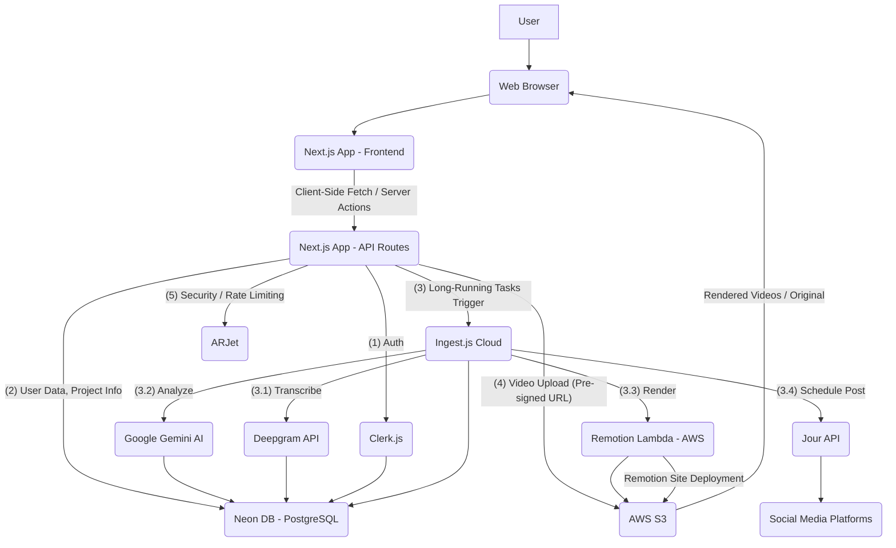
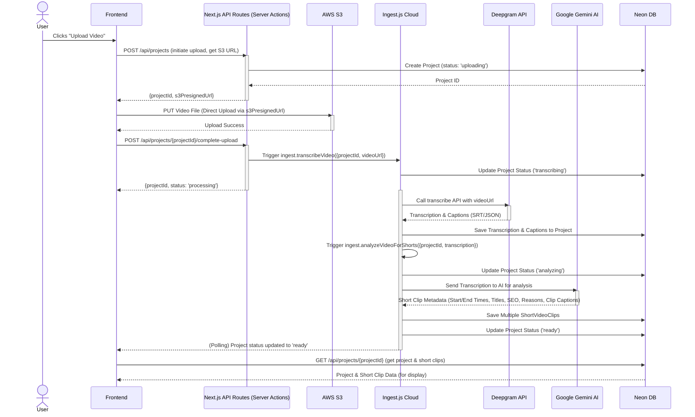
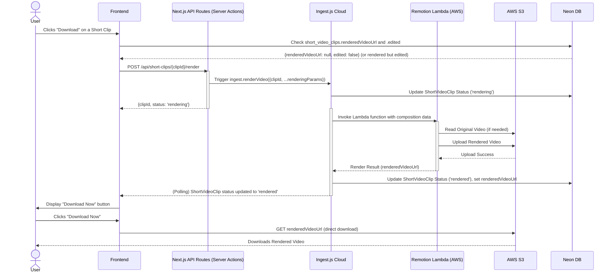
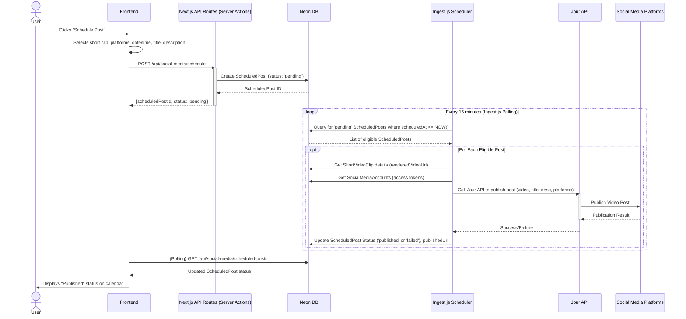

# Technical Requirements Document: VidShort - AI-Powered Long Video to Short Video Generator

**Document Version:** 1.0
**Date:** October 26, 2023
**Prepared By:** Senior Software Architect / Technical Product Manager

---

## 1. Introduction

This document outlines the technical architecture, design, and implementation details for VidShort, an AI-powered full-stack SaaS application designed to transform long-form videos into viral short-form content. The application automates the process of identifying high-engagement moments, cutting clips, generating captions, editing styles, rendering videos, and scheduling posts to multiple social media platforms through a single API endpoint.

## 2. System Architecture

VidShort adopts a modern, serverless-first architecture leveraging Next.js for its full-stack capabilities, AWS for cloud infrastructure, and specialized third-party services for AI, video processing, and social media integration.

### 2.1. High-Level Architecture

The system consists of a Next.js application acting as both the frontend and API gateway, a serverless PostgreSQL database (Neon), object storage (AWS S3), and a robust workflow orchestration system (Ingest.js) for long-running video processing tasks. Dedicated services handle authentication (Clerk), social media publishing (Jour), and security (ARJet). Video rendering is offloaded to AWS Lambda using Remotion.



### 2.2. Component Diagram

```mermaid
graph TD
    subgraph Frontend
        FE[Next.js App (Client Components)]
        FE --> UI[Shadcn UI]
        FE --> RT[Remotion Player]
    end

    subgraph Backend & APIs
        API[Next.js App (API Routes / Server Actions)]
        API --> CL[Clerk.js SDK]
        API --> ARJ[ARJet SDK]
        API --> DRIZ[Drizzle ORM]
    end

    subgraph Workflow & Processing
        INGEST[Ingest.js Workflow Engine]
        INGEST --> DG[Deepgram API (Transcription)]
        INGEST --> GEMA[Google Gemini API (AI Analysis)]
        INGEST --> REMLAM[Remotion Lambda (Video Rendering)]
        INGEST --> JOUR[Jour API (Social Media)]
    end

    subgraph Data & Storage
        NEON[Neon PostgreSQL Database]
        S3[AWS S3 (Video Storage)]
    end

    subgraph Security
        ARJ_SVC[ARJet Service]
    end

    subgraph External Services
        SM[Social Media Platforms]
    end

    User --> FE
    FE <--> API
    API <--> CL
    API <--> ARJ
    API <--> DRIZ
    API --> INGEST
    API --> S3
    INGEST --> DG
    INGEST --> GEMA
    INGEST --> REMLAM
    INGEST --> JOUR
    REMLAM --> S3
    ARJ --> ARJ_SVC
    CL --> NEON
    DRIZ --> NEON
    DG --> NEON
    GEMA --> NEON
    JOUR --> SM
    INGEST <--> NEON
    S3 <--> RT
    S3 <--> SM
```

## 3. Tech Stack

| Category        | Technology                                     | Version / Details                                                                     |
| :-------------- | :--------------------------------------------- | :------------------------------------------------------------------------------------ |
| **Frontend**    | Next.js                                        | v16+ (App Router, Client Components)                                                  |
|                 | React                                          | v19+                                                                                  |
|                 | TypeScript                                     | Latest                                                                                |
|                 | Tailwind CSS                                   | v4 (Utility-first CSS)                                                                |
|                 | Shadcn UI                                      | Component Library (built on Radix UI, Tailwind CSS)                                   |
|                 | Remotion Player                                | Programmatic video playback on client                                                 |
| **Backend**     | Next.js                                        | v16+ (API Routes, Server Actions)                                                     |
|                 | Node.js                                        | Latest LTS                                                                            |
|                 | Drizzle ORM                                    | Type-safe ORM for PostgreSQL                                                          |
|                 | Ingest.js                                      | Workflow engine for long-running background jobs, step functions, retries             |
| **Database**    | Neon                                           | Serverless PostgreSQL                                                                 |
| **Cloud**       | AWS S3                                         | Object storage for raw & rendered videos, Remotion site                               |
|                 | AWS Lambda                                     | Serverless compute for Remotion Lambda rendering                                      |
| **AI/ML**       | Deepgram API                                   | AI-powered speech-to-text transcription, caption generation                           |
|                 | Google Gemini AI                               | AI model for high-engagement moment detection, content analysis, short clip metadata  |
| **Authentication** | Clerk.js                                     | User authentication, session management, social sign-ons, UI components             |
| **Security**    | ARJet                                          | API security, bot protection, rate limiting, prompt injection detection               |
| **Social Media** | Jour API                                       | Unified social media API for posting & scheduling across platforms                    |
| **Video Tools** | Remotion                                       | Programmatic video creation, editing, rendering                                       |
|                 | Remotion Lambda                                | Cloud-based video rendering for Remotion compositions                                 |
| **Development** | Google Anti-Gravity / VS Code with AI agents   | IDE / Development environment (not part of production stack)                          |
|                 | `npx drizzle-kit`                              | Database migration CLI                                                                |
|                 | `npx ingest dev`                               | Local Ingest.js development server                                                    |
|                 | `npx remotion lambda deploy`, `npx remotion deploy` | Remotion deployment CLI                                                               |

## 4. Folder Structure

The project follows a standard Next.js App Router structure, extended for specific services and components.

```
.
├── app/
│   ├── (auth)/
│   │   ├── sign-in/
│   │   │   └── page.tsx      // Clerk sign-in page
│   │   └── sign-up/
│   │       └── page.tsx      // Clerk sign-up page
│   ├── (dashboard)/
│   │   ├── dashboard/
│   │   │   ├── page.tsx      // Dashboard home with video upload UI
│   │   │   ├── project/[projectId]/
│   │   │   │   └── page.tsx  // Project detail page, short clip display
│   │   │   └── layout.tsx    // Dashboard layout with sidebar
│   │   ├── my-videos/
│   │   │   └── page.tsx
│   │   ├── schedule-post/
│   │   │   └── page.tsx      // Calendar for scheduling posts
│   │   └── pricing/
│   │       └── page.tsx
│   ├── api/
│   │   ├── ingest/
│   │   │   └── route.ts      // Ingest.js webhook/trigger
│   │   ├── social-media/
│   │   │   └── connect/route.ts
│   │   │   └── callback/route.ts
│   │   └── ...               // Other API routes (e.g., user, upload-initiate)
│   ├── globals.css           // Global Tailwind CSS imports
│   ├── layout.tsx            // Root layout, ClerkProvider, Metadata
│   └── page.tsx              // Landing page (vidshot)
├── components/
│   ├── ui/                   // Shadcn UI components (button, dialog, card, etc.)
│   │   └── ...
│   ├── auth/
│   │   └── clerk-provider.tsx // Clerk integration component
│   ├── dashboard/
│   │   ├── sidebar.tsx
│   │   └── header.tsx
│   ├── project/
│   │   ├── video-upload-card.tsx
│   │   ├── short-clip-card.tsx
│   │   ├── edit-caption-dialog.tsx
│   │   └── ...
│   └── common/
│       └── progress-bar.tsx
│       └── ...
├── config/
│   ├── gemini.ts             // Gemini AI configuration
│   ├── remotion.ts           // Remotion Lambda/Site configuration (AWS keys, bucket, function name)
│   ├── arjet.ts              // ARJet security configuration (rate limits, clients)
│   └── constants.ts          // General application constants (e.g., SHORT_VIDEO_COUNT)
├── drizzle/
│   ├── meta/                 // Drizzle migration metadata
│   └── migrations/           // Drizzle migration files
├── ingest/
│   └── functions.ts          // Ingest.js workflow functions (upload, transcribe, analyze, render, schedule)
├── lib/
│   ├── db/                   // Drizzle ORM connection, schema import
│   │   └── drizzle.ts
│   │   └── schema.ts
│   ├── utils.ts              // General utility functions
│   └── aws/
│       └── s3.ts             // AWS S3 client & upload logic
├── middleware.ts             // Next.js middleware for authentication and ARJet protection
├── public/                   // Static assets (images, fonts)
│   └── ...
├── remotion/                 // Remotion root composition for rendering
│   ├── Composition.tsx       // Main Remotion video composition
│   ├── index.ts              // Remotion root entry file
│   └── styles/
│       └── caption-styles.ts   // Defines various caption styles for Remotion
├── .env                      // Environment variables (local)
├── .env.example              // Example environment variables
├── package.json              // Project dependencies and scripts
├── next.config.ts            // Next.js configuration (e.g., server actions body size limit)
├── tsconfig.json             // TypeScript configuration
└── agent.md                  // AI Agent instructions (development only)
```

## 5. Database Design

The database schema is designed to support user management, project lifecycle, short video clip metadata, customization, and social media scheduling. Neon (PostgreSQL) is used with Drizzle ORM for type safety and migrations.

### 5.1. Entities and Relationships

**Key:**
*   `PK`: Primary Key
*   `FK`: Foreign Key
*   `(A)`: Assumption

### `users` Table

*   Stores user profile information, synchronized with Clerk.
*   **Table Name:** `users`
*   **Columns:**
    *   `id` (VARCHAR(255) PK): Clerk user ID.
    *   `name` (VARCHAR(255)): User's display name.
    *   `email` (VARCHAR(255) UNIQUE): User's primary email address.
    *   `imageUrl` (VARCHAR(255) (A)): URL to user's profile image.
    *   `subscription` (VARCHAR(50) DEFAULT 'free' (A)): User's subscription plan (e.g., 'free', 'pro').
    *   `createdAt` (TIMESTAMP DEFAULT NOW()): Timestamp of user creation.
    *   `updatedAt` (TIMESTAMP DEFAULT NOW()): Timestamp of last update.

### `projects` Table

*   Represents a long video uploaded by a user and its processing status.
*   **Table Name:** `projects`
*   **Columns:**
    *   `id` (VARCHAR(255) PK): Unique project ID.
    *   `userId` (VARCHAR(255) FK `users.id`): ID of the user who owns the project.
    *   `originalVideoUrl` (VARCHAR(2048)): S3 URL of the original long video.
    *   `title` (VARCHAR(255) (A)): Title of the project (e.g., derived from filename or user input).
    *   `status` (VARCHAR(50) DEFAULT 'uploaded'): Current processing status (e.g., 'uploaded', 'transcribing', 'analyzing', 'ready', 'failed').
    *   `transcription` (TEXT): Full transcription of the video content (from Deepgram).
    *   `captionsJson` (JSONB (A)): SRT/VTT formatted captions as JSON (from Deepgram).
    *   `thumbnailUrl` (VARCHAR(2048) (A)): URL to a thumbnail of the original video.
    *   `createdAt` (TIMESTAMP DEFAULT NOW()): Timestamp of project creation.
    *   `updatedAt` (TIMESTAMP DEFAULT NOW()): Timestamp of last update.

### `short_video_clips` Table

*   Stores metadata and status for each generated short video clip from a project.
*   **Table Name:** `short_video_clips`
*   **Columns:**
    *   `id` (VARCHAR(255) PK): Unique ID for the short video clip.
    *   `projectId` (VARCHAR(255) FK `projects.id`): ID of the parent project.
    *   `title` (VARCHAR(255)): AI-generated title for the clip.
    *   `description` (TEXT (A)): AI-generated description for the clip.
    *   `startTimeSeconds` (INTEGER): Start time of the clip in seconds.
    *   `endTimeSeconds` (INTEGER): End time of the clip in seconds.
    *   `seoScore` (INTEGER): AI-generated SEO score (0-100).
    *   `reason` (TEXT): AI-generated reason why this is a high-engagement clip.
    *   `clipCaptionsJson` (JSONB (A)): Captions specific to this short clip (from Deepgram, filtered by start/end time).
    *   `status` (VARCHAR(50) DEFAULT 'pending'): Rendering status ('pending', 'rendering', 'rendered', 'failed').
    *   `renderedVideoUrl` (VARCHAR(2048) NULL): S3 URL of the final rendered short video.
    *   `captionStyleId` (VARCHAR(255) FK `caption_styles.id` (A)): Selected caption style for this clip.
    *   `edited` (BOOLEAN DEFAULT FALSE (A)): Flag indicating if the clip's style was edited after rendering.
    *   `createdAt` (TIMESTAMP DEFAULT NOW()): Timestamp of clip creation.
    *   `updatedAt` (TIMESTAMP DEFAULT NOW()): Timestamp of last update.

### `caption_styles` Table (Assumption)

*   Stores predefined and custom caption styles.
*   **Table Name:** `caption_styles`
*   **Columns:**
    *   `id` (VARCHAR(255) PK): Unique style ID.
    *   `name` (VARCHAR(255) UNIQUE): Display name for the style (e.g., 'Modern', 'Bold Yellow').
    *   `styleProperties` (JSONB (A)): JSON object defining CSS-like properties (font, color, background, highlight, position, max words, etc.).
    *   `isDefault` (BOOLEAN DEFAULT FALSE (A)): Flag for default styles.
    *   `userId` (VARCHAR(255) FK `users.id` NULL (A)): User ID if it's a custom style.

### `social_media_accounts` Table (Assumption)

*   Stores connections to various social media platforms.
*   **Table Name:** `social_media_accounts`
*   **Columns:**
    *   `id` (VARCHAR(255) PK): Unique account ID.
    *   `userId` (VARCHAR(255) FK `users.id`): User who owns this connection.
    *   `platform` (VARCHAR(50)): e.g., 'YouTube', 'TikTok', 'Instagram', 'Facebook'.
    *   `platformAccountId` (VARCHAR(255)): Unique ID from the social media platform.
    *   `platformAccountName` (VARCHAR(255) (A)): User-friendly name for the connected account.
    *   `accessToken` (VARCHAR(2048) ENCRYPTED (A)): OAuth access token.
    *   `refreshToken` (VARCHAR(2048) ENCRYPTED (A)): OAuth refresh token.
    *   `expiresAt` (TIMESTAMP (A)): Token expiration time.
    *   `createdAt` (TIMESTAMP DEFAULT NOW()): Timestamp of connection.
    *   `updatedAt` (TIMESTAMP DEFAULT NOW()): Timestamp of last update.

### `scheduled_posts` Table (Assumption)

*   Stores details of short video clips scheduled for social media posting.
*   **Table Name:** `scheduled_posts`
*   **Columns:**
    *   `id` (VARCHAR(255) PK): Unique schedule ID.
    *   `shortVideoClipId` (VARCHAR(255) FK `short_video_clips.id`): The short clip to be posted.
    *   `userId` (VARCHAR(255) FK `users.id`): User who scheduled the post.
    *   `socialMediaAccountIds` (VARCHAR(255)[] (A)): Array of IDs from `social_media_accounts` to post to.
    *   `title` (VARCHAR(255)): Post title (AI-generated, editable).
    *   `description` (TEXT): Post description (AI-generated, editable).
    *   `scheduledAt` (TIMESTAMP): Desired publication date/time.
    *   `status` (VARCHAR(50) DEFAULT 'pending'): Posting status ('pending', 'publishing', 'published', 'failed').
    *   `publishedUrl` (VARCHAR(2048) NULL (A)): URL of the published post on social media.
    *   `createdAt` (TIMESTAMP DEFAULT NOW()): Timestamp of scheduling.
    *   `updatedAt` (TIMESTAMP DEFAULT NOW()): Timestamp of last update.

## 6. API Design

API endpoints primarily use Next.js API Routes and Server Actions. Ingest.js functions act as internal "API" endpoints for long-running processes triggered by the main application.

### 6.1. Authentication & User Management

*   **`POST /api/webhooks/clerk`** (Clerk Webhook - Assumption)
    *   **Description**: Receives user events from Clerk (e.g., user created, user updated) to synchronize `users` table.
    *   **Request**: Clerk webhook payload.
    *   **Response**: `200 OK`.
*   **`POST /api/user/sync`** (Server Action)
    *   **Description**: Checks if a logged-in user exists in `users` table; if not, creates a new entry. Triggered on successful Clerk sign-in.
    *   **Request**: `userId` (from Clerk context).
    *   **Response**: `200 OK` or `201 Created`.

### 6.2. Video Upload & Project Management

*   **`POST /api/projects`** (Server Action)
    *   **Description**: Creates a new project entry in the DB and returns a pre-signed S3 URL for direct video upload.
    *   **Request**: `fileName`, `fileType`, `fileSize`.
    *   **Response**: `{ projectId, uploadUrl }`.
*   **`PUT {uploadUrl}`** (Direct to AWS S3)
    *   **Description**: Client uploads video file directly to AWS S3 using the pre-signed URL.
    *   **Request**: Raw video file.
    *   **Response**: S3 upload success/failure.
*   **`POST /api/projects/{projectId}/complete-upload`** (Server Action)
    *   **Description**: Notifies backend that video upload to S3 is complete and triggers the Ingest.js workflow for processing.
    *   **Request**: `s3Key`.
    *   **Response**: `{ projectId, status: 'processing' }`.
*   **`GET /api/projects/{projectId}`** (Server Action)
    *   **Description**: Retrieves details for a specific project, including its short clips.
    *   **Response**: `{ project: {...}, shortClips: [...] }`.
*   **`GET /api/projects`** (Server Action)
    *   **Description**: Retrieves a list of all projects for the authenticated user.
    *   **Response**: `{ projects: [...] }`.

### 6.3. Short Clip Management

*   **`GET /api/short-clips/{clipId}`** (Server Action)
    *   **Description**: Retrieves details for a specific short video clip.
    *   **Response**: `{ shortClip: {...} }`.
*   **`PUT /api/short-clips/{clipId}/caption-style`** (Server Action)
    *   **Description**: Updates the caption style for a specific short clip and marks it as `edited=TRUE` (requiring re-render).
    *   **Request**: `captionStyleId`.
    *   **Response**: `{ shortClipId, status: 'pending_render' }`.
*   **`POST /api/short-clips/{clipId}/render`** (Server Action)
    *   **Description**: Triggers the Ingest.js workflow to render a specific short clip.
    *   **Request**: None.
    *   **Response**: `{ shortClipId, status: 'rendering' }`.

### 6.4. Social Media Integration

*   **`GET /api/social-media/connect`** (Server Action)
    *   **Description**: Redirects to Jour's OAuth initiation URL for connecting a new social media account.
    *   **Response**: `302 Redirect`.
*   **`GET /api/social-media/callback`** (API Route)
    *   **Description**: Handles the callback from Jour after a user grants OAuth permissions. Stores `SocialMediaAccount` details in DB.
    *   **Request**: OAuth `code` and `state`.
    *   **Response**: `302 Redirect` to dashboard or success page.
*   **`GET /api/social-media/accounts`** (Server Action)
    *   **Description**: Retrieves a list of connected social media accounts for the user.
    *   **Response**: `{ accounts: [...] }`.
*   **`POST /api/social-media/schedule`** (Server Action)
    *   **Description**: Schedules a short video clip to be posted to selected social media accounts at a specified time. Triggers Ingest.js workflow.
    *   **Request**: `shortVideoClipId`, `socialMediaAccountIds`, `title`, `description`, `scheduledAt`.
    *   **Response**: `{ scheduledPostId, status: 'pending' }`.
*   **`GET /api/social-media/scheduled-posts`** (Server Action)
    *   **Description**: Retrieves a calendar-view of upcoming and past scheduled posts.
    *   **Response**: `{ scheduledPosts: [...] }`.

### 6.5. Ingest.js Workflow Functions (Internal)

These are long-running background jobs, conceptually "API endpoints" for the Ingest.js engine.

*   **`ingest.transcribeVideo`**
    *   **Trigger**: Called by `POST /api/projects/{projectId}/complete-upload`.
    *   **Input**: `projectId`, `videoUrl`.
    *   **Action**: Calls Deepgram API for transcription and caption generation. Updates `projects` table with `transcription` and `captionsJson`.
    *   **Next Step**: `ingest.analyzeVideoForShorts`.
*   **`ingest.analyzeVideoForShorts`**
    *   **Trigger**: Called by `ingest.transcribeVideo` on completion.
    *   **Input**: `projectId`, `transcription`.
    *   **Action**: Calls Google Gemini AI to identify high-engagement moments, generate start/end times, titles, descriptions, SEO scores, and specific captions for multiple short clips. Saves `short_video_clips` to DB.
    *   **Output**: Multiple `short_video_clips` entries.
    *   **Next Step**: Updates `projects` status to 'ready'.
*   **`ingest.renderVideo`**
    *   **Trigger**: Called by `POST /api/short-clips/{clipId}/render`.
    *   **Input**: `shortVideoClipId`, `originalVideoUrl`, `startTimeSeconds`, `endTimeSeconds`, `clipCaptionsJson`, `captionStyleId`.
    *   **Action**: Invokes Remotion Lambda function with video composition details. Polls Lambda for render progress.
    *   **Output**: `renderedVideoUrl` on AWS S3. Updates `short_video_clips` table.
*   **`ingest.scheduleSocialMediaPost`**
    *   **Trigger**: Periodically runs (e.g., every 15 minutes) or is triggered by `POST /api/social-media/schedule`.
    *   **Input**: `scheduledPostId`.
    *   **Action**: Fetches `renderedVideoUrl` and post details. Calls Jour API to publish the video to selected social media accounts.
    *   **Output**: Updates `scheduled_posts` table with 'published' status and `publishedUrl`.

## 7. Authentication Flow

VidShort utilizes Clerk.js for robust and user-friendly authentication.

1.  **User Interface**: Clerk's pre-built UI components (`<SignIn>`, `<SignUp>`) are integrated into the `/sign-in` and `/sign-up` pages.
2.  **Sign-up/Sign-in**:
    *   Users can register or log in using email/password, magic link, or various social providers (Google, GitHub, etc., configurable in Clerk dashboard).
    *   Clerk handles the entire authentication lifecycle, including MFA, session management, and JWTs.
3.  **Middleware Protection**:
    *   Next.js `middleware.ts` is configured to protect routes (e.g., `/dashboard`, `/api/*`) requiring authentication.
    *   Clerk's `authMiddleware` checks for an active session.
4.  **User Synchronization (on first login)**:
    *   Upon successful authentication, the application checks the `users` table.
    *   If the Clerk user ID is not found, a new `user` record is created in the Neon database with basic profile information from Clerk (ID, name, email, image URL). This ensures our database is populated for application-specific data.
5.  **Session Management**:
    *   Clerk manages user sessions, automatically refreshing tokens and maintaining authentication state across the application.
6.  **Authorization**:
    *   Clerk provides user roles and metadata, which can be extended to implement role-based access control (RBAC) for different subscription tiers or features. (Assumption: `subscription` column in `users` table can be used for this).

## 8. State Management

Client-side state management is handled using a combination of React's built-in hooks and potentially a lightweight global state solution.

*   **Local Component State**: `useState` and `useReducer` for managing UI-specific state (e.g., form inputs, modal visibility, current selection).
*   **Global Application State (Assumption)**: For widely accessed data such as current user information, notifications, and application-wide settings, React Context API or a library like Zustand/Jotai can be used.
*   **Server State**: Next.js Server Actions and data fetching mechanisms (e.g., `fetch` with caching) are used to manage data received from the backend. React Query or SWR could be introduced for more advanced caching, revalidation, and loading state management, but the transcript doesn't explicitly mention it.
*   **Progress Tracking**: For long-running operations (video upload, transcription, rendering), a polling mechanism updates the UI with real-time progress indicators. This state is often local to the component displaying the progress or managed through a specific context.

## 9. Scalability Considerations

VidShort is designed with scalability in mind, leveraging serverless and cloud-native technologies.

*   **Serverless Architecture**: Next.js API Routes, AWS Lambda (Remotion), and Neon PostgreSQL automatically scale based on demand, eliminating the need for manual server provisioning.
*   **Asynchronous Processing with Ingest.js**: Decoupling long-running tasks from the main request/response cycle using Ingest.js prevents bottlenecks. Ingest.js handles task orchestration, retries, and parallel execution, ensuring that the core API remains responsive.
*   **AWS S3**: Provides highly scalable and durable object storage for both raw and processed video files.
*   **Remotion Lambda Concurrency**: For video rendering, AWS Lambda concurrency limits are crucial. The default quota (10) should be increased to accommodate higher rendering volumes (e.g., 1000 or more) as the user base grows.
*   **Rate Limiting with ARJet**: ARJet's rate limiting capabilities (e.g., "2 videos per user per day") prevent abuse and ensure fair resource distribution, protecting backend services from overload.
*   **External API Limits**: Integrations with Deepgram, Gemini, and Jour are subject to their respective API rate limits. The Ingest.js retry mechanism helps handle transient errors due to rate limits or network issues.
*   **CDN**: Vercel's global CDN for Next.js deployments ensures low latency for static assets and API responses worldwide.

## 10. Security Architecture

Security is a primary concern, implemented across multiple layers of the application.

*   **Authentication & Authorization (Clerk.js)**:
    *   Industry-standard authentication methods (OAuth, email/password, MFA).
    *   Secure session management and JWT handling.
    *   `middleware.ts` for route protection based on authentication status.
    *   User data synchronization with Clerk webhooks ensures consistent user states.
*   **API Security (ARJet)**:
    *   **Endpoint Abuse Prevention**: Protects API routes from malicious or excessive calls.
    *   **Bot Protection**: Detects and blocks automated bot traffic.
    *   **Prompt Injection Detection**: Critical for AI-driven features using Gemini, preventing malicious prompts that try to extract sensitive data or manipulate AI behavior.
    *   **Rate Limiting**: Configured to limit user actions (e.g., 2 video uploads/generations per user per day, tracked by Clerk User ID).
*   **Data Security**:
    *   **Environment Variables**: All sensitive API keys and credentials (`CLERK_SECRET_KEY`, `AWS_SECRET_ACCESS_KEY`, `DEEPGRAM_API_KEY`, `GEMINI_API_KEY`, `ARJET_API_KEY`, `JOUR_API_KEY`, `DATABASE_URL`) are stored as environment variables and kept out of client-side bundles (unless explicitly `NEXT_PUBLIC_`).
    *   **AWS S3 Bucket Policies**: Configured for private storage of original videos. Pre-signed URLs are used for temporary, secure client-side uploads and limited public access for video playback. CORS policies are correctly configured.
    *   **Database Security**: Neon provides robust security for PostgreSQL instances, including encryption at rest and in transit. Drizzle ORM helps prevent SQL injection vulnerabilities.
    *   **Encryption**: Sensitive data in the database (e.g., social media access tokens in `social_media_accounts`) should be encrypted at rest. (Assumption)
*   **Network Security**:
    *   All communication within the application and with third-party services uses HTTPS/SSL/TLS.
*   **Code Security**:
    *   TypeScript helps catch type-related errors at compile time.
    *   Regular dependency updates to patch known vulnerabilities.

## 11. Deployment Strategy

The deployment strategy leverages Vercel for the Next.js application, Ingest.js Cloud for workflows, and AWS for Remotion components.

*   **Next.js Application (Frontend & API)**:
    *   **Platform**: Vercel.
    *   **Process**: Integrated with a Git repository (e.g., GitHub). Automatic deployments triggered on pushes to the `main` or `master` branch.
    *   **Benefits**: Serverless functions, global CDN, automatic scaling, easy environment management.
*   **Ingest.js Workflows**:
    *   **Platform**: Ingest.js Cloud.
    *   **Process**: Ingest.js functions defined in `ingest/functions.ts` are deployed to the Ingest.js Cloud. This can be integrated into CI/CD or deployed via `ingest deploy` command.
    *   **Benefits**: Handles background jobs, retries, and workflow orchestration off-server.
*   **Remotion Lambda Functions (Video Rendering)**:
    *   **Platform**: AWS Lambda.
    *   **Process**: Deployed using `npx remotion lambda deploy`. This command packages the Remotion composition and deploys it as a Lambda function in a specified AWS region. IAM roles and policies are pre-configured.
    *   **Benefits**: Serverless, scalable video rendering.
*   **Remotion Site (Rendering Environment for Lambda)**:
    *   **Platform**: AWS S3/CloudFront (via Remotion CLI).
    *   **Process**: Deployed using `npx remotion deploy`. This builds a static website containing the Remotion compositions and uploads it to an S3 bucket, typically fronted by CloudFront for global delivery. The Remotion Lambda function uses this deployed site as its rendering environment.
    *   **Benefits**: Efficient distribution of rendering assets to Lambda workers.
*   **Database Migrations**:
    *   **Tool**: Drizzle Kit.
    *   **Process**: `npx drizzle-kit push` command is used to apply schema changes to the Neon PostgreSQL database. This can be run manually during development or integrated into a CI/CD pipeline for automated deployments (carefully, with backup strategies).

## 12. Caching Strategy

Caching is implemented at various levels to enhance performance and reduce latency.

*   **CDN (Vercel/AWS CloudFront)**:
    *   **Assets**: Static assets (images, CSS, JavaScript bundles) served from Vercel's global CDN or AWS CloudFront for Remotion site.
    *   **Next.js Data Caching**: Next.js provides built-in data caching mechanisms, including fetch caching, memoization for Server Components, and Incremental Static Regeneration (ISR) for landing pages.
*   **Browser Cache**:
    *   Frontend assets leverage browser caching with appropriate HTTP headers (Cache-Control).
*   **Application-Level Caching**:
    *   **Rendered Videos**: Once a video is rendered by Remotion Lambda, its output URL is stored in `short_video_clips.renderedVideoUrl`. Subsequent download requests directly retrieve the video from AWS S3, bypassing the rendering process.
    *   **Transcription/Analysis Results**: Deepgram transcription and Gemini AI analysis results are stored in the `projects` and `short_video_clips` tables. This prevents redundant API calls and processing for the same content.
*   **Database Caching**:
    *   Neon PostgreSQL performs internal query optimizations and caching. Drizzle ORM can be used with a query caching layer if needed, though for a serverless setup, often the database itself handles this efficiently.

## 13. Queue/Worker Systems

Ingest.js serves as the primary queue and worker system, orchestrating all long-running and asynchronous tasks.

*   **Ingest.js Core Role**:
    *   **Workflow Definition**: Complex, multi-step processes like video upload -> transcribe -> analyze -> render -> schedule are defined as Ingest.js functions.
    *   **Asynchronous Execution**: All heavy computation (Deepgram, Gemini, Remotion Lambda, Jour API calls) is offloaded to Ingest.js. This frees up the Next.js API routes, keeping the user interface responsive.
    *   **Reliability**: Ingest.js includes built-in retry mechanisms (3 retries mentioned in the transcript) for transient failures, ensuring tasks eventually complete.
    *   **Progress Tracking**: Ingest.js provides real-time status updates for workflow steps, which the frontend polls to display progress bars to the user.
    *   **Concurrency Control**: Manages the concurrent execution of tasks to prevent system overload.
    *   **Scheduling**: Ingest.js is used to trigger social media posts at scheduled times (e.g., hourly checks for pending posts).
*   **AWS Lambda (Remotion Lambda)**:
    *   **Dedicated Worker**: Functions as a specialized worker for computationally intensive video rendering tasks.
    *   **Trigger**: Invoked by the `ingest.renderVideo` function with specific Remotion composition parameters.
    *   **Benefits**: Highly scalable, cost-effective for burstable workloads.

## 14. Error Handling

A comprehensive error handling strategy is implemented across the stack to ensure system stability and user experience.

*   **Frontend Error Handling**:
    *   **User Feedback**: Display clear, user-friendly error messages using toast notifications (e.g., Shadcn's `useToast` hook) for API failures or client-side validation errors.
    *   **Error Boundaries**: React Error Boundaries are used to gracefully catch errors in UI components and prevent the entire application from crashing.
    *   **Loading/Error States**: Proper loading indicators and error states are managed in components during data fetching and long operations.
*   **Backend (Next.js API Routes/Server Actions)**:
    *   **HTTP Status Codes**: Return appropriate HTTP status codes (e.g., `400 Bad Request`, `401 Unauthorized`, `404 Not Found`, `500 Internal Server Error`).
    *   **Structured Error Responses**: API responses include a JSON body with a descriptive error message and potentially an error code for client-side handling.
    *   **Validation**: Input validation for all API requests to prevent invalid data from reaching core logic.
*   **Ingest.js Workflow Error Handling**:
    *   **Retries**: Ingest.js automatically retries failed steps (3 times mentioned) for transient errors, improving reliability without custom code.
    *   **Persistent State**: Workflow state is persisted, allowing recovery from failures and retries.
    *   **Failure Notification**: Workflows can be configured to send notifications (e.g., to Slack, email) upon persistent failures after retries are exhausted.
    *   **Status Updates**: The `projects` and `short_video_clips` tables (`status` column) are updated to reflect the outcome of processing steps, including 'failed'.
*   **Third-Party API Errors**:
    *   **Graceful Degradation**: If a third-party service fails, the system attempts to handle it gracefully (e.g., retry via Ingest.js, notify admin).
    *   **Circuit Breaker (Assumption)**: For critical external services, a circuit breaker pattern could be implemented to prevent cascading failures if the service is consistently unavailable.
*   **Remotion Lambda Errors**:
    *   Errors during video rendering are logged in AWS CloudWatch.
    *   The `ingest.renderVideo` function monitors Lambda status and updates the `short_video_clips.status` to 'failed' if rendering fails.

## 15. Logging & Monitoring

Robust logging and monitoring are essential for observing system health, performance, and user activity.

*   **Next.js Application (Vercel)**:
    *   **Vercel Logs**: Vercel provides built-in logging for Next.js serverless functions and server actions.
    *   **Custom Logging**: Use a logging library (e.g., Pino, Winston) to output structured logs (JSON) to standard output, which Vercel collects. These logs can be forwarded to a centralized logging service (e.g., Datadog, Sentry, AWS CloudWatch Logs).
*   **Ingest.js Workflows**:
    *   **Ingest.js Dashboard**: Provides a visual dashboard to monitor workflow executions, statuses, step-by-step logs, and performance metrics. This is critical for debugging background jobs.
*   **AWS Lambda (Remotion Lambda)**:
    *   **CloudWatch Logs**: All logs from Remotion Lambda functions are automatically sent to AWS CloudWatch Logs.
    *   **CloudWatch Metrics**: Monitor Lambda invocations, errors, duration, and throttles.
*   **Neon PostgreSQL**:
    *   **Neon Dashboard**: Provides database-specific metrics like connection count, query performance, and storage usage.
    *   **Drizzle ORM Logging**: Drizzle can be configured to log SQL queries for debugging and performance tuning.
*   **ARJet Dashboard**:
    *   Provides a dedicated dashboard for monitoring security events, including bot detections, prompt injection attempts, and rate limit enforcements. This allows for real-time threat intelligence and policy adjustments.
*   **Third-Party Service Dashboards**:
    *   Monitor usage, errors, and performance of Deepgram, Gemini, and Jour via their respective dashboards.
*   **Application Performance Monitoring (APM - Assumption)**:
    *   Integrate an APM tool (e.g., Sentry, New Relic, Datadog) to track end-to-end transaction traces, identify performance bottlenecks, and monitor user experience.
*   **Alerting**:
    *   Configure alerts (e.g., PagerDuty, Slack, email) for critical events like API errors, workflow failures, security incidents (from ARJet), and high latency.

## 16. Performance Optimization

Optimizing performance is crucial for a smooth user experience, especially with video processing.

*   **Frontend Optimizations**:
    *   **Next.js Image Optimization**: Use `next/image` for automatic image optimization, lazy loading, and responsive images.
    *   **Code Splitting & Lazy Loading**: Next.js automatically splits JavaScript bundles. Lazy load non-critical components or modules using `React.lazy()` and `Suspense`.
    *   **UI Library**: Shadcn UI provides highly optimized and accessible UI components.
    *   **Efficient Video Playback**: Remotion Player is optimized for programmatic video playback, playing only the necessary segment of the full video URL to save bandwidth.
*   **Video Upload Optimization**:
    *   **Direct-to-S3 Uploads**: Using pre-signed URLs, clients upload video files directly to AWS S3. This offloads the Next.js server, improving API responsiveness and scalability.
*   **Asynchronous Processing**:
    *   **Ingest.js for Background Tasks**: All long-running, CPU-intensive tasks (transcription, AI analysis, rendering, social media posting) are executed asynchronously by Ingest.js, preventing the frontend or API from blocking.
*   **Video Rendering Optimization**:
    *   **Remotion Lambda**: Leveraging AWS Lambda for video rendering ensures fast, parallelizable, and scalable processing. Remotion itself is optimized for programmatic video creation.
    *   **Smart Rendering/Caching**: Rendered videos are cached in S3. If a clip's style is edited, it triggers a re-render; otherwise, subsequent downloads are instant.
*   **Database Optimization**:
    *   **Indexing**: Properly index frequently queried columns (e.g., `userId`, `projectId`, `status`, `scheduledAt`).
    *   **Efficient Queries**: Use Drizzle ORM to generate optimized SQL queries.
*   **Resource Management**:
    *   **Garbage Collection**: Implement a policy for cleaning up old or unused data (e.g., raw videos after a retention period, old project data).

## 17. CI/CD Flow

A robust CI/CD pipeline ensures consistent, automated, and reliable deployments.

1.  **Code Repository**:
    *   **Platform**: GitHub (or similar Git hosting service).
    *   **Branches**: `main` (production), `develop` (staging/integration), feature branches.
2.  **Continuous Integration (CI)**:
    *   **Trigger**: Pushes to `develop` or feature branches.
    *   **Steps**:
        *   **Linting**: ESLint, Prettier for code style and quality.
        *   **Type Checking**: TypeScript compilation.
        *   **Unit/Integration Tests**: Run `jest`, `react-testing-library` tests.
        *   **Build**: `next build` to verify the application builds successfully.
        *   **Drizzle Schema Check**: `drizzle-kit check` to validate schema against database.
        *   **Ingest.js Lint/Build**: Verify Ingest functions.
        *   **Remotion Build**: `remotion render` (dry run) or `remotion build` to ensure compositions are valid.
3.  **Continuous Delivery (CD)**:
    *   **Staging Environment (on `develop` branch merge)**:
        *   **Next.js Deployment**: Automatically deploy to a Vercel staging environment.
        *   **Ingest.js Deployment**: Deploy Ingest functions to a staging Ingest.js Cloud environment.
        *   **Remotion Lambda/Site Deployment**: Deploy Remotion Lambda and Site to staging AWS environment.
        *   **Database Migrations**: Apply Drizzle migrations to staging Neon DB.
        *   **Automated E2E Tests**: Run Cypress/Playwright tests against the staging environment.
    *   **Production Environment (on `main` branch merge)**:
        *   **Manual Approval**: Requires manual approval for deployment to production.
        *   **Next.js Deployment**: Deploy to Vercel production.
        *   **Ingest.js Deployment**: Deploy Ingest functions to production Ingest.js Cloud.
        *   **Remotion Lambda/Site Deployment**: Deploy Remotion Lambda and Site to production AWS.
        *   **Database Migrations**: Carefully apply Drizzle migrations to production Neon DB (with backups).
        *   **Post-Deployment Checks**: Health checks, smoke tests.

## 18. Infrastructure Design

Leverages a serverless-first approach on AWS and specialized platforms.

*   **Compute**:
    *   **Next.js Backend/Frontend**: Vercel (serverless functions, global CDN).
    *   **Video Rendering**: AWS Lambda (managed by Remotion Lambda).
    *   **Workflow Engine**: Ingest.js Cloud.
*   **Storage**:
    *   **Raw & Rendered Videos, Remotion Site**: AWS S3 buckets (separate buckets for raw, rendered, and Remotion site for better organization and policy management).
*   **Database**:
    *   **Primary Database**: Neon PostgreSQL (serverless, scalable, managed).
*   **Networking**:
    *   **Global CDN**: Vercel's CDN for Next.js. AWS CloudFront for S3 assets (Remotion site, potentially rendered videos).
    *   **DNS**: Custom domain configuration via Vercel for the main application, AWS Route 53 if needed for other services.
    *   **VPC (Assumption)**: AWS Lambda functions could operate within a Virtual Private Cloud (VPC) for enhanced security and connectivity to private resources (if the DB wasn't serverless public endpoint, for example).
*   **Security & Identity**:
    *   **IAM**: AWS Identity and Access Management for fine-grained control over AWS resources (S3 bucket policies, Lambda execution roles, user access keys).
    *   **Secrets Management**: Environment variables for sensitive keys, potentially AWS Secrets Manager or Vercel's environment variable management for production secrets.
*   **Monitoring & Logging**:
    *   AWS CloudWatch for Lambda and S3 logs. Vercel's built-in logging.

## 19. Third-Party Integrations

VidShort relies on several key third-party services to deliver its core functionality.

1.  **Clerk.js (Authentication)**
    *   **Purpose**: User authentication, authorization, and session management.
    *   **Integration**: Clerk SDK for Next.js, ClerkProvider, `<SignIn>`, `<SignUp>` components, `authMiddleware`, webhooks for user sync.
    *   **Key Features**: Social sign-on, MFA, custom UI, user management dashboard.

2.  **Deepgram API (Transcription & Captions)**
    *   **Purpose**: Convert speech in videos to text (transcription) and generate time-aligned captions.
    *   **Integration**: Deepgram SDK within `ingest.transcribeVideo` function.
    *   **Key Features**: High accuracy, language support, SRT/VTT output.

3.  **Google Gemini AI (AI Content Analysis)**
    *   **Purpose**: Analyze video transcriptions to identify high-engagement moments, generate clip metadata (start/end times, titles, descriptions, SEO scores, reasons).
    *   **Integration**: Gemini SDK within `ingest.analyzeVideoForShorts` function.
    *   **Key Features**: Generative AI for content understanding and summarization.

4.  **Jour API (Social Media Publishing)**
    *   **Purpose**: Unified API for connecting to multiple social media platforms and scheduling video posts.
    *   **Integration**: Jour SDK within `ingest.scheduleSocialMediaPost` function and API routes for OAuth connection.
    *   **Key Features**: One API for 15+ platforms, bypasses individual platform app review processes, unified scheduling.

5.  **ARJet (Security)**
    *   **Purpose**: Protect API endpoints, detect prompt injection, bot protection, and implement rate limiting.
    *   **Integration**: ARJet SDK in Next.js `middleware.ts` and within `ingest` functions for specific checks.
    *   **Key Features**: Real-time security insights, configurable policies, user-ID based rate limiting (e.g., 2 video uploads/day).

6.  **AWS S3 (Object Storage)**
    *   **Purpose**: Store raw long videos, rendered short videos, and Remotion site assets.
    *   **Integration**: AWS SDK for S3, pre-signed URLs for direct client uploads, configured bucket policies (CORS).

7.  **AWS Lambda (Remotion Lambda)**
    *   **Purpose**: Serverless execution environment for video rendering using Remotion compositions.
    *   **Integration**: `npx remotion lambda deploy` for deployment, invoked by `ingest.renderVideo` function.

8.  **Neon (PostgreSQL Database)**
    *   **Purpose**: Primary data store for all application-specific data.
    *   **Integration**: Drizzle ORM for database interaction, `npx drizzle-kit` for migrations.

## 20. Sequence Diagrams

### 20.1. Video Upload & AI Analysis Workflow

This diagram illustrates the full process from a user uploading a long video to the system generating short clip metadata using AI.



### 20.2. Short Video Rendering Workflow

This diagram outlines how a user requests to download a short video, triggering a cloud rendering process.



### 20.3. Social Media Scheduling Workflow

This diagram describes the process of a user scheduling a short video post to social media.

