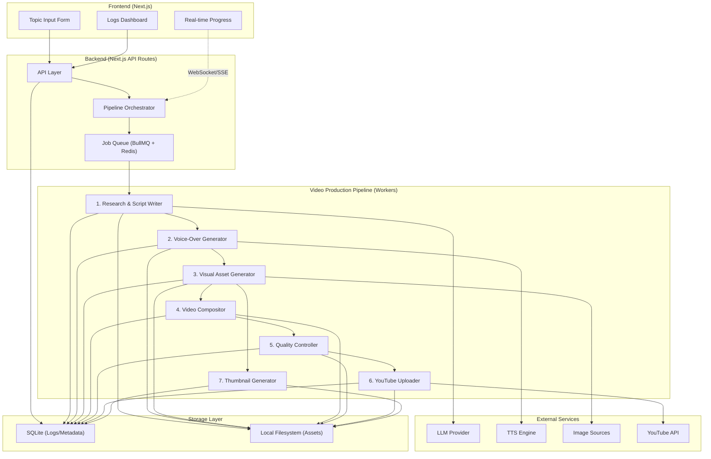
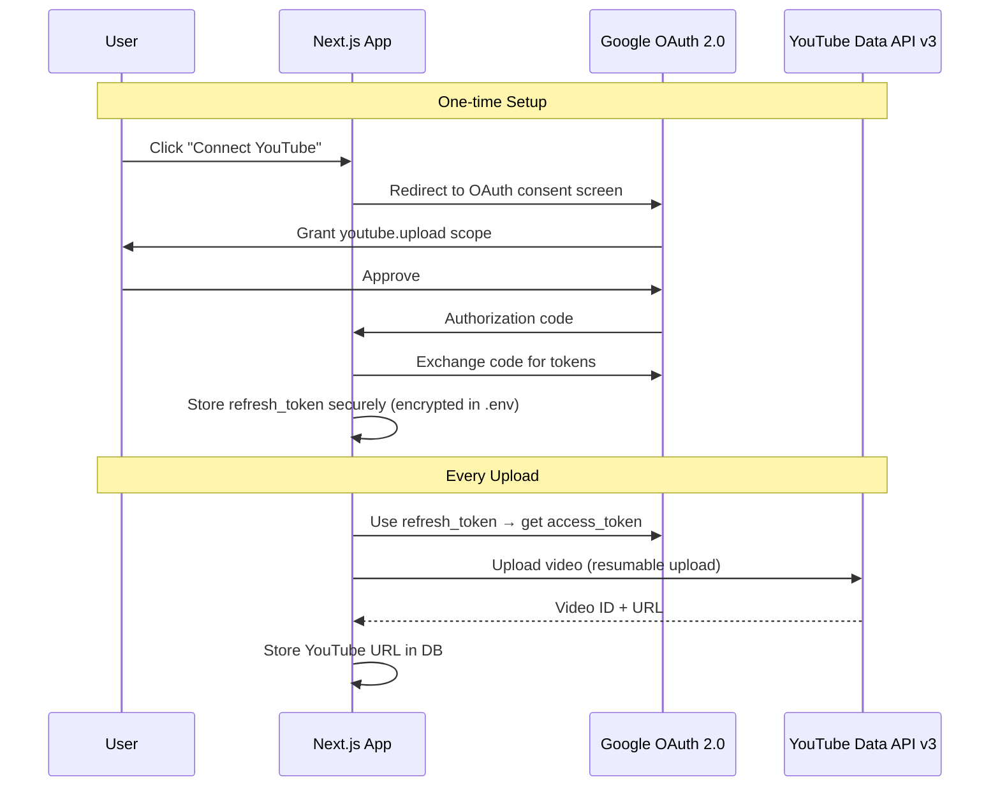
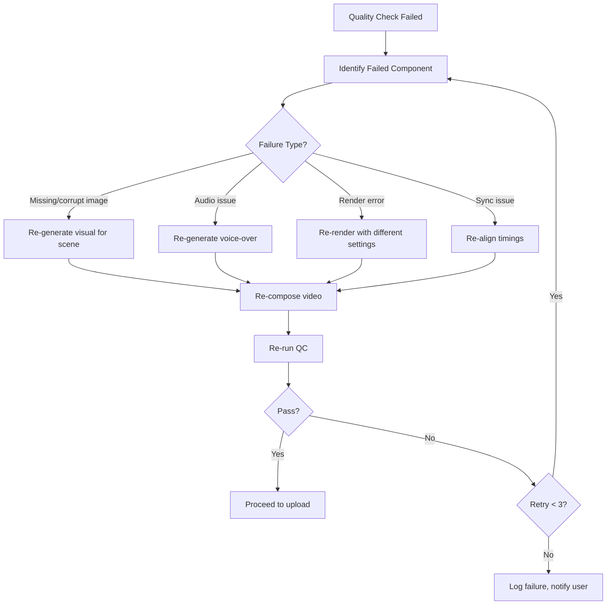

# YouTube Video Automation System — Complete Implementation Plan

## 1. Product Requirements Document (PRD)

### 1.1 Vision
A fully automated system where a user enters **one topic** and the system autonomously researches, writes a script, generates natural voice-over, creates dynamic visuals, composes a professional video, validates quality, uploads to YouTube, and logs everything — with **zero manual intervention**.

### 1.2 Core User Flow
```
User enters topic → System researches topic → AI writes structured script →
Voice-over generated → Visuals created per scene → Video composed with subtitles,
transitions, music → Quality check → YouTube upload → Log entry with YouTube URL
```

### 1.3 Functional Requirements

| ID | Requirement | Priority |
|:---|:---|:---|
| FR-01 | Web form with topic input (+ optional: duration, language, tone, audience) | P0 |
| FR-02 | AI-powered script generation with hook, body, conclusion structure | P0 |
| FR-03 | Natural-sounding voice-over generation | P0 |
| FR-04 | Scene-by-scene visual generation (AI images, stock footage, diagrams) | P0 |
| FR-05 | Video composition engine (narration + visuals + subtitles + transitions + BGM) | P0 |
| FR-06 | Automated quality control with retry/recovery | P0 |
| FR-07 | YouTube upload with auto-generated metadata | P0 |
| FR-08 | Execution logs dashboard with complete pipeline status | P0 |
| FR-09 | Real-time pipeline progress tracking | P1 |
| FR-10 | Thumbnail auto-generation | P1 |
| FR-11 | Batch video generation | P2 |

### 1.4 Non-Functional Requirements
- **Output Quality**: 1080p minimum, proper audio levels, readable typography
- **Performance**: Full pipeline completion within 15-30 minutes per video
- **Reliability**: Automatic failure detection and intelligent retry
- **Modularity**: Each component (LLM, TTS, visuals, etc.) swappable independently
- **Cost**: Maximum free/open-source tools; paid APIs only where genuinely required

---

## 2. System Architecture

### 2.1 High-Level Architecture Diagram



### 2.2 Technology Stack

| Layer | Technology | License | Justification |
|:---|:---|:---|:---|
| **Frontend** | Next.js 15 (React) | MIT | Full-stack framework, SSR, API routes |
| **Backend** | Next.js API Routes + Node.js Workers | MIT | Unified codebase, TypeScript throughout |
| **Job Queue** | BullMQ + Redis | MIT | Robust async job processing with retries |
| **Database** | SQLite via better-sqlite3 | MIT | Zero-config, serverless, perfect for logs |
| **Video Engine** | FFmpeg + fluent-ffmpeg | LGPL/MIT | Industry-standard, maximum control |
| **TTS** | Kokoro TTS (kokoro-js) | Apache 2.0 | Best quality/size ratio, runs on CPU |
| **LLM** | Ollama (local) / OpenAI API (fallback) | MIT / Paid | Local-first, cloud fallback |
| **Image Gen** | Stable Diffusion (ComfyUI API) / Pexels API | Various/Free | AI-generated + stock media hybrid |
| **Subtitles** | Whisper.cpp / faster-whisper | MIT | Word-level timestamps for sync |
| **YouTube** | YouTube Data API v3 | Free (quota) | Official upload API |
| **Thumbnails** | Sharp (Node.js) | Apache 2.0 | High-perf image composition |
| **BGM** | Pixabay Audio API | Free | Royalty-free, no attribution needed |

---

## 3. Detailed Pipeline Workflow

### 3.1 Complete Workflow Diagram

```mermaid
flowchart TD
    START(("User Submits Topic")) --> VALIDATE["Validate Input"]
    VALIDATE --> CREATE_JOB["Create Job Record in DB"]
    CREATE_JOB --> RESEARCH["Stage 1: Topic Research"]
    
    subgraph S1["Stage 1: Research & Script"]
        RESEARCH --> |"LLM analyzes topic"| OUTLINE["Generate Content Outline"]
        OUTLINE --> SCRIPT["Generate Full Script"]
        SCRIPT --> SCENES["Split into Scenes with Visual Cues"]
    end
    
    SCENES --> VOICE["Stage 2: Voice-Over"]
    
    subgraph S2["Stage 2: Voice Generation"]
        VOICE --> CHUNK["Chunk script by scene"]
        CHUNK --> TTS_GEN["Generate audio per scene (Kokoro)"]
        TTS_GEN --> CONCAT_AUDIO["Concatenate with pauses"]
        CONCAT_AUDIO --> TIMESTAMPS["Extract word-level timestamps (Whisper)"]
    end
    
    TIMESTAMPS --> VISUALS["Stage 3: Visual Assets"]
    
    subgraph S3["Stage 3: Visual Generation"]
        VISUALS --> PROMPTS["Generate image prompts per scene"]
        PROMPTS --> PARALLEL{"Parallel Generation"}
        PARALLEL --> AI_IMG["AI-Generated Images (SD/ComfyUI)"]
        PARALLEL --> STOCK_IMG["Stock Images/Video (Pexels)"]
        PARALLEL --> DIAGRAMS["Charts/Diagrams (Chart.js → Canvas)"]
        AI_IMG & STOCK_IMG & DIAGRAMS --> ASSET_POOL["Asset Pool per Scene"]
    end
    
    ASSET_POOL --> COMPOSE["Stage 4: Video Composition"]
    
    subgraph S4["Stage 4: Composition"]
        COMPOSE --> TIMELINE["Build Timeline from Scenes"]
        TIMELINE --> APPLY_MOTION["Apply Ken Burns / Pan / Zoom"]
        APPLY_MOTION --> OVERLAY_SUBS["Overlay Subtitles/Captions"]
        OVERLAY_SUBS --> ADD_TRANSITIONS["Add Transitions between Scenes"]
        ADD_TRANSITIONS --> MIX_BGM["Mix Background Music"]
        MIX_BGM --> RENDER["Render Final Video (FFmpeg)"]
    end
    
    RENDER --> QC["Stage 5: Quality Control"]
    
    subgraph S5["Stage 5: Quality Check"]
        QC --> CHECK_DURATION["Verify Duration"]
        CHECK_DURATION --> CHECK_AUDIO["Check Audio Levels"]
        CHECK_AUDIO --> CHECK_VISUAL["Detect Blank/Corrupt Frames"]
        CHECK_VISUAL --> CHECK_SYNC["Verify A/V Sync"]
        CHECK_SYNC --> DECISION{Pass?}
        DECISION -->|Yes| THUMB["Stage 6: Generate Thumbnail"]
        DECISION -->|No| RETRY{"Retry Count < 3?"}
        RETRY -->|Yes| IDENTIFY_FAIL["Identify Failed Component"]
        IDENTIFY_FAIL --> REGENERATE["Regenerate Failed Assets"]
        REGENERATE --> COMPOSE
        RETRY -->|No| FAIL_LOG["Log Failure & Alert User"]
    end
    
    subgraph S6["Stage 6: Upload"]
        THUMB --> GEN_META["Generate Title/Description/Tags"]
        GEN_META --> UPLOAD["Upload to YouTube"]
        UPLOAD --> CAPTURE_URL["Capture YouTube URL"]
    end
    
    CAPTURE_URL --> LOG["Update Execution Log"]
    FAIL_LOG --> LOG
    LOG --> END(("Dashboard Updated"))
```



---

## 4. Tool & Library Comparison: Free vs Paid Analysis

### 4.1 Script Generation (LLM)

| Option | Type | Cost | Quality | Recommendation |
|:---|:---|:---|:---|:---|
| **Ollama + Llama 3.1 70B** | Free/Local | $0 (needs 48GB RAM) | Good | ✅ Primary (if hardware available) |
| **Ollama + Llama 3.1 8B** | Free/Local | $0 (needs 8GB RAM) | Acceptable | ✅ Lightweight fallback |
| **Gemini 2.0 Flash** | API | Free tier: 15 RPM / 1M TPD | Very Good | ✅ **Recommended cloud fallback** |
| **OpenAI GPT-4o-mini** | API | ~$0.15/M input, $0.60/M output | Very Good | ⚠️ Backup option |
| **OpenAI GPT-4o** | API | ~$2.50/M input, $10/M output | Excellent | ❌ Too expensive for default |
| **Claude 3.5 Sonnet** | API | ~$3/M input, $15/M output | Excellent | ❌ Too expensive for default |

> [!IMPORTANT]
> **Recommendation**: Use **Gemini 2.0 Flash** (free tier, generous limits) as the default cloud LLM provider. For users with capable hardware (32GB+ RAM, good GPU), provide an **Ollama local option**. The system should support swappable LLM providers via a simple adapter pattern.

### 4.2 Text-to-Speech (Voice-Over)

| Option | Type | Cost | Quality | Speed | License |
|:---|:---|:---|:---|:---|:---|
| **Kokoro TTS (82M)** | Free/Local | $0 | ⭐⭐⭐⭐ Natural | Real-time on CPU | Apache 2.0 ✅ |
| **Piper TTS** | Free/Local | $0 | ⭐⭐⭐ Good | Very Fast | MIT ✅ |
| **Coqui XTTS v2** | Free/Local | $0 | ⭐⭐⭐⭐⭐ Excellent | Slow (needs GPU) | CPML (Non-commercial) ❌ |
| **ElevenLabs** | API/Paid | $5-$22/mo | ⭐⭐⭐⭐⭐ Best | Fast | Proprietary |
| **Google Cloud TTS** | API | Free: 4M chars/mo | ⭐⭐⭐⭐ Very Good | Fast | Proprietary |

> [!TIP]
> **Recommendation**: **Kokoro TTS** is the clear winner — Apache 2.0 licensed, runs on CPU, sounds natural, supports multiple languages. Install via `npm install kokoro-js` for Node.js integration. Use `kokoro-fastapi` as a microservice if needed.

### 4.3 Visual Generation

| Option | Type | Cost | Quality | Setup |
|:---|:---|:---|:---|:---|
| **Pexels API** | Free API | $0 (200 req/hr) | ⭐⭐⭐⭐ Stock quality | Easy ✅ |
| **Pixabay API** | Free API | $0 (100 req/min) | ⭐⭐⭐ Good | Easy ✅ |
| **Stable Diffusion (ComfyUI)** | Free/Local | $0 (needs 12GB VRAM GPU) | ⭐⭐⭐⭐⭐ AI-generated | Complex setup |
| **FLUX.2 (via ComfyUI)** | Free/Local | $0 (needs 16GB+ VRAM) | ⭐⭐⭐⭐⭐ Best AI | Complex setup |
| **DALL-E 3** | API/Paid | $0.04/image | ⭐⭐⭐⭐⭐ Excellent | Easy |
| **Google Imagen** | API/Paid | $0.04/image | ⭐⭐⭐⭐⭐ Excellent | Easy |

> [!IMPORTANT]
> **Recommendation**: Use a **hybrid approach**:
> - **Primary (free)**: Pexels API for stock images + stock video clips per scene
> - **Optional (free/local)**: ComfyUI + Stable Diffusion for AI-generated visuals (if user has GPU)
> - **Paid fallback**: DALL-E 3 or Imagen for high-quality AI visuals (~$0.40-$0.80 per video for 10-20 scenes)
> 
> The system will work with **Pexels-only** out of the box, with AI image generation as an optional upgrade.

### 4.4 Video Composition Engine

| Option | Type | Cost | Quality | Complexity |
|:---|:---|:---|:---|:---|
| **FFmpeg (fluent-ffmpeg)** | Free/Local | $0 | ⭐⭐⭐⭐⭐ Full control | High |
| **MoviePy (Python)** | Free/Local | $0 | ⭐⭐⭐⭐ Good | Medium |
| **Remotion (React)** | Source-available | $0 (≤3 people) | ⭐⭐⭐⭐⭐ Best | Medium |
| **Shotstack** | API/Paid | $25+/mo | ⭐⭐⭐⭐ Good | Low |

> [!TIP]
> **Recommendation**: **FFmpeg via fluent-ffmpeg** is the core engine. It's 100% free, universally available, and gives maximum control over every aspect of video composition. We'll build a custom composition layer in Node.js that generates FFmpeg filter graphs programmatically. This avoids any licensing concerns with Remotion and keeps everything truly free and open-source.

### 4.5 Subtitle/Caption Generation

| Option | Type | Cost | Precision |
|:---|:---|:---|:---|
| **Whisper.cpp** | Free/Local | $0 | Word-level ✅ |
| **faster-whisper (Python)** | Free/Local | $0 | Word-level ✅ |
| **WhisperX (Python)** | Free/Local | $0 | Best word-level ✅ |

> **Recommendation**: Since we generate the voice-over from our script, we already know the text. We'll use **Whisper.cpp** to generate precise word-level timestamps for subtitle synchronization, or we can compute timestamps directly from Kokoro's output timing data.

### 4.6 Background Music

| Option | Type | Cost | License Safety |
|:---|:---|:---|:---|
| **Pixabay Audio API** | Free | $0 | ✅ No attribution needed |
| **Freesound API** | Free | $0 | ⚠️ Mixed licenses (CC-BY, CC-NC) |
| **YouTube Audio Library** | Free | $0 | ✅ Safest but no API |

> **Recommendation**: **Pixabay Audio API** — free, no attribution required, programmatic access. Pre-download a curated set of background tracks for different moods (upbeat, calm, dramatic, tech).

---

## 5. Data Model

### 5.1 Database Schema (SQLite)

```sql
-- Main job tracking table
CREATE TABLE video_jobs (
    id              TEXT PRIMARY KEY DEFAULT (lower(hex(randomblob(16)))),
    topic           TEXT NOT NULL,
    status          TEXT NOT NULL DEFAULT 'queued',  -- queued | researching | scripting | voiceover | visuals | composing | quality_check | uploading | completed | failed
    
    -- Optional inputs
    duration_target  INTEGER,          -- Target duration in seconds
    language         TEXT DEFAULT 'en',
    tone             TEXT DEFAULT 'informative', -- informative | casual | dramatic | humorous
    target_audience  TEXT,
    
    -- Script
    script_status    TEXT DEFAULT 'pending',
    script_content   TEXT,              -- JSON: {scenes: [{narration, visualCue, duration}]}
    script_error     TEXT,
    
    -- Voice-over
    voiceover_status TEXT DEFAULT 'pending',
    voiceover_path   TEXT,              -- Path to final audio file
    voiceover_duration REAL,            -- Actual duration in seconds
    voiceover_error  TEXT,
    
    -- Visuals
    visuals_status   TEXT DEFAULT 'pending',
    visuals_manifest TEXT,              -- JSON: [{sceneId, assets: [{path, type, source}]}]
    visuals_error    TEXT,
    
    -- Composition
    render_status    TEXT DEFAULT 'pending',
    render_path      TEXT,              -- Path to final video
    render_resolution TEXT DEFAULT '1920x1080',
    render_error     TEXT,
    
    -- Quality Control
    qc_status        TEXT DEFAULT 'pending',
    qc_report        TEXT,              -- JSON: {checks: [{name, passed, details}]}
    qc_error         TEXT,
    
    -- Upload
    upload_status    TEXT DEFAULT 'pending',
    youtube_url      TEXT,
    youtube_video_id TEXT,
    youtube_title    TEXT,
    youtube_description TEXT,
    youtube_tags     TEXT,              -- JSON array
    thumbnail_path   TEXT,
    upload_error     TEXT,
    
    -- Metadata
    retry_count      INTEGER DEFAULT 0,
    total_duration   REAL,              -- Final video duration
    file_size        INTEGER,           -- Final file size in bytes
    created_at       DATETIME DEFAULT CURRENT_TIMESTAMP,
    started_at       DATETIME,
    completed_at     DATETIME,
    error_log        TEXT               -- JSON array of all errors encountered
);

-- Granular stage tracking for progress UI
CREATE TABLE pipeline_stages (
    id          INTEGER PRIMARY KEY AUTOINCREMENT,
    job_id      TEXT NOT NULL REFERENCES video_jobs(id),
    stage_name  TEXT NOT NULL,
    status      TEXT NOT NULL DEFAULT 'pending',
    started_at  DATETIME,
    completed_at DATETIME,
    duration_ms INTEGER,
    details     TEXT,                   -- JSON with stage-specific details
    error       TEXT
);

-- Individual asset tracking
CREATE TABLE assets (
    id          INTEGER PRIMARY KEY AUTOINCREMENT,
    job_id      TEXT NOT NULL REFERENCES video_jobs(id),
    scene_index INTEGER NOT NULL,
    asset_type  TEXT NOT NULL,          -- image | video_clip | audio | diagram | subtitle
    source      TEXT NOT NULL,          -- pexels | stable_diffusion | kokoro | whisper | generated
    file_path   TEXT NOT NULL,
    metadata    TEXT,                   -- JSON with source-specific metadata
    created_at  DATETIME DEFAULT CURRENT_TIMESTAMP
);
```

---

## 6. YouTube Integration Architecture

### 6.1 Authentication Flow



### 6.2 Upload Configuration
- **Quota**: ~100 uploads/day (10,000 units, 100 units per upload)
- **Protocol**: Resumable uploads for reliability
- **Metadata**: Auto-generated title, description, tags, category
- **Privacy**: Default to "unlisted" (user can change to "public")
- **Thumbnail**: Custom thumbnail uploaded via `thumbnails.set`

---

## 7. Video Composition Pipeline (Deep Dive)

### 7.1 Scene-Based Architecture

Each video is split into **scenes** derived from the script. Each scene contains:

```typescript
interface Scene {
  index: number;
  narration: string;           // Text to speak
  visualCue: string;           // Description for visual generation
  audioPath: string;           // Path to scene audio
  audioDuration: number;       // Duration in seconds
  assets: SceneAsset[];        // Generated/fetched visuals
  subtitleSegments: SubtitleSegment[];  // Word-level timestamps
}
```

### 7.2 Visual Composition Strategy (Not a Slideshow!)

To avoid the "slideshow" feel, each scene applies **multiple motion techniques**:

| Technique | Description | When Used |
|:---|:---|:---|
| **Ken Burns** | Slow zoom + pan on images | Default for static images |
| **Parallax Layers** | Foreground/background at different speeds | Scene transitions |
| **Picture-in-Picture** | Smaller media overlaid on a blurred background | Data/diagram scenes |
| **Split Screen** | Two images side by side | Comparison scenes |
| **Text Overlays** | Animated key facts/stats | Emphasis moments |
| **Lower Thirds** | Animated info bars | Introductions, labels |
| **Transitions** | Crossfade, wipe, zoom transitions | Between all scenes |

### 7.3 FFmpeg Composition Flow

```
[Scene 1 Image] → Ken Burns filter → [Scene 1 Video]
[Scene 2 Image] → Zoom-Pan filter → [Scene 2 Video]
...
[All Scene Videos] → Concatenate with transitions → [Base Video]
[Base Video] + [Subtitles ASS] → Subtitle overlay → [Video + Subs]
[Video + Subs] + [Narration Audio] → Audio mix → [Video + Audio]
[Video + Audio] + [Background Music] → Volume balanced mix → [Final Video]
```

### 7.4 FFmpeg Filter Graph Example

```bash
# Ken Burns effect on a 1920x1080 image (zoom from 100% to 120% over 8 seconds)
ffmpeg -loop 1 -i scene1.png -t 8 -vf "
  scale=8000:-1,
  zoompan=z='min(zoom+0.0015,1.5)':d=240:x='iw/2-(iw/zoom/2)':y='ih/2-(ih/zoom/2)':s=1920x1080
" -c:v libx264 -pix_fmt yuv420p scene1.mp4
```

---

## 8. Quality Control Strategy

### 8.1 Automated Checks

| Check | Method | Pass Criteria |
|:---|:---|:---|
| **Duration** | FFprobe metadata | Within ±10% of expected |
| **Audio Levels** | FFmpeg volumedetect | Mean volume > -30dB, max < 0dB |
| **Blank Frames** | FFmpeg blackdetect | No black frames > 0.5s |
| **Frozen Frames** | FFmpeg freezedetect | No frozen segments > 3s |
| **Resolution** | FFprobe | Exactly 1920x1080 |
| **File Integrity** | FFprobe error check | No corrupt containers |
| **Audio/Video Sync** | Compare durations | A/V within 0.5s |
| **Asset Completeness** | Manifest check | All scenes have visuals |
| **Subtitle Presence** | Check SRT/ASS file | Non-empty, valid format |

### 8.2 Failure Recovery Strategy



---

## 9. Project Structure

```
youtube-automation/
├── .env.example                    # Environment variables template
├── .env.local                      # Actual env vars (gitignored)
├── package.json
├── next.config.js
├── tsconfig.json
│
├── prisma/                         # DB (or we use better-sqlite3 directly)
│   └── schema.sql
│
├── src/
│   ├── app/                        # Next.js App Router
│   │   ├── layout.tsx              # Root layout
│   │   ├── page.tsx                # Home → Topic Input Form
│   │   ├── dashboard/
│   │   │   └── page.tsx            # Logs Dashboard
│   │   ├── jobs/
│   │   │   └── [id]/
│   │   │       └── page.tsx        # Individual job detail + progress
│   │   └── api/
│   │       ├── jobs/
│   │       │   ├── route.ts        # GET (list), POST (create)
│   │       │   └── [id]/
│   │       │       └── route.ts    # GET (detail), DELETE
│   │       ├── youtube/
│   │       │   ├── auth/
│   │       │   │   └── route.ts    # OAuth flow
│   │       │   └── callback/
│   │       │       └── route.ts    # OAuth callback
│   │       └── progress/
│   │           └── [id]/
│   │               └── route.ts    # SSE endpoint for real-time progress
│   │
│   ├── lib/
│   │   ├── db.ts                   # SQLite database connection
│   │   ├── queue.ts                # BullMQ job queue setup
│   │   ├── config.ts               # Configuration & env vars
│   │   └── logger.ts               # Structured logging utility
│   │
│   ├── pipeline/                   # Core pipeline modules
│   │   ├── orchestrator.ts         # Main pipeline orchestrator
│   │   ├── research.ts             # Topic research module
│   │   ├── scriptWriter.ts         # Script generation
│   │   ├── voiceGenerator.ts       # TTS integration
│   │   ├── visualGenerator.ts      # Image/video asset generation
│   │   ├── videoCompositor.ts      # FFmpeg video composition
│   │   ├── subtitleGenerator.ts    # Subtitle/caption generation
│   │   ├── qualityController.ts    # Automated QC checks
│   │   ├── thumbnailGenerator.ts   # Thumbnail creation
│   │   └── youtubeUploader.ts      # YouTube API integration
│   │
│   ├── providers/                  # Swappable provider adapters
│   │   ├── llm/
│   │   │   ├── types.ts            # LLM provider interface
│   │   │   ├── ollama.ts           # Ollama local adapter
│   │   │   ├── gemini.ts           # Google Gemini adapter
│   │   │   └── openai.ts           # OpenAI adapter
│   │   ├── tts/
│   │   │   ├── types.ts            # TTS provider interface
│   │   │   ├── kokoro.ts           # Kokoro TTS adapter
│   │   │   └── piper.ts            # Piper TTS adapter
│   │   ├── images/
│   │   │   ├── types.ts            # Image provider interface
│   │   │   ├── pexels.ts           # Pexels stock images
│   │   │   ├── pixabay.ts          # Pixabay stock images
│   │   │   └── comfyui.ts          # ComfyUI/StableDiffusion
│   │   └── audio/
│   │       ├── types.ts            # Background music interface
│   │       └── pixabay.ts          # Pixabay Audio
│   │
│   ├── workers/                    # BullMQ worker processes
│   │   └── videoWorker.ts          # Main worker that runs pipeline
│   │
│   ├── components/                 # React UI components
│   │   ├── TopicForm.tsx           # Main input form
│   │   ├── JobCard.tsx             # Job summary card
│   │   ├── JobTable.tsx            # Logs table
│   │   ├── JobDetail.tsx           # Detailed job view
│   │   ├── PipelineProgress.tsx    # Real-time progress component
│   │   ├── StatusBadge.tsx         # Status indicator
│   │   └── YouTubePreview.tsx      # Embedded YT preview
│   │
│   └── types/                      # TypeScript type definitions
│       ├── job.ts                  # Job-related types
│       ├── script.ts               # Script/scene types
│       └── pipeline.ts             # Pipeline types
│
├── output/                         # Generated video output (gitignored)
│   └── [job-id]/
│       ├── script.json
│       ├── scenes/
│       │   ├── scene_001_audio.wav
│       │   ├── scene_001_visual.png
│       │   └── ...
│       ├── voiceover.wav
│       ├── subtitles.ass
│       ├── thumbnail.png
│       └── final_video.mp4
│
├── assets/                         # Static assets
│   ├── fonts/                      # Typography (Inter, etc.)
│   ├── music/                      # Pre-downloaded BGM tracks
│   ├── templates/                  # Video templates/overlays
│   └── watermarks/                 # Channel branding
│
└── scripts/                        # Utility scripts
    ├── setup-youtube-auth.ts       # YouTube OAuth setup helper
    ├── download-models.ts          # Download TTS/Whisper models
    └── seed-music.ts               # Pre-download BGM library
```

---

## 10. API Requirements

### 10.1 Required API Keys / Configuration

| Service | Required? | How to Get | Cost |
|:---|:---|:---|:---|
| **Pexels API Key** | Yes (for stock visuals) | [pexels.com/api](https://www.pexels.com/api/) | Free |
| **Pixabay API Key** | Optional (backup visuals + BGM) | [pixabay.com/api/docs](https://pixabay.com/api/docs/) | Free |
| **Google Cloud Project** | Yes (for YouTube upload) | [console.cloud.google.com](https://console.cloud.google.com) | Free |
| **YouTube Data API v3** | Yes | Enable in GCP Console | Free (quota-based) |
| **Gemini API Key** | Yes (default LLM) | [aistudio.google.com](https://aistudio.google.com) | Free tier available |
| **Ollama** | Optional (local LLM) | [ollama.com](https://ollama.com) | Free |
| **ComfyUI** | Optional (local AI images) | [github.com/comfyanonymous/ComfyUI](https://github.com/comfyanonymous/ComfyUI) | Free |
| **OpenAI API Key** | Optional (paid LLM fallback) | [platform.openai.com](https://platform.openai.com) | Paid |

### 10.2 REST API Endpoints

| Method | Endpoint | Description |
|:---|:---|:---|
| `POST` | `/api/jobs` | Create new video generation job |
| `GET` | `/api/jobs` | List all jobs (with filters & pagination) |
| `GET` | `/api/jobs/[id]` | Get job details |
| `DELETE` | `/api/jobs/[id]` | Cancel/delete a job |
| `GET` | `/api/progress/[id]` | SSE stream for real-time progress |
| `GET` | `/api/youtube/auth` | Initiate YouTube OAuth |
| `GET` | `/api/youtube/callback` | Handle OAuth callback |

---

## 11. Security Considerations

| Concern | Mitigation |
|:---|:---|
| API keys exposure | Store in `.env.local`, never commit; use server-side only |
| YouTube OAuth tokens | Encrypt refresh tokens at rest; restrict scopes to `youtube.upload` only |
| LLM prompt injection | Sanitize topic input; use structured prompts |
| File system access | Sandboxed output directory; validate all file paths |
| Rate limiting | Respect API quotas; implement exponential backoff |
| Content safety | LLM generates safe content; no user-uploaded media |
| CORS | API routes are same-origin (Next.js handles this) |

---

## 12. Phased Implementation Plan

### Phase 1: Foundation (Days 1-3)
> Project setup, database, basic UI, and pipeline skeleton

- [x] Initialize Next.js project with TypeScript
- [ ] Setup SQLite database with schema
- [ ] Build Topic Input Form (with optional fields)
- [ ] Build Logs Dashboard with job table
- [ ] Create API routes (CRUD for jobs)
- [ ] Setup BullMQ + Redis job queue
- [ ] Create pipeline orchestrator skeleton
- [ ] Setup configuration management

### Phase 2: Script Generation (Days 3-4)
> LLM integration for research and script writing

- [ ] Implement LLM provider interface
- [ ] Build Gemini adapter (primary)
- [ ] Build Ollama adapter (local option)
- [ ] Create script generation prompts (hook → body → conclusion)
- [ ] Implement scene splitting logic
- [ ] Add visual cue generation per scene

### Phase 3: Voice-Over (Days 4-5)
> TTS integration and audio processing

- [ ] Integrate Kokoro TTS (kokoro-js)
- [ ] Implement scene-by-scene audio generation
- [ ] Audio concatenation with natural pauses
- [ ] Word-level timestamp extraction
- [ ] Generate ASS subtitle files

### Phase 4: Visual Assets (Days 5-7)
> Image sourcing and generation

- [ ] Implement Pexels API adapter
- [ ] Build intelligent search query generator (scene → search terms)
- [ ] Implement image downloading and caching
- [ ] Build diagram/chart generator (for data-heavy scenes)
- [ ] Optional: ComfyUI integration for AI images

### Phase 5: Video Composition (Days 7-10)
> FFmpeg-based video rendering

- [ ] Build FFmpeg filter graph generator
- [ ] Implement Ken Burns / pan / zoom effects
- [ ] Build scene transition system (crossfade, wipe, zoom)
- [ ] Subtitle overlay (ASS format with styling)
- [ ] Background music mixing with ducking
- [ ] Text overlay animations (key facts, lower thirds)
- [ ] Final render pipeline (1080p, H.264, proper audio)

### Phase 6: Quality Control (Days 10-11)
> Automated validation and recovery

- [ ] Implement all QC checks (duration, audio, blanks, sync, etc.)
- [ ] Build failure identification system
- [ ] Implement retry/recovery logic
- [ ] Add QC report generation

### Phase 7: YouTube Upload (Days 11-12)
> YouTube API integration

- [ ] YouTube OAuth setup flow
- [ ] Video upload (resumable uploads)
- [ ] Auto-generate title, description, tags
- [ ] Thumbnail generation and upload
- [ ] YouTube URL capture and storage

### Phase 8: Polish & Real-time Progress (Days 12-14)
> UI polish, progress tracking, production readiness

- [ ] SSE-based real-time pipeline progress
- [ ] Job detail page with stage breakdown
- [ ] Error display and retry UI
- [ ] Dashboard filters and sorting
- [ ] Loading states and animations
- [ ] Comprehensive error handling
- [ ] Documentation

---

## User Review Required

> [!IMPORTANT]
> ### Decisions Needed Before Implementation
>
> 1. **LLM Provider**: Do you want to use **Gemini Flash (free tier)** as the default? Or do you prefer **Ollama (fully local, needs 16GB+ RAM)?** We can support both with a config switch.
>
> 2. **Image Source Priority**: The plan uses **Pexels stock images as default** (free, instant, reliable). AI-generated images via ComfyUI/Stable Diffusion are optional (requires GPU setup). Is this acceptable, or do you want AI images as the primary source?
>
> 3. **YouTube OAuth**: You'll need to create a Google Cloud project and configure OAuth credentials. The system will guide you through this. Are you comfortable with that setup?
>
> 4. **Redis Requirement**: BullMQ requires Redis for job queuing. This adds a dependency but enables robust async processing, retries, and progress tracking. Alternative: We could use a simpler in-process queue (less robust but zero extra dependencies). Which do you prefer?
>
> 5. **Default Video Privacy**: Should uploaded videos default to **"unlisted"** (safe, review before making public) or **"public"** (immediately visible)?
>
> 6. **Language Priority**: The plan defaults to **English**. Do you want Hindi or any other language as a primary/secondary option from the start?

## Open Questions

> [!WARNING]
> ### Hardware Considerations
>
> - **Kokoro TTS** runs fine on CPU — no GPU needed for voice-over ✅
> - **FFmpeg rendering** is CPU-bound — a modern quad-core is sufficient ✅
> - **AI Image Generation** (Stable Diffusion/FLUX) requires a **12-16GB VRAM GPU** — this is optional and the system works without it using stock images
> - **Local LLM (Ollama)** requires **16-48GB RAM** depending on model size — cloud LLM (Gemini) works as an alternative
>
> What are your system specifications (RAM, GPU, CPU)?

## Verification Plan

### Automated Tests
- Unit tests for each pipeline stage (script parser, audio processor, QC checks)
- Integration test: Submit a test topic → verify all stages complete
- `npm run test` for all tests

### Manual Verification
- Generate a complete video and visually inspect quality
- Verify YouTube upload works with unlisted video
- Check logs dashboard shows complete execution data
- Test retry/recovery by simulating failures

### End-to-End Smoke Test
```bash
# Submit topic via API
curl -X POST http://localhost:3000/api/jobs \
  -H "Content-Type: application/json" \
  -d '{"topic": "5 Amazing Facts About Black Holes"}'

# Monitor progress, verify video generation, check YouTube upload
```
